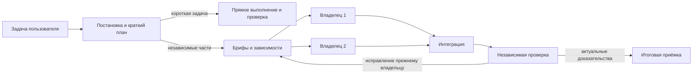

# Native Agent Harness 1.2.0

[Исправления и проверка 1.2.0](docs/REVIEW_1_2_0.md): корректность приёмки,
rollback, независимое ревью, файловый контекст и измеренные локальные оптимизации.

[Предыдущий релиз v1.1.0](https://github.com/SUKUNA-AI/agent-harness/releases/tag/v1.1.0)
· [История изменений](CHANGELOG.md) · [Автоподключение](docs/AUTOLOAD_RU.md)

Переносимый комплект общих настроек для локального Codex. Скачайте этот
репозиторий на другое устройство и выполните [короткую установку](SETUP_RU.md).
База данных, Claude-Mem, импорт чатов и фоновые службы не нужны и не устанавливаются.
Модели и учётные записи на новом устройстве остаются его собственными.
После однократной установки общие правила подключаются к новым локальным чатам
в этом профиле Codex независимо от проекта. Вызывать skill или повторять правила
при каждом открытии проекта не требуется. Подробности и границы —
в [проверке автоподключения](docs/AUTOLOAD_RU.md).

Общий порядок работы: постановка задачи, краткий план,
полезная делегация, изолированные исполнители, проверка результата и восстановление
контекста. Пользователь формулирует результат обычным сообщением; служебные
контракты, брифы и команды готовит основной агент.

Ограниченная самостоятельная задача выполняется напрямую. Полезные независимые
части делегируются автоматически: обычно два native владельца, третий — при
дополнительной независимой части и доступной ёмкости. Неделимость, ограничения пользователя или нехватка native slots дают
последовательный путь. Все потомки и idle/open refs учитываются вместе.
Provider и безопасность наследуются; модель учитывает defaults дочерних
агентов и overrides клиента. Усилие координатора сохраняется;
узкая механика — medium, содержательная реализация и ревью — high. Фиксированный
effort в файле роли имеет приоритет над effort запроса spawn.



## Состав

Выбранные механизмы long-running agents, Playwright, файловой wiki и bounded
experiments описаны в [практиках развития](docs/SELECTED_PATTERNS_RU.md).
Локальные source packets: `agent-harness context --help`. Они не требуют БД,
сети, нового agent runtime или установки eval frameworks.

| Компонент | Назначение |
|---|---|
| `policies/global.md`, `adapters/codex/bootstrap.md` | Общая политика и короткий автоматически подключаемый prompt |
| `workflows/`, `roles/` | Процедуры исследования, реализации, review, документов, эксплуатации и recovery |
| `src/agent_harness/`, `schemas/` | Contracts, snapshots, checks/evidence/gates, ledger, checkpoints и read-only DAG helpers |
| `skills/` | Создание skills, экономия контекста, integrations и автоматическая orchestration |
| `plugins/harness-assistant/` | Отдельный переносимый plugin с двумя самостоятельными skills |
| `integrations/` | Маршрутизация tools, public docs MCP и пример локального read-only connector |
| `profiles/` | Справочные пользовательские правила и настройки без credentials |
| `provenance/` | Происхождение исходника и pinned реестр изученных upstream |

Python не вызывает LLM и не создаёт native agents. Он детерминированно проверяет
план/состояние и готовит briefs; spawn/follow-up выполняют штатные tools Codex.
Файлы и worktrees обеспечивают координацию, а не отдельный OS sandbox.

## Установка

Нужен Python 3.11+; ядро использует stdlib. Работайте из полного source checkout:
wheel без policy/workflow assets не является самостоятельной поставкой.
Подойдёт также ZIP с полным содержимым репозитория. Git нужен для клонирования
и обновления, но не для установки из ZIP. [Инструкция переноса](SETUP_RU.md)
объясняет `config.toml`, выбор локальных путей и даёт готовый запрос новому Codex.
Ниже `<package>`, `<codex-home>`, `<skills-home>` и `<private-state>` заменяет
агент по текущей среде. Private state хранится вне репозитория.

```text
python <package>/tools/harness.py doctor --codex-home <codex-home> --state-dir <private-state>
python <package>/tools/harness.py install --codex-home <codex-home> --skills-home <skills-home> --state-dir <private-state>
python <package>/tools/harness.py install --codex-home <codex-home> --skills-home <skills-home> --state-dir <private-state> --apply
python <package>/tools/harness.py verify --codex-home <codex-home> --skills-home <skills-home> --state-dir <private-state> --native --cwd <empty-project>
```

Первый install — dry-run с адресным diff; apply создаёт backups/manifest.
Сохраняются неизвестные TOML keys, comments, пользовательский текст и чужие роли.
Установщик управляет `agents.enabled`, cap и отсутствующим `interrupt_message`;
model/provider/reasoning/security не меняет. Если корневой параметр
`model_auto_compact_token_limit` отсутствует, добавляет `500000`: порог автоматического
сжатия истории Codex. Явный пользовательский порог сохраняется; повторная установка
и откат поддерживаются. Это не увеличение окна модели и не сумма токенов за всё
время работы. Ограничения модели/клиента могут вызвать сжатие раньше.
[Описание параметра OpenAI](https://learn.chatgpt.com/docs/config-file/config-reference).
Portable default cap — 4 children;
существующий более строгий cap сохраняется. Явный `--max-child-threads N` адресно
разрешает иной cap. Legacy `agents.max_threads` обратимо переносится в единственный
`agents.max_concurrent_threads_per_session`; при двух старых значениях выбирается
более строгий предел, если не задан явный override. Число логических направлений, target active owners и backend
slots — разные значения; фактическую ёмкость наблюдают в текущем клиенте.

`doctor` показывает разрешённые поля модели/effort/контекста/tool output limit
с источниками: основной config, `*.config.toml` профили и TOML файлов ролей.
Это наблюдение файлов, а не утверждение о текущей модели сессии: CLI/project/managed
overrides и runtime limits проверяются в самом клиенте.

Непустой `AGENTS.override.md` имеет приоритет над `AGENTS.md`. Ставятся managed
bootstrap, machine pointer, три native роли и skills. Пути обновляются через
installer/machine overlay. Одноимённые чужие skills или ручные изменения managed
файлов вызывают конфликт без перезаписи. Если новый пакет удалил прежний owned
skill/resource, обновление останавливается до явной миграции: старый активный
skill не оставляется незаметно. Новая установка не гарантирует hot reload старого
чата; локальные файлы не настраивают hosted ChatGPT Work.

```text
python <package>/tools/harness.py rollback --state-dir <private-state>
python <package>/tools/harness.py rollback --state-dir <private-state> --apply
python <package>/tools/harness.py uninstall --state-dir <private-state>
python <package>/tools/harness.py uninstall --state-dir <private-state> --apply
```

Rollback/uninstall сначала проверяют всю транзакцию и backups. Чужие edits,
репозитории, runs, процессы и файлы, созданные самим Codex, не удаляются.

## Повседневное использование

Примеры обычных запросов:

- «Реализуй изменение и проверь конечный сценарий».
- «Проверь этот PR, исходники не меняй».
- «Исследуй варианты по актуальным первичным источникам».
- «Подготовь документ полностью и проверь оформление».
- «Покажи статус задачи» или «Продолжи по сохранённому checkpoint».

Root сам определяет intent/scope, план, общие inputs, owners и достаточную
приёмку. Review/plan/research не разрешают product edits. Внешние действия
выполняются при действующем основании задачи; зелёные tests его не создают.
Подробности: [orchestration](docs/ORCHESTRATION_RU.md),
[операции](docs/OPERATIONS.md), [критерии приёмки](docs/ACCEPTANCE.md).

## Plugin и бесплатный локальный MCP

[Plugin](docs/PLUGIN_RU.md) можно установить отдельно через включённый marketplace.
Он содержит самостоятельные coordination/status skills и не подменяет global
bootstrap. Lifecycle hooks и автоматическое подключение аккаунтов отсутствуют.

[Read-only MCP](docs/MCP_RU.md) предоставляет ограниченные metadata статусов из
явно выбранного private store. Нет raw prompts, goals, файлов, логов, network
или выполнения команд. Optional dependency — официальный `mcp==2.3.0`.
Он не включается в live profile автоматически. [Другие integrations](integrations/README.md)
подключаются по конкретной задаче после проверки уже доступных tools.

## Готовые open source решения

[Обзор](docs/ECOSYSTEM_RU.md) содержит source screening нескольких десятков
репозиториев, pins, лицензии и решения по применимости. ECC/Superpowers полезны
выборочными skills; Spec Kit/OpenSpec/GSD — проектными процессами; Worktrunk,
Serena и browser tools — специализированными возможностями. Их source support
не считается нашей runtime-проверкой. LangGraph/Langfuse не обязательны для
нынешнего native control plane; rationale и ограничения приведены в обзоре.
В [справочном обзоре Claude-Mem и TokenEconomizer](docs/MEMORY_TOKENS_RU.md)
сохранены результаты изучения присланных репозиториев. Они не входят в установку.
Подключение памяти и импорт истории отменены; продолжать их как следующий этап
этого комплекта не требуется.

## Проверки и доказательства

```text
python tools/release_check.py
python tools/run_tests.py
python -m pip install "mcp==2.3.0"
python -I -B tools/check_mcp.py
```

CI запускает эти проверки на Windows/Ubuntu и Python 3.11/3.13. Наличие YAML не
равно успешному запуску — сверяйте Actions конкретного commit. Реально выполненные
проверки и ограничения: [проверка 1.1.1](docs/REVIEW_2026-11-01.md),
[историческая проверка 1.1.0](docs/RELEASE_REVIEW.md).
Tests не заменяют native/visual/runtime acceptance. Unknown/not_run/skipped
не passed; ускорение и экономия токенов не объявляются без измерения.

Исходный snapshot 1.0.1 сохранён в provenance; проектные адаптеры, auth,
machine state, приватные runs и история исходного Git в поставку не входят.
