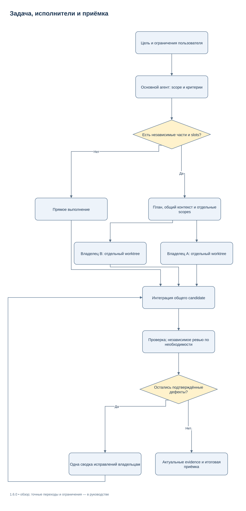
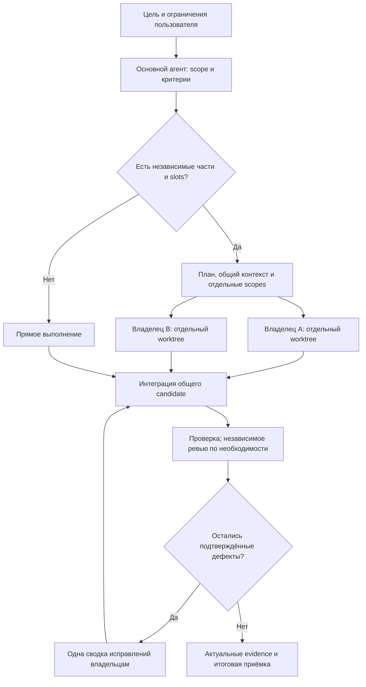

# Native Agent Harness 1.5.0

Локальное расширение установленного Codex для длительных задач. Модельные заходы
исполняет штатный `codex exec`; harness управляет процессами, памятью и независимой
приёмкой. Сервер, daemon, SQLite/vector DB, дополнительный LLM API/key не нужны.

[Новый execution loop](docs/EXECUTION_SUPERVISOR_RU.md) ·
[Memory/context](docs/MEMORY_AND_CONTEXT_RU.md) ·
[Managed agents](docs/DYNAMIC_AGENTS_RU.md) ·
[Migration](docs/STATE_FORMATS_AND_MIGRATION_RU.md) ·
[Релиз 1.5.0](docs/RELEASE_NOTES_1.5.0.md) ·
[Редактируемые схемы draw.io](docs/diagrams/README.md)

## Новое в 1.5.0

| Возможность | Проверяемый механизм |
| --- | --- |
| Полный цикл | `work start`: preflight → Codex edit → freeze → checks → gate |
| Автоматическое исправление | Компактный failure packet и exact `codex exec resume <ID>` |
| Восстановление | Strict YAML checkpoints, hash-chained journal, PID + birth identity |
| Актуальные факты | Ledger inform/advisory govern, version-bound opt-in memory |
| Ограниченный контекст | Reducer, адресные pointers, явные omissions/stale warnings |
| Навигация | `repomap related-tests/trace-to-code/change-impact/symbol-context` |
| Независимые исполнители | DAG/critical path, отдельные worktrees, последовательная интеграция |
| Технические документы | `harness-doc-author` и независимый `harness-doc-review`, style50 |
| Поставка | Детерминированный ZIP, hashes и extracted install/verify/rollback smoke |

Успешный выход модели не означает `ACCEPTED`: существующий gate проверяет
текущий candidate, required checks, toolchain и immutable receipts. Initial edit
входит в конечный `max_attempts`; restart не увеличивает бюджет. Raw evidence
хранится вне prompt. Старые JSON Run/installer artifacts остаются читаемыми.

```text
python tools/harness.py work start --contract /absolute/private/task.yaml --cwd /absolute/project --run-dir /absolute/private/run
python tools/harness.py work status --run-dir /absolute/private/run --summary
python tools/harness.py work report --run-dir /absolute/private/run --format yaml
python tools/harness.py work stop --run-dir /absolute/private/run --reason "pause requested"
python tools/harness.py work resume --run-dir /absolute/private/run
```

Замените example paths; для PowerShell используйте Windows paths и `py -3`.
Полный runnable YAML/tutorial и ожидаемые ответы — в
[Execution Supervisor](docs/EXECUTION_SUPERVISOR_RU.md). `work watch` наблюдает
локальное состояние без model calls. После закрытия foreground процесса нужен
новый `work resume`; автоматическая фоновая работа не обещается.

**Разрешения.** Контракт разрешает конкретные write scopes. Для такой edit phase
выбирается per-invocation `workspace-write`, без изменения persistent config и
approvals. Явный пользовательский `sandbox_mode="read-only"` сохраняется и
блокирует запись. Reviewer получает `read-only`; bypass flags не применяются.

**Два разных лимита.** `agents.max_concurrent_threads_per_session=5` считает
native children без root. Managed global slots ограничивают пять отдельных
model sessions, включая planner/reviewer; native recursion в них отключается.
Concurrency выше одного требует свежего binary/version-bound inventory proof.
При отсутствии proof используется явный native/single вариант.

Managed-интеграция проходит в отдельном staging worktree; отчёт указывает путь
принятого candidate и patches. Исходный пользовательский checkout сохраняется.
Worktree, hashes и cooperating locks не заменяют OS sandbox.

**TOON и измерения.** По умолчанию компактный JSON. `work format-bench` измеряет
одинаковые задачи и реальный reported usage; `--render --evaluation RECEIPT`
выбирает TOON лишь при совпадающем положительном A/B. Nested/heterogeneous данные
и отрицательные/неполные измерения дают fallback. Token budget проверяется на
границах turns: у harness нет API жёсткой остановки скрытого inference внутри
turn. Неизвестный usage обозначается unavailable.

**Совместимость.** Python3.11+, vendored PyYAML6.0.3 (MIT), Rust1.90.0 + C toolchain
для сборки helper. Реальные проверки выполняются с Codex CLI0.166.0-alpha.5.1.
State/status/memory и fake-Codex проверки работают offline; модельный Codex может
требовать сеть. Git checkout не включает готовые binaries: нужен проверенный
bundle или `python tools/build_native.py`. Found version/hash mismatch — отказ.

```text
python tools/run_tests.py
python tools/release_check.py
cargo test --release --manifest-path native/Cargo.toml --locked
python tools/build_native.py
python tools/check_native.py
python tools/build_release.py --output-dir /absolute/release-output
```

Сборщик требует чистый committed candidate и проверенные bundles. Он сохраняет
reproducible ZIP + manifest/SHA256SUMS, проверяет распаковку и isolated install,
reinstall/verify/rollback. Настоящие user config/state/logs в поставку не входят.
Source-only artifact выбирается явно и не называется готовым native bundle.

**Повторное использование.** Ledger govern даёт advisory decision для явно
контролируемого read; он не перехватывает встроенные tools Codex. Optional
CheckCache v3 допускает только literal probes с `-I -S` в доказанном закрытом
Windows Python bundle. Обычные global/venv/POSIX interpreters и arbitrary tests
выполняются fresh. Финальные required checks всегда запускает runner заново.
Подробные границы и bounds — [Memory/context](docs/MEMORY_AND_CONTEXT_RU.md).

## Существующие инструменты и native workflow


Локальный комплект для Codex: общие инструкции, координация исполнителей,
инструменты для больших репозиториев и проверяемое продолжение долгих задач.
После установки правила подключаются к новым чатам выбранного профиля.
Пользователь описывает желаемый результат обычным сообщением; основной агент
выбирает нужную процедуру и готовит служебные файлы.

**Rust выполняет scanner/snapshot и RepoMap. Python stdlib управляет
контрактами, проверками, установкой и файловым состоянием.** Модели запускает
сам Codex через свои штатные инструменты. Постоянная служба, БД, векторное
хранилище и отдельный LLM API для базового комплекта не требуются.

Версия **1.5.0** добавляет Execution Supervisor, managed runtime, Strict YAML,
Ledger, память и независимую приёмку; совместимые legacy APIs сохраняются.
Исправления всех R01–R14 из аудита включены в [1.4.1](docs/REVIEW_1_4_1.md).
Существующие snapshot/runner/gate переиспользуются. Параметры моделей,
provider, reasoning, permissions и порог compaction `500000` не меняются.
Переносимый child cap по умолчанию теперь **5**; существующий более строгий cap
и сохранённое preference overlay остаются без автоматического повышения.
Для намеренного перехода установленного профиля используйте
`install --max-child-threads 5` сначала как dry-run, затем с `--apply`.

[Установка и обновление](SETUP_RU.md) · [Вся документация](docs/INDEX.md) ·
[Архитектура с диаграммами](docs/ARCHITECTURE_RU.md) ·
[Справочник CLI](docs/CLI_REFERENCE_RU.md) ·
[Релиз 1.5.0](docs/RELEASE_NOTES_1.5.0.md) · [История изменений](CHANGELOG.md)

## Навигация

- [Что делает комплект](#что-делает-комплект)
- [Требования и варианты поставки](#требования-и-варианты-поставки)
- [Быстрый старт](#быстрый-старт)
- [Как задача проходит через harness](#как-задача-проходит-через-harness)
- [Настройки Codex и моделей](#настройки-codex-и-моделей)
- [Большой репозиторий: поиск, RepoMap и LSP](#большой-репозиторий-поиск-repomap-и-lsp)
- [Экономия контекста и долгие задачи](#экономия-контекста-и-долгие-задачи)
- [Проверки и приёмка результата](#проверки-и-приёмка-результата)
- [Обновление и восстановление](#обновление-и-восстановление)
- [Интеграции и заимствованные механизмы](#интеграции-и-заимствованные-механизмы)
- [Структура репозитория](#структура-репозитория)
- [Диагностика частых проблем](#диагностика-частых-проблем)
- [Проверка сборки и границы результата](#проверка-сборки-и-границы-результата)

## Что делает комплект

| Возможность | Что происходит на практике | Где читать |
| --- | --- | --- |
| Общие инструкции | Небольшой managed bootstrap направляет Codex к установленной политике, skills и процедурам | [Автоподключение](docs/AUTOLOAD_RU.md) |
| Делегация | Основной агент выделяет независимые части, назначает владельцев и собирает результат через native tools Codex | [Координация](docs/ORCHESTRATION_RU.md) |
| Быстрый локальный снимок | Rust обходит выбранные файлы, проверяет metadata, хеширует содержимое и строит canonical manifest | [Native и контекст](docs/CONTEXT_AND_NATIVE_RU.md) |
| Карта незнакомого проекта | RepoMap извлекает определения и упоминания, ранжирует связи файлов по задаче и выдаёт ограниченный ответ | [RepoMap](docs/CONTEXT_AND_NATIVE_RU.md) |
| Точная навигация | Локальный language server отвечает на symbols, definition и references; rename сначала создаёт проверяемый план | [LSP](docs/LSP_RU.md) |
| Ограниченная выдача | Выдержки, source packets, summary и handoff дают нужные данные с явными лимитами и признаками неполноты | [CLI](docs/CLI_REFERENCE_RU.md) |
| Проверяемое завершение | Контракт задаёт критерии; runner сохраняет receipts; gate сверяет evidence с текущими входами и attempt | [Приёмка](docs/ACCEPTANCE.md) |
| Продолжение после сжатия | Private run, checkpoint, handoff и ссылки на файлы сохраняют цель, решения, состояние и следующий шаг | [Эксплуатация](docs/OPERATIONS.md) |
| Обратимая установка | Dry-run показывает diff; применение сохраняет backups, manifest и поддерживаемые security metadata | [Установка](SETUP_RU.md) |

Каждая возможность включается по необходимости. Короткую самостоятельную
задачу агент выполняет напрямую. Формальный run полезен там, где нужны
повторяемая проверка, длительное выполнение или восстановление.

## Требования и варианты поставки

| Компонент | Требование |
| --- | --- |
| Базовый CLI и установщик | Python **3.11+**, полный каталог пакета с `tools/`, `src/`, policy и workflow assets |
| Готовый native bundle | Linux x86_64 или Windows x86_64; Rust/Cargo/C compiler при использовании готового бинарника не нужны |
| Сборка native из Git | Rust **1.90.0**, Cargo и C toolchain для Tree-sitter grammars |
| Работа через Codex | Локальный клиент с нужными настройками/skills/native agent tools; возможности проверяются в установленном клиенте |
| Семантическая навигация | Установленный language server нужного языка и корректная конфигурация проекта |
| Browser acceptance | Уже доступный браузерный инструмент или установленный проектный Playwright |
| Read-only MCP | Только при отдельном выборе: официальный Python SDK `mcp==2.3.0` |

**Релизный ZIP** содержит полный пакет и готовые `bin/linux-x86_64` и
`bin/windows-x86_64`. Manifests связывают version, native source digest,
бинарник и notices зависимостей. **Git clone и GitHub «Download ZIP»** содержат
исходники; скомпилированные файлы в Git не хранятся. Native helper нужно
собрать явно либо взять полный релизный пакет той же версии.

```sh
git clone https://github.com/SUKUNA-AI/agent-harness.git
cd agent-harness
python tools/harness.py native status
# Только для source checkout при необходимости native helper:
python tools/build_native.py
```

Обычные команды ничего не скачивают и не компилируют. При отсутствии native
helper снимки могут работать на Python; `context map` требует Rust helper.
Найденный, но повреждённый или несовместимый bundle возвращает ошибку.
Для установки нужен весь каталог пакета: wheel с одним Python-кодом не содержит
все переносимые инструкции и не является самостоятельной поставкой.

CI проверяет Linux/Windows. Другие платформы не объявляются проверенными:
в частности, установщик отклоняет неподдерживаемый перенос security metadata.
Подробности сборки — [bin/README.md](bin/README.md).

## Быстрый старт

Распакуйте релиз в постоянный каталог или используйте source checkout.
Установленные инструкции ссылаются на этот каталог; сохраняйте его после
установки. Команды ниже выполняются **из корня пакета** на Linux/POSIX shell.
Эквивалент PowerShell, нестандартный `CODEX_HOME` и перенос на другой компьютер —
в [SETUP_RU.md](SETUP_RU.md).

```sh
HARNESS_PACKAGE="$PWD"
HARNESS_CODEX_HOME="${CODEX_HOME:-$HOME/.codex}"
HARNESS_SKILLS_HOME="$HOME/.agents/skills"
HARNESS_STATE="${XDG_STATE_HOME:-$HOME/.local/state}/agent-harness"

python "$HARNESS_PACKAGE/tools/harness.py" doctor \
  --codex-home "$HARNESS_CODEX_HOME" --skills-home "$HARNESS_SKILLS_HOME" \
  --state-dir "$HARNESS_STATE"

python "$HARNESS_PACKAGE/tools/harness.py" install \
  --codex-home "$HARNESS_CODEX_HOME" --skills-home "$HARNESS_SKILLS_HOME" \
  --state-dir "$HARNESS_STATE"
```

Первый `install` — **предпросмотр**. Он показывает точечные изменения. После
проверки вывода примените их и проверьте установленные файлы:

```sh
python "$HARNESS_PACKAGE/tools/harness.py" install \
  --codex-home "$HARNESS_CODEX_HOME" --skills-home "$HARNESS_SKILLS_HOME" \
  --state-dir "$HARNESS_STATE" --apply

python "$HARNESS_PACKAGE/tools/harness.py" verify \
  --codex-home "$HARNESS_CODEX_HOME" --skills-home "$HARNESS_SKILLS_HOME" \
  --state-dir "$HARNESS_STATE"
```

Затем откройте **новую сессию Codex**. Пример первой задачи:

> Изучи этот проект, найди место изменения, реализуй его и проверь конечный
> сценарий. Сохрани текущие настройки моделей и разрешений. Для независимых
> частей используй исполнителей, а перед завершением проверь итоговый diff.

`verify` без `--native` проверяет установку на диске. Чтобы дополнительно
проверить фактическое подключение в локальном Codex, используйте `verify --native`
с `--cwd` отдельного пустого проекта по [инструкции проверки](docs/AUTOLOAD_RU.md).
Эта проверка требует установленного и работоспособного клиента. Структурный
успех не доказывает, что уже открытая сессия перечитала правила.

### Что появится после установки

| Место | Содержимое и роль |
| --- | --- |
| Глобальный `AGENTS.md` либо активный `AGENTS.override.md` | Управляемый блок bootstrap внутри сохранённого пользовательского файла |
| `config.toml` выбранного Codex home | Адресные настройки агентов и отсутствующий порог compaction |
| `harness-machine.json` выбранного Codex home | Machine pointer на package root и private machine overlay |
| Каталог ролей Codex | Три роли `delivery_owner`, `delivery_reviewer`, `delivery_helper` |
| Выбранный skills home | Навыки из пакета и адаптер с подставленными ссылками на package root |
| Private state вне репозитория | Machine overlay, manifests, backups и данные восстановления установки |

Непустой `AGENTS.override.md` имеет приоритет над `AGENTS.md`. Более локальные
инструкции проекта также участвуют в цепочке Codex. Схема загрузки и диагностика
конфликтов — в [AUTOLOAD_RU.md](docs/AUTOLOAD_RU.md).
Локальная установка не настраивает hosted ChatGPT Work.

## Как задача проходит через harness



[Редактировать в draw.io](docs/diagrams/task-delivery.drawio) · [Все схемы](docs/diagrams/README.md)

<details>
<summary>Mermaid source той же схемы</summary>



</details>

В native mode основной агент управляет spawn/follow-up средствами Codex, а `plan` готовит read-only briefs. В managed mode namespace `work` запускает штатный `codex exec`, сохраняет точный session ID и управляет конечным циклом edit/freeze/check/gate/repair. Один writer работает в одном checkout. Обычно полезны два владельца;
третий назначается при независимой работе и свободной ёмкости.

Логические направления, активные исполнители и доступные native slots — разные
величины. В общем бюджете учитываются также дочерние и открытые idle refs.
Worktree разделяет записи в Git, но не создаёт OS sandbox. Полномочия происходят
из задачи и среды; успешные tests сами по себе не разрешают внешнюю публикацию.
Режим review/research/plan не даёт права менять product code.

Подробно: [координация и планы](docs/ORCHESTRATION_RU.md),
[архитектура и границы](docs/ARCHITECTURE_RU.md).

## Настройки Codex и моделей

Установщик не подбирает модель за пользователя. Он сохраняет текущие
model/provider, усилие основного агента и security settings, неизвестные TOML
keys, comments и чужие роли.

| Параметр | Поведение установки |
| --- | --- |
| `model_auto_compact_token_limit` | Добавляет `500000`, только если корневое значение отсутствует; явное значение сохраняет |
| `agents.enabled` | Добавляет `true` при отсутствии; существующий `false` возвращает как конфликт |
| `agents.max_concurrent_threads_per_session` | Portable default — 5 children; существующий более строгий cap сохраняет |
| `--max-child-threads N` | Явно выбирает иной положительный cap для этой установки |
| Legacy `agents.max_threads` | Обратимо переносится в canonical key; при конфликте старых значений выбирается более строгий предел без явного override |
| `agents.interrupt_message` | Добавляет default при отсутствии |
| Effort ролей | Owner/reviewer — `high`, helper — `medium`; effort координатора сохраняется |
| `tool_output_token_limit` | Не меняет; пример `4096` доступен отдельно для оценки на своих задачах |

**`500000` — порог автоматического сжатия истории.** Он не расширяет context
window модели и не задаёт пожизненный бюджет чата. Клиент и модель могут
потребовать сжатие раньше. Размер контекста, лимит вывода инструмента и этот
порог — разные настройки.

Фиксированный model/effort в custom role TOML влияет на фактический выбор агента;
параметр spawn не всегда его переопределяет. `doctor` показывает наблюдаемые
настройки файлов и их источники. Активную модель с учётом CLI/project/managed
overrides и доступную ёмкость проверяйте в клиенте.

Полная схема, таблица наследования и примеры:
[CONFIGURATION_RU.md](docs/CONFIGURATION_RU.md).
Официальные определения: [config reference](https://learn.chatgpt.com/docs/config-file/config-reference),
[subagents](https://learn.chatgpt.com/docs/agent-configuration/subagents).

## Большой репозиторий: поиск, RepoMap и LSP

Начинайте с точного имени и обычного `rg`. Если место неизвестно, используйте
RepoMap; если нужна семантика символа — LSP. Дополнительный обзор проекта не
нужен, когда первый поиск уже нашёл нужный участок.

### 1. Найти кандидатов

Из корня пакета можно безопасно попробовать инструменты на самом harness:

```sh
rg -n 'AUTO_NATIVE_FILE_THRESHOLD' src
python tools/harness.py native status
python tools/harness.py context map --root . \
  --query "snapshot input freshness" --max-bytes 8192
```

Карта использует Tree-sitter definitions/references и граф файлов с task-aware
ranking. Она возвращает кандидатов в пределах бюджета, вместе с content/revision
binding и признаками неполноты. Это синтаксическая подсказка для навигации;
полноту semantic references подтверждает сервер языка.

### 2. Прочитать нужный участок

```sh
python tools/harness.py context read --root . \
  --file src/agent_harness/native.py --start-line 1 --lines 60 --max-bytes 8192
```

Ответ содержит выдержку, SHA-256 полного файла и данные для продолжения.
`--max-bytes` здесь измеряет UTF-8 bytes JSON-выдачи, включая переводы строк,
а не токены модели. Для следующей страницы используйте возвращённый offset;
`--expect-sha256` помогает заметить изменение файла между чтениями.

### 3. Запросить семантику и переименование

```sh
python tools/harness.py code doctor --root . --file src/agent_harness/native.py
python tools/harness.py code symbols --root . --file src/agent_harness/native.py
```

Для `definition`, `references` и `rename` задаются файл, строка и колонка.
CLI использует позиции с единицы; правила Unicode/UTF-16 подробно разобраны
в [LSP_RU.md](docs/LSP_RU.md). `rename` сохраняет план, а `code apply` отдельно
проверяет все входы перед изменениями. План нельзя применять к уже другим bytes.
При незавершённой компенсации сохраняются backup и recovery receipt.

Language server запускается локально на время команды и затем завершается.
Он должен быть установлен заранее; harness не ставит его автоматически.
Поддержка конкретного языка и полнота ответов зависят от сервера и проекта.

### Как выбирается Rust

`AGENT_HARNESS_BACKEND` принимает `auto`, `python`, `native`. В `auto` scanner
использует Python для наблюдаемого дерева меньше **512 файлов**, Rust — для
большого или неопределённого дерева при доступном helper. Подсказка маршрутизации
живёт только внутри процесса. Входные файлы при snapshot всё равно хешируются:
mtime-кэш не заменяет проверку содержимого. RepoMap выполняется в Rust.

Rust ускоряет локальную работу с файлами. Время генерации модели, внешнего
инструмента, language server и ревью нужно измерять отдельно. Исторические A/B
и ограничения измерений сохранены в [отчёте 1.4.0](docs/REVIEW_1_4_0.md).

## Экономия контекста и долгие задачи

| Приём | Практический эффект | Что обязательно сохраняется |
| --- | --- | --- |
| `rg` → карта → точная выдержка | В чат попадает нужный участок вместо всего репозитория | Путь, line/offset, digest и ограничения поиска |
| `context pack` | Исполнители получают общий ограниченный source packet | Include scope, omissions, hashes, `complete` |
| `status --summary` | Короткий обзор без повторной печати всех records | Стадия, issues и честная свежесть evidence |
| Raw outputs в private files | Длинные логи не заполняют переписку | Проверяемые paths/digests и выдержки ошибок |
| Handoff и checkpoint | После сжатия можно восстановить цель и следующий шаг | Текущий attempt, решения, blockers и незавершённые операции |
| Одна сводка ревью | Владелец исправляет связанные findings вместе | Контрпример, ожидаемый результат и достаточная повторная проверка |

Файлы состояния выбираются **вне source checkout**. Пример команд для уже
созданного run; замените `<private-run>` его действительным путём:

```text
python tools/harness.py status --run-dir <private-run> --summary --max-output-bytes 8192
python tools/harness.py checkpoint --run-dir <private-run> --note "Что завершено и проверено" --next "Следующий конкретный шаг"
python tools/harness.py handoff --run-dir <private-run> --max-output-bytes 8192
python tools/harness.py resume --run-dir <private-run>
```

`status` и `handoff` без `--verify-evidence` не делают полный пересчёт всех
доказательств: свежесть может оставаться неизвестной. Для содержательной
перепроверки добавьте `--verify-evidence` либо используйте `resume` по его
контракту. `resume` проверяет возможность продолжения; сами модельные действия
продолжает Codex. При изменённых входах создаётся новая attempt и выполняются
нужные проверки, а старое `passed` не переносится автоматически.

Для устойчивых проектных решений можно вести небольшую Markdown wiki:
[шаблон](templates/project-wiki.md) хранит источники, решения и условия
актуальности. Wiki не доказывает текущий acceptance и не объединяет память
разных проектов. Native compaction остаётся механизмом Codex; второй скрытой
модели-суммаризатора в комплекте нет. Продолжение после закрытия клиента или
исчерпания его лимитов не гарантируется.

Сценарии и бюджеты — [CONTEXT_AND_NATIVE_RU.md](docs/CONTEXT_AND_NATIVE_RU.md).

## Проверки и приёмка результата

Для managed run критерии заранее описываются в contract. Runner выполняет
разрешённую команду, сохраняет stdout/stderr, reports и receipt, связанные с
входами, attempt и executable. Evidence record и result record собирают эти
данные. Итоговый gate повторно проверяет состояние под lock перед acceptance.

**Код возврата 0 одной команды недостаточен.** Учитываются обязательные cases,
валидность отчёта, реальное выполнение tests, актуальность снимка и полнота
evidence. `unknown`, `not_run`, `skipped`, повреждённый JSON и отсутствующий
результат выполняющейся проверки не считаются успешным подтверждением.

| Вид задачи | Достаточное наблюдение выбирается по результату |
| --- | --- |
| Исправление кода | Воспроизведение дефекта, проверка изменённого поведения и независимый review итогового candidate |
| Web UI | Реальный пользовательский путь, состояние после действий, console errors и визуальный результат |
| Документ | Корректное содержание, ссылки, открытие и проверка требуемого отображения |
| Производительность | Сопоставимые входы, несколько измерений и отдельно указанные составляющие времени |
| Внешняя операция | Действующее разрешение и подтверждение результата во внешней системе |

Полный копируемый пример, который создаёт isolated fixture и проходит путь
`init → freeze → check → evidence → result → gate → checkpoint → handoff`,
находится в [эксплуатации](docs/OPERATIONS.md#полный-локальный-пример).
Структуры records и коды возврата — [CLI](docs/CLI_REFERENCE_RU.md),
правила доказательств — [ACCEPTANCE.md](docs/ACCEPTANCE.md).

## Обновление и восстановление

Для обновления распакуйте **полную новую версию** или обновите чистый checkout,
затем повторите `install` сначала без `--apply`, затем с ним, используя те же
Codex home, skills home и private state. После этого выполните `verify` и
откройте новую сессию. Если package root изменился, установщик обновит pointer
и ссылки; не переносите machine state с чужого компьютера.

Обновление исходников Git само по себе не пересобирает старый ignored `bin/`.
Для нового source checkout явно выполните `python tools/build_native.py`,
либо используйте согласованный native bundle нового релизного ZIP.

```text
python tools/harness.py rollback --state-dir <private-state>
python tools/harness.py rollback --state-dir <private-state> --apply
python tools/harness.py uninstall --state-dir <private-state>
python tools/harness.py uninstall --state-dir <private-state> --apply
```

Rollback и uninstall сначала проверяют всю операцию и backups. Чужие edits и
metadata-конфликты не перезаписываются. На Linux сохраняются поддерживаемые
mode/owner/group/xattrs/ACL, на Windows — DACL и owner/group; невозможность
переноса определяется до публикации. Старые byte-only backups не могут
восстановить ACL, потерянную прежней версией.

Если возвращён recovery receipt, сначала сохраните его и backups, разберите
точный исход операции и используйте [инструкцию восстановления](SETUP_RU.md).
Установка не удаляет проектные репозитории, runs и файлы, созданные самим Codex.

## Интеграции и заимствованные механизмы

Основной комплект автономен. Дополнительные инструменты выбираются под задачу:

| Интеграция | Когда нужна | Как подключается |
| --- | --- | --- |
| Playwright / browser tools | Приёмка web-сценария | Сначала уже доступный инструмент, затем при необходимости проектная установка; [workflow](workflows/browser.md) |
| Read-only status MCP | Получать ограниченные metadata private runs из клиента MCP | Явный выбор store и отдельный запуск stdio adapter; [MCP](docs/MCP_RU.md) |
| Harness Assistant plugin | Нужны переносимые coordination/status skills без полной global установки | Отдельный marketplace/plugin; [plugin](docs/PLUGIN_RU.md) |
| GitHub / документация / другие connectors | Нужны возможности конкретного сервиса | Доступные tools и действующие права пользователя; [integrations](integrations/README.md) |

Plugin имеет собственную версию и не равен версии всего harness. MCP не
запускается установщиком автоматически и не выдаёт raw prompts, logs или
произвольные файлы. Его роль — metadata статусов, а не выполнение команд.

В комплекте применены конкретные идеи: ранжированная карта Aider, LSP-навигация,
неуспех до доказательств и handoff CWC, сводное ревью Superpowers, компактный
контекст Pi/Deep Agents, наблюдаемый цикл mini-SWE-agent, файловая wiki и
ограниченные offline experiments. Что реализовано кодом, что процедурой и что
зависит от внешнего инструмента, перечислено в
[SELECTED_PATTERNS_RU.md](docs/SELECTED_PATTERNS_RU.md).

Исследованные upstream и их pins сохранены в [обзоре](docs/ECOSYSTEM_RU.md) и
`provenance/`. Это архив исследования, а не список установленных зависимостей.
Claude-Mem, TokenEconomizer, Promptfoo, NVIDIA SkillEvaluator и Harbor не
включены в базовую поставку. Массовый импорт histories/hooks и отдельная БД
для продолжения задач не требуются.

## Структура репозитория

| Каталог или файл | Назначение |
| --- | --- |
| `README.md`, `SETUP_RU.md`, `docs/` | Точка входа, установка, справочники, диаграммы и датированные отчёты |
| `policies/global.md`, `adapters/codex/` | Общая политика, компактный bootstrap и адаптер установки |
| `workflows/`, `roles/`, `skills/` | Процедуры по типу задачи, обязанности ролей и выбираемые skills |
| `templates/` | Handoff, review packet, wiki и JSON-шаблоны |
| `src/agent_harness/` | Детерминированный Python control plane, CLI, LSP и installer |
| `native/` | Rust scanner, snapshot, RepoMap, locked зависимости и notices |
| `bin/` | В Git — инструкция; в релизном ZIP — проверенные native bundles |
| `schemas/` | Закрытые schemas для Strict YAML work state и совместимых JSON contracts/records |
| `docs/diagrams/` | Редактируемые draw.io XML и SVG-экспорты; Mermaid source остаётся в руководствах |
| `tools/`, `tests/`, `.github/workflows/` | Сборка, проверки и CI |
| `integrations/`, `plugins/` | Опциональные adapters и standalone plugin |
| `profiles/` | Примеры настроек, которые не заменяют пользовательский config |
| `provenance/` | Исходный snapshot и закреплённые источники исследования |

Private state, auth, chat histories, machine paths и runtime logs в переносимую
поставку не входят. Отдельная карта актуальной и исторической документации —
[docs/INDEX.md](docs/INDEX.md).

## Диагностика частых проблем

| Симптом | Что проверить и сделать |
| --- | --- |
| В новом чате не видно правил | Выполнить `verify`, проверить активный override и выбранный Codex home, затем native verification в новом сеансе |
| После `git pull` native bundle несовместим | Собрать helper текущей версии или взять полный release ZIP; сверить `native status` |
| `context map` сообщает unavailable | Установить/собрать helper для своей платформы; Python fallback относится к snapshot |
| `code doctor` не находит сервер | Установить language server; при нестандартном пути передать trusted JSON argv через `--server` |
| Ответ обрезан или `complete=false` | Сузить scope/query, прочитать нужную страницу или осознанно изменить бюджет; не трактовать omissions как отсутствие кода |
| Записано `running`, но результата нет | Проверить действительную identity/lifecycle процесса: запись может остаться после crash. По задаче выполнить reconcile через recovery/resume; не создавать фиктивный receipt |
| Freshness неизвестна или evidence устарело | Запросить `--verify-evidence`/`resume`, проверить входы и attempt, повторить необходимые проверки |
| Установка сообщает managed-file conflict | Сохранить ручные edits; сравнить diff/manifest и выполнить явную миграцию по SETUP |
| Rename оставил recovery state | Сохранить receipt и backup, проверить фактические файлы; повторный apply без разбора не подтверждает восстановление |
| Codex всё ещё долго отвечает | Измерить model/tool/review/local time отдельно; уменьшить повторные чтения и лишние запуски исполнителей |

## Проверка сборки и границы результата

Обязательные проверки source checkout:

```sh
python tools/release_check.py
python tools/run_tests.py
```

Для native helper и LSP существуют отдельные интеграционные проверки:

```sh
cargo +1.90.0 test --release --manifest-path native/Cargo.toml --locked
python tools/build_native.py
python tools/check_native.py
python tools/check_native_build.py
# Для реального LSP smoke: установить только закреплённый test fixture.
npm install --prefix .test-tmp/language-tools --no-audit --no-fund --ignore-scripts pyright@1.1.414
python tools/check_lsp.py
```

Optional MCP smoke выполняется после отдельной установки `mcp==2.3.0`:
`python -I -B tools/check_mcp.py`.
Точная матрица Windows/Ubuntu и Python 3.11/3.13 находится в
[CI workflow](.github/workflows/check.yml). Проверяйте Actions конкретного commit:
наличие workflow не подтверждает его успешное выполнение.

Документация 1.5.0 включает проверяемые CLI-примеры, Mermaid source и
[редактируемые draw.io схемы со SVG](docs/diagrams/README.md).
Состав ZIP, порядок применения и границы проверки описаны в
[релизной заметке 1.5.0](docs/RELEASE_NOTES_1.5.0.md). Старые отчёты оставлены с исходными
версиями и измерениями. Новые проценты ускорения, экономии токенов, полнота
всех LSP-языков и бесконечная работа одного чата не заявляются без измерений.
