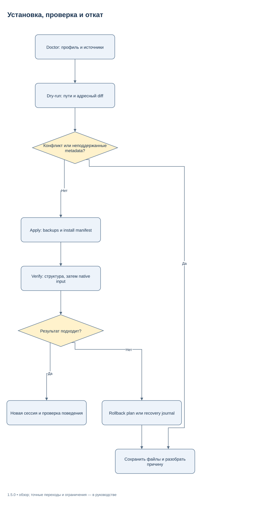
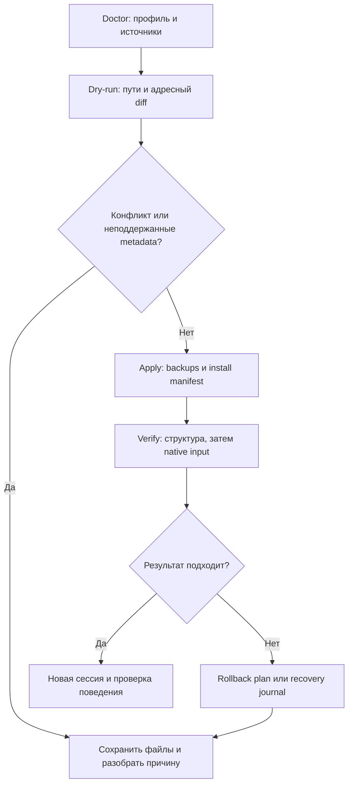

# Установка и перенос Agent Harness

Документация пакета **1.5.1** с текущими исправлениями контрактов установки.
Описание поведения не является подтверждением выпуска или квалификации среды.
Установка подключает общие инструкции, три native-роли, семь skills и определение
SessionStart hook к локальному профилю Codex. Операции выполняются явно;
синхронизация GitHub сама профиль не обновляет. Настройки модели, provider, reasoning основного чата и безопасности
сохраняются. Точные изменения TOML — в [справочнике конфигурации](docs/CONFIGURATION_RU.md).

## Требования и постоянные каталоги

Нужен Python **3.11+**. Управляющий Python-код использует стандартную библиотеку
и включённый pure-Python PyYAML 6.0.3 (MIT); основной runtime не требует pip.
Для работы в клиенте нужен установленный и авторизованный локальный Codex;
для структурной проверки установленных файлов его исполняемый файл не требуется.
Аккаунты, службы, БД и дополнительные Python-пакеты основной установке не нужны.
MCP и plugin подключаются отдельно по конкретной задаче.

Возьмите checkout либо полный релизный ZIP из
[репозитория](https://github.com/SUKUNA-AI/agent-harness). Архив исходников GitHub
и релизный архив с native-бинарниками различаются. Сохраните распакованный пакет
в постоянной папке: bootstrap, роли и skills ссылаются на его policy/workflows.
Не устанавливайте из временной загрузки, которую затем удалите.

| Каталог | Назначение | Как выбирать |
|---|---|---|
| Package root | Версионируемые исходники, политика, workflows, tools | Постоянный checkout или распакованный релиз |
| Codex home | `config.toml`, глобальные инструкции, native-роли, machine pointer | Реальный профиль клиента; по умолчанию `CODEX_HOME` либо `~/.codex` |
| Skills home | Установленные пользовательские skills | По умолчанию `~/.agents/skills`; это отдельный каталог от Codex home |
| Private state | Machine overlay, backup copies, install/rollback manifests, run store | Вне репозитория и чужих проектов, с подходящими правами доступа |

На Windows `~` здесь означает домашний каталог текущего пользователя, доступный
как `$HOME` в PowerShell. WSL, remote-среда, другой аккаунт ОС и другой
`CODEX_HOME` имеют собственную установку. Skills home по умолчанию общий для
данного пользователя ОС: для независимых тестовых профилей задавайте отдельный
`--skills-home`, чтобы они не делили установленные файлы.

Если `--state-dir` не указан, установщик ищет сохранённый state через
`harness-machine.json`; при первой установке выбирает `agent-harness-local`
рядом с package root. Явные пути ниже делают выбор проверяемым. Не переносите
machine pointer/overlay другой машины: они содержат её локальные пути.

## Первая установка: Linux и POSIX shell

Команды выполняются из постоянного package root. Измените пути под свою машину;
переменные ниже не заменяют системный `HOME`. Если Python называется `python`,
используйте его вместо `python3` после проверки версии.

```bash
HARNESS_PACKAGE="$HOME/tools/agent-harness"
HARNESS_HOME="${CODEX_HOME:-$HOME/.codex}"
HARNESS_SKILLS="$HOME/.agents/skills"
HARNESS_STATE="$HOME/.local/state/agent-harness"
cd "$HARNESS_PACKAGE"
python3 --version
python3 tools/harness.py doctor --codex-home "$HARNESS_HOME" --skills-home "$HARNESS_SKILLS" --state-dir "$HARNESS_STATE"
python3 tools/harness.py install --codex-home "$HARNESS_HOME" --skills-home "$HARNESS_SKILLS" --state-dir "$HARNESS_STATE"
```

`doctor` показывает объявленные параметры и их источники, выбранные каталоги
и доступность executable. Это инвентаризация файлов, а не определение активной
модели/профиля текущего чата. При `agents.enabled=false`, чужих файлах на месте
управляемых ресурсов или повреждённом TOML сначала разберите конфликт.

Вторая команда — **dry-run**, поскольку отсутствует `--apply`. Проверьте адресный
`changes[].diff`, пути и hashes. Установка не должна заменять ваши model/provider,
security или пользовательские инструкции. Dry-run не записывает targets, но
может создать private state и временный writer lock; это не режим «вообще без I/O».

После просмотра diff примените план и проверьте результат:

```bash
python3 tools/harness.py install --codex-home "$HARNESS_HOME" --skills-home "$HARNESS_SKILLS" --state-dir "$HARNESS_STATE" --apply
python3 tools/harness.py verify --codex-home "$HARNESS_HOME" --skills-home "$HARNESS_SKILLS" --state-dir "$HARNESS_STATE"
python3 tools/harness.py install --codex-home "$HARNESS_HOME" --skills-home "$HARNESS_SKILLS" --state-dir "$HARNESS_STATE" --apply
```

Первый apply возвращает `written_pending_native_verification` и путь manifest.
Последний повторный apply при неизменных inputs должен вернуть `unchanged`.
Сохраните private state: без manifest chain установщик не может безопасно принять
ранее установленные owned-файлы как свои или восстановить историю изменений.

## Первая установка: Windows PowerShell

Откройте обычный PowerShell от своего пользователя. Повышение прав для штатной
установки в собственные каталоги не требуется. `py -3` должен выбирать Python
3.11+; при другом launcher используйте подходящий Python executable.

```powershell
$HarnessPackage = Join-Path $HOME "Tools\agent-harness"
$HarnessHome = if ($env:CODEX_HOME) { $env:CODEX_HOME } else { Join-Path $HOME ".codex" }
$HarnessSkills = Join-Path $HOME ".agents\skills"
$HarnessState = Join-Path $HOME ".agent-harness-state"
Set-Location $HarnessPackage
py -3 --version
py -3 tools/harness.py doctor --codex-home "$HarnessHome" --skills-home "$HarnessSkills" --state-dir "$HarnessState"
py -3 tools/harness.py install --codex-home "$HarnessHome" --skills-home "$HarnessSkills" --state-dir "$HarnessState"
```

Проверьте diff, затем выполните:

```powershell
py -3 tools/harness.py install --codex-home "$HarnessHome" --skills-home "$HarnessSkills" --state-dir "$HarnessState" --apply
py -3 tools/harness.py verify --codex-home "$HarnessHome" --skills-home "$HarnessSkills" --state-dir "$HarnessState"
py -3 tools/harness.py install --codex-home "$HarnessHome" --skills-home "$HarnessSkills" --state-dir "$HarnessState" --apply
```

В PowerShell код завершения внешней команды находится в `$LASTEXITCODE`.
После ненулевого кода остановитесь и прочитайте JSON-отчёт; последовательные
строки примера не являются автоматической обработкой ошибок.

## Что будет установлено

| Объект | Действие установщика |
|---|---|
| Активный глобальный `AGENTS.override.md` или `AGENTS.md` | Добавить/обновить только managed block между harness markers |
| `config.toml` | Адресно управлять agent keys и отсутствующим compaction threshold |
| `agents/delivery_owner.toml`, `delivery_helper.toml`, `delivery_reviewer.toml` | Установить bundled native-роли: high / medium / high, без закрепления модели |
| Skills home | Установить `agent-harness` и шесть `harness-*` skills, включая doc-author/doc-review с их ресурсами |
| `harness-machine.json` в Codex home | Записать package root, version, overlay и state location |
| `hooks.json` в Codex home | Добавить/обновить собственную SessionStart-группу, сохранив чужие handlers |
| `agent-harness-hook.py` в Codex home | Создать статический launcher к `tools/session.py` выбранного пакета |
| Private state | Сохранить `machine.json`, install history, byte backups и security metadata |

Имеющийся непустой `AGENTS.override.md` получает managed block; пустой или
отсутствующий override оставляет активным `AGENTS.md`. Чужие инструкции вокруг
managed block сохраняются. Существующий чужой owned-файл либо ручное изменение
установленного role/skill не перезаписываются автоматически.

Hook и launcher входят в общий dry-run, backups, проверку конфликтов и rollback.
План фиксирует digest определения handler, launcher и entrypoint. Повторная
установка неизменного payload идемпотентна. Уже существующий unmanaged handler
harness без явного adoption либо его подключение одновременно через config
и hooks-файл блокируют план: сначала сопоставьте определения с diff. Установщик
не удаляет чужие handlers и не принимает ручную установку как свою по одному совпадению команды.

Для проверенного legacy wrapper есть install-only opt-in
`--adopt-hook-sha256 EXPECTED_GROUP_DIGEST`. Сначала просмотрите ровно одну
существующую harness SessionStart-группу и явно подтвердите её содержимое.
Digest относится ко всей группе, а не к файлу `hooks.json` или только строке
command. Canonical bytes: `json.dumps(group, ensure_ascii=False, indent=2,
sort_keys=True) + "\n"`, затем UTF-8 и SHA-256 в lowercase hex. Это тот же формат,
который использует `installation.canonical` для `handler_digest`.

Из постоянного package root повторите dry-run и apply с одним проверенным
значением; пути определены в шагах первоначальной установки:

```bash
HARNESS_HOOK_SHA256="<проверенный SHA-256 одной SessionStart-группы>"
python3 tools/harness.py install --codex-home "$HARNESS_HOME" --skills-home "$HARNESS_SKILLS" --state-dir "$HARNESS_STATE" --adopt-hook-sha256 "$HARNESS_HOOK_SHA256"
python3 tools/harness.py install --codex-home "$HARNESS_HOME" --skills-home "$HARNESS_SKILLS" --state-dir "$HARNESS_STATE" --adopt-hook-sha256 "$HARNESS_HOOK_SHA256" --apply
```

```powershell
$HarnessHookSha256 = "<проверенный SHA-256 одной SessionStart-группы>"
py -3 tools/harness.py install --codex-home "$HarnessHome" --skills-home "$HarnessSkills" --state-dir "$HarnessState" --adopt-hook-sha256 "$HarnessHookSha256"
py -3 tools/harness.py install --codex-home "$HarnessHome" --skills-home "$HarnessSkills" --state-dir "$HarnessState" --adopt-hook-sha256 "$HarnessHookSha256" --apply
```

Adoption допускает ровно один command handler внутри выбранной группы.
Смешанная группа с harness и пользовательскими handlers отклоняется даже при
верном digest. Оператор сначала разделяет определения на отдельные группы,
сохраняя matcher и порядок по требованиям клиента, затем заново проверяет
содержимое и digest. Installer не удаляет и не переносит чужие handlers сам.
Изменённая managed-группа без явного adoption остаётся конфликтом.

Неверный digest, отсутствие или несколько harness-групп, concurrent edit и
дублирующий config source блокируют план до target writes. Чужие группы
сохраняются. Manifest записывает старую группу как `handler_before`, новую как
`handler_after` и `adopted_group_digest`; обычный rollback восстанавливает legacy
группу. Повтор того же apply с исходным digest идемпотентен только при точном
совпадении текущего owned handler и сохранённого adoption receipt. Это разрешение
обновить конкретное определение, без изменения client trust или автоматического
доверия новой команде. Без флага сохраняется прежний отказ от unmanaged hook.

Launcher использует Python executable, запустивший installer, и постоянный путь
пакета. Linux-команда имеет shell quoting; Windows-команда поддерживает пути
с пробелами и Unicode, а опасные для shell метасимволы в путях отклоняются.
Событие поступает через stdin; его поля не добавляются в shell-команду.

`harness-doc-author` ведёт документацию по фактическому коду/CLI, а
`harness-doc-review` задаёт независимую content/visual проверку. Их наличие
не создаёт новый model process автоматически. Исходники схем и готовые SVG
находятся в [docs/diagrams](docs/diagrams/README.md); draw.io нужен только автору
для редактирования/экспорта, а не для установки и выполнения harness.

## Структурная и native-проверка

Успешный apply возвращает `hook_status=configured_trust_and_runtime_pending`.
Он не редактирует внутреннюю trust database или `hooks.state` клиента и не включает
trust bypass. Откройте новый процесс Codex, просмотрите команду и launcher через
штатный `/hooks`, затем доверьте точное определение интерфейсом клиента.
Изменение определения или script требует нового review. Проверьте вызов новым
стартом сессии; наличие файлов и прямой запуск Python не доказывают callback Codex.

| Наблюдение | Что подтверждает | Что ещё нужно проверить |
|---|---|---|
| `doctor` | Содержимое разрешённых полей, происхождение параметров, executable discovery | Реальный runtime/выбранный профиль |
| `verify` → `structural_verified` | Manifest chain, backups/hashes, parent bindings, canonical targets и hook definition | Trust, фактический callback клиента и поведение агентов |
| `verify --native` → `native_input_verified` | Успех поддержанных CLI-probes и policy marker/version во входе модели | SessionStart callback, полный lifecycle, desktop hot reload и выполнение задачи |

Для native probe нужен доступный `codex` в PATH. Создайте пустую папку вне
рабочего проекта и вызовите новый процесс:

```bash
HARNESS_PROBE="$(mktemp -d)"
python3 tools/harness.py verify --codex-home "$HARNESS_HOME" --skills-home "$HARNESS_SKILLS" --state-dir "$HARNESS_STATE" --native --cwd "$HARNESS_PROBE"
```

```powershell
$HarnessProbe = Join-Path ([System.IO.Path]::GetTempPath()) ([guid]::NewGuid().ToString())
New-Item -ItemType Directory -Path $HarnessProbe | Out-Null
py -3 tools/harness.py verify --codex-home "$HarnessHome" --skills-home "$HarnessSkills" --state-dir "$HarnessState" --native --cwd "$HarnessProbe"
```

Реализация запускает `codex app-server --strict-config --print-startup-config`
и `codex -C ... debug prompt-input ...`, с отдельным `CODEX_HOME`. Она проверяет
startup и сборку model input; это не модельный ход и не доказательство native
spawning. Неподдерживаемый флаг, отсутствие executable или timeout дают failed,
а не успешно пропущенную проверку. После обновления откройте новый чат;
при сохранении старого контекста перезапустите клиент. Подробнее —
[автоподключение](docs/AUTOLOAD_RU.md).

## Обновление и перемещение пакета

Для чистого Git checkout сначала проверьте `git status --short`, затем обновите
его штатным `git pull --ff-only`. При локальных изменениях сохраните их и разберите
расхождения; установка не требует reset/stash. Для ZIP распакуйте новый полный
релиз в постоянную папку. Сохраняйте прежний пакет, пока проверка новой установки
и решение об откате не завершены.

Для Git-варианта команды обновления одинаковы в POSIX shell и PowerShell;
сначала разберите вывод первой команды, затем выполняйте вторую:

```text
git status --short
git pull --ff-only
```

Из **нового актуального package root** повторите doctor → dry-run → apply →
verify с прежними Codex home, skills home и private state. `--package-root` можно
задать явно, если вызываете entrypoint из другого каталога. Установщик обновит
свои ссылки на новый package root, если installed ownership и managed block
проходят проверки. Вместе с ними обновляется статический hook launcher;
снова выполните review/trust штатным клиентским интерфейсом и проверку новой
сессии. Обновление package само по себе меняет доступные по этим путям исходники; не считайте старую открытую сессию автоматически обновлённой.

Примеры apply для обеих оболочек приведены выше; шаги обновления используют те
же команды и явно выбранные каталоги. Для намеренного изменения child cap есть
только install-флаг `--max-child-threads N`, где N — положительное целое.
Для новой установки без сохранённого предпочтения default — **5 дочерних потоков**,
без primary/root. Без explicit flag сохраняются более строгий имеющийся cap
и сохранённое предпочтение machine overlay: старое значение 4 или 2 не повышается
автоматически. Сам cap не доказывает доступные runtime slots.

Чтобы перевести уже установленный профиль именно на 5, проверьте отдельный
explicit dry-run и затем примените его с теми же каталогами:

```bash
python3 tools/harness.py install --codex-home "$HARNESS_HOME" --skills-home "$HARNESS_SKILLS" --state-dir "$HARNESS_STATE" --max-child-threads 5
python3 tools/harness.py install --codex-home "$HARNESS_HOME" --skills-home "$HARNESS_SKILLS" --state-dir "$HARNESS_STATE" --max-child-threads 5 --apply
```

```powershell
py -3 tools/harness.py install --codex-home "$HarnessHome" --skills-home "$HarnessSkills" --state-dir "$HarnessState" --max-child-threads 5
py -3 tools/harness.py install --codex-home "$HarnessHome" --skills-home "$HarnessSkills" --state-dir "$HarnessState" --max-child-threads 5 --apply
```

Это явное разрешение изменить текущий меньший cap; обычный install без флага
не делает такого повышения. После применения выполните `verify` и откройте
новую сессию Codex.

## Rollback, uninstall и recovery

`rollback` отменяет **последнюю install-транзакцию** и переводит active pointer
на предыдущий manifest. `uninstall` проходит всю цепочку установки и удаляет
её управляемые добавления. Оба сначала показывают план, пока нет `--apply`.
Они не удаляют сам checkout/ZIP, private evidence и весь каталог Codex.

```bash
python3 tools/harness.py rollback --codex-home "$HARNESS_HOME" --skills-home "$HARNESS_SKILLS" --state-dir "$HARNESS_STATE"
python3 tools/harness.py rollback --codex-home "$HARNESS_HOME" --skills-home "$HARNESS_SKILLS" --state-dir "$HARNESS_STATE" --apply
```

```powershell
py -3 tools/harness.py rollback --codex-home "$HarnessHome" --skills-home "$HarnessSkills" --state-dir "$HarnessState"
py -3 tools/harness.py rollback --codex-home "$HarnessHome" --skills-home "$HarnessSkills" --state-dir "$HarnessState" --apply
```

Для полного удаления управляемых добавлений выберите `uninstall` вместо
последнего rollback; сначала проверьте его собственный dry-run:

```bash
python3 tools/harness.py uninstall --codex-home "$HARNESS_HOME" --skills-home "$HARNESS_SKILLS" --state-dir "$HARNESS_STATE"
python3 tools/harness.py uninstall --codex-home "$HARNESS_HOME" --skills-home "$HARNESS_SKILLS" --state-dir "$HARNESS_STATE" --apply
```

```powershell
py -3 tools/harness.py uninstall --codex-home "$HarnessHome" --skills-home "$HarnessSkills" --state-dir "$HarnessState"
py -3 tools/harness.py uninstall --codex-home "$HarnessHome" --skills-home "$HarnessSkills" --state-dir "$HarnessState" --apply
```

Выбирайте rollback или uninstall по цели; последовательное выполнение обоих
apply после отмены единственной установки даст «No active installation manifest».
Rollback файлов профиля не переключает версию Git checkout. Для последующей
структурной/native проверки нужен соответствующий package root предыдущей
версии. После uninstall отсутствие active installation — ожидаемый результат;
`verify` уже не должен сообщать verified installation.

При failed operation прочитайте `status`, `manifest`/`journal` и
`recovery_errors`, если они присутствуют. Install может вернуть `blocked`,
указав путь failed manifest в тексте `error`; подробный статус хранится в manifest. `rollback_failed_compensated` означает возвращённые изменения
попытки, но сама операция всё равно завершилась ошибкой. `recovery_required`
требует разбора оставленных файлов и сохранённых copies/metadata. Не повторяйте
apply вслепую и не удаляйте manifest, active pointer или writer lock ради обхода
защиты. Существующий `install.lock` требует проверки владельца; автоматического
удаления чужого lock нет.

Для адресной recovery можно выбрать сохранённый manifest. Подставьте путь из
реального отчёта и сначала получите dry-run:

```bash
HARNESS_MANIFEST="<путь к manifest из реального отчёта>"
python3 tools/harness.py rollback --codex-home "$HARNESS_HOME" --skills-home "$HARNESS_SKILLS" --state-dir "$HARNESS_STATE" --manifest "$HARNESS_MANIFEST"
```

```powershell
$HarnessManifest = "<путь к manifest из реального отчёта>"
py -3 tools/harness.py rollback --codex-home "$HarnessHome" --skills-home "$HarnessSkills" --state-dir "$HarnessState" --manifest "$HarnessManifest"
```

`--manifest` не отключает integrity/конфликты и не гарантирует обход повреждённого
machine pointer. Используйте этот флаг только с текущим поддержанным installer.
Новые install manifests имеют `schema_version=2` и
`boundary_protocol=physical-parent-v2`; reader сохраняет поддержку legacy v1,
не переписывая прежнюю chain. Обычный reader baseline v1 отвергает новый active
manifest до изменения targets. Но старый бинарник с прямым `--manifest` может
обойти собственную проверку версии: такой downgrade-путь не поддерживается.
Не запускайте его на новой установке и не считайте смену package checkout
доказательством безопасного отката состояния. Если discovery блокируется,
сначала сопоставьте pointer, overlay и state с сохранёнными данными. Не придумывайте manifest или hashes.
Подробный операционный порядок — [OPERATIONS](docs/OPERATIONS.md).



[Редактировать в draw.io](docs/diagrams/installation-recovery.drawio) · [Все схемы](docs/diagrams/README.md)

<details>
<summary>Mermaid source той же схемы</summary>



</details>

## Физические границы установки

До изменения targets проверяются их существующие ancestors, типы файлов и
ожидаемые bytes/metadata. Root alias и промежуточные symlink/junction/reparse
переходы по умолчанию запрещены; explicit policy для linked root не реализована.
Используйте физический путь, а не автоматический `resolve` для обхода конфликта.
Unsafe target блокирует план целиком; private lock/state I/O остаётся возможным.

Целевые файлы должны быть обычными regular files. Symlink/reparse targets,
FIFO, hardlinks и неподдержанные metadata отклоняются. Installer inputs
ограничены **16 MiB на файл**; чтение bounded/nonblocking, с проверкой identity
и final entry. На Windows дополнительно сравниваются два bounded чтения одного
fd, поскольку timestamps могут обновляться с задержкой.

На POSIX publication/delete привязаны к directory descriptors. Linux staging
metadata изменяются через открытый inode; descriptor alias требует доступного
`/proc/self/fd`, иначе операция отказывает. На Windows используются удерживаемые
ancestor handles без разрешения share-delete; реальная junction/ACL/quoting
квалификация Windows выполняется отдельно и не доказывается Linux-прогоном.

На Linux сохраняются mode, uid/gid и точный набор доступных xattrs, включая
POSIX ACL. На Windows проверяются DACL, owner/group и поддерживаемые обычные
attributes; uncertain ownership и специальные attributes требуют отказа.
Hardlinks, неподдержанные inode/platform flags и невозможность staging
обнаруживаются до изменения targets. Путь metadata-preserving installation
поддерживает Linux и Windows; macOS не заявляется поддержанным installer target.

Install manifest v2 связывает target с physical identity parent chain,
installed digest, publication identity и backup. Замена parent другим каталогом
блокирует install/reinstall/verify/rollback даже при byte-identical copies;
копии в новом месте не удаляются как собственная установка. Legacy v1 не содержит
исторического parent binding: reader проверяет текущие nofollow boundaries,
но не выдумывает недостающую историю владения.

Новые manifests и rollback journals сохраняют security metadata. Публикация
связывает ownership с проверенным staging inode и ожидаемыми metadata. Поздняя
чужая ACL/xattr не принимается как собственная запись установщика: неизвестный
результат сохраняется для recovery. Rollback замены сохраняет актуальные
пользовательские metadata; удаление созданного установщиком файла с изменёнными
metadata блокируется. Для старых byte-only manifests удаление ограничено обычным
Linux-файлом `0600`, текущими uid/gid и отсутствием xattrs. Уже утраченные ACL
старый byte backup восстановить не сможет.

Это защита согласованной локальной операции, а не filesystem CAS или OS sandbox
против другого процесса с теми же правами. Сохранение backup не заменяет резервное
копирование важных пользовательских данных.

## Необязательные возможности

Релизный native-архив включает `harness-native` для Linux/Windows x86_64;
compiler при его использовании не нужен. Source-only checkout может собрать
helper через `python tools/build_native.py` с закреплённым Rust/C toolchain.
`python tools/harness.py native status` показывает выбранный backend; Python
snapshot fallback остаётся доступен при отсутствии helper. Наличие старого helper
без capability snapshot scheme v2 даёт отказ с требованием rebuild, даже при той
же версии продукта; такой отказ не скрывается Python fallback. RepoMap требует
native backend. Для semantic code operations нужен language server языка;
`python tools/harness.py code doctor` проверяет discovery без запуска серверов.
LSP child живёт одну команду и завершается после неё.

[Конфигурация](docs/CONFIGURATION_RU.md) · [MCP](docs/MCP_RU.md) ·
[Plugin](docs/PLUGIN_RU.md) · [Интеграции](integrations/README.md) ·
[Граница ChatGPT Work](adapters/chatgpt-work/README.md).
