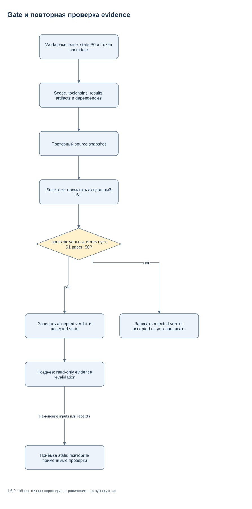
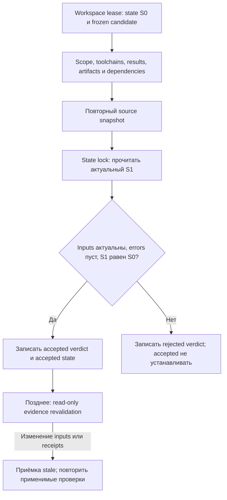

# Приёмка и виды доказательств — 1.5.1

Supervisor применяет тот же gate после завершения model edit phase. Required
criteria проходят независимо от model exit/status; optional failure остаётся
failed в отчёте даже при принятом результате. При managed integration command
cwd и внутренние source paths привязываются к staging candidate. Process identity
проверяется также по global slots до recovery/fast accepted return. Наличие
recovery marker блокирует актуальную приёмку до явной сверки.

Универсальный пакет, его подключение к клиенту и результат конкретной задачи
принимаются отдельно. Этот документ задаёт критерии; фактические результаты
связываются с текущим commit и разрешённым private evidence.
[RELEASE_REVIEW](RELEASE_REVIEW.md) — исторический отчёт 1.1.0;
[release notes 1.5.1](RELEASE_NOTES_1.5.1.md) описывают текущий интерфейс.
`not_run`, `unknown`, `unavailable`, `skipped` и `unverified` не означают passed.
Полный работающий fixture с JSON contract/evidence —
[эксплуатация](OPERATIONS.md#полный-локальный-пример).

## Три разных подтверждения

| Подтверждение | Достаточное наблюдение | Что не следует из успеха |
| --- | --- | --- |
| Correctness ядра | Tests конкретного source/binary candidate и реальные отрицательные сценарии | Поведение модели, установка в активный desktop profile |
| Подключение к клиенту | Нужный config/bootstrap/roles, штатный parser, новый model-input marker и отдельные native probes | Полнота content/visual приёмки проектной задачи |
| Приёмка задачи | Exact contract/attempt/candidate, применимые checks/evidence, root gate и проверенная актуальность | Разрешение publish/deploy/remote write или всех будущих изменений |

Release/runtime отчёт связывайте с версией пакета/клиента, backend, профилем и ОС.
Core verdict автоматически связывается с run_id/task_id/attempt_id,
contract_digest/candidate_digest и receipts. Он не определяет сам версию UI,
учётную запись, фактический native lifecycle или identity автора assessment.
Такие факты фиксируются отдельным observed evidence, если нужны для критерия.

## Что фиксирует freeze

Candidate snapshot охватывает actual source bytes, dirty/untracked и tracked
missing entries, supported file metadata, Git state и declared external inputs.
HEAD без полного snapshot недостаточен. `.git` и явно заданные excludes не входят
в source inventory; исключённый путь не получает проверки только потому, что он
существует рядом. Run store держат вне source, reports/build outputs — снаружи либо
с обоснованными явными excludes. Нельзя исключать проверяемые inputs ради успеха.

Freeze записывает candidate и command toolchains. Executable fingerprints,
version probes и declared implementation files проверяются до/после check.
Изменившийся toolchain или source требует новой попытки и applicable checks;
нельзя заменить candidate.json вручную или ослабить required в worker result.
Python и native snapshots должны совпадать по manifest/digest; adaptive выбор
backend не освобождает от повторного хеширования файлов.

Snapshot scheme v2 (`snapshot_scheme_version=2`,
`topology_policy=nofollow-ancestors-literal-leaf-v1`) запрещает root alias и
intermediate symlink/junction/reparse. Каждый tracked path проверяется вместе
с ancestors, даже под ignored parent. Leaf symlink учитывается literal target;
внешние file bytes через него не становятся обычным source проекта.

`root_binding` хранит локальную physical identity root. Полный `digest` связывает
её с manifest; `content_digest` вычисляется без `root_binding`, но по-прежнему
содержит cwd, Git metadata, scope/exclusions. Это не универсальный переносимый
hash между checkout-ами. Для переноса candidate нужна явная versioned content
projection, проверенное целевое владение и полный digest целевого candidate;
совпадение file hashes само по себе не переносит приёмку. Смена scheme делает
старую source binding stale без переписывания исторических receipts.
Python/native обязаны выдавать один protocol; старый native backend без v2
capability отклоняется с требованием rebuild, даже при той же версии продукта.

Для `work` внешние и ignored ordinary files, от которых зависит check,
объявляйте в typed `inputs` с абсолютным path и optional SHA-256. Они попадают
в frozen contract и evidence. Это не автоматическое вычисление всех зависимостей
произвольного теста. Optional Ledger/CheckCache reuse использует отдельное
доказательство closure; его PASS не заменяет fresh required runner/gate.

Managed acceptance проверяет staging cwd. Восстановленные worker/staging paths
сначала сверяются с ownership metadata и назначенным run; чужой path не даёт
основания запустить модель или перенести patch. Отчёт указывает actual candidate
и original source cwd; accepted staging не является публикацией в user checkout.

## Виды evidence

| Kind | Основание | Обязательный смысл proof |
| --- | --- | --- |
| `command` | Runner сам запускает frozen argv, captures stdout/stderr/reports и exit | Команда исполнилась на этом candidate, закончилась допустимо, assertions/reports подтверждены |
| `source` | source_review + sources/URL/date/claim/support и captured artifacts | Каждый вывод опирается на действительно прочитанный источник |
| `content` | agent_assessment либо human_assessment, criteria и artifacts | Проверены смысл, полнота, требования и конкретные наблюдённые части результата |
| `visual` | agent_visual_review либо human_visual_review, просмотренные image/PDF | Фактический просмотр нужной версии/страниц; наличие картинки не равнозначно просмотру |
| `runtime` | observed_runtime + criteria/artifacts | Реальный сценарий в названной среде, с observed состоянием и практическими границами |

Non-command JSON содержит объяснение каждого frozen criterion ID и копируемые
artifact_paths. Один самоотчёт без artifact не проходит формат. Проверка формата
не делает оценку объективной и не гарантирует, что модель действительно просмотрела
файл: root проверяет достаточность и достоверность наблюдения. Автор и независимый
reviewer должны различаться там, где требуется независимая приёмка.

Command `passed` — только один вид evidence. У документа могут требоваться content
и visual, у интерфейса runtime/browser, у research — source. Не добавляйте пустой
command ради замены этих проверок. Applicable required check остаётся failed/not_run,
пока не получено актуальное наблюдение нужного вида.

### Reports, JSON types и skipped cases

Отчёт должен быть произведён **данным запуском**. Runner сравнивает identity,
размер и timestamps до/после и сохраняет копию для parsing/integrity. Существующий
неизменный старый report отклоняется; новая запись с теми же bytes допустима,
если наблюдение отличает её от прежнего файла. На средах с недостаточным различением
используйте уникальный output path для каждого check/attempt. Это не повод
подменять mtime в тестах или объявлять старый report новым.

`reports.equals` поддерживается одинаково в core и managed contract. Это map
из dotted selector в JSON value: null, boolean, finite number, string, ordered
array либо object. Selector проходит по object keys; missing key отличается
от explicit null. Разрешены до 1000 selectors длиной 1–1000 символов. Payload
ограничен 2 MiB в JSON с ASCII escaping, depth 48, 100000 nodes и 262144 символами
на строку; keys учитываются в node bound. Остальные report fields остаются
закрытыми. Duplicate/non-string keys, reserved merge key `<<` и non-finite
values отклоняются. Пустой map `{}` допустим по совместимости, но не доказывает
содержательную цель пользователя.

JSON equals использует рекурсивное сравнение: `true != 1`, `false != 0`, в том числе
в lists/objects. Числа `1` и `1.0` сохраняют числовую эквивалентность; порядок
массива значим. Например, fragment report definition:

```json
{"path":"result.json","format":"json","equals":{"summary.status":"ok","summary.values":[null,false,1]}}
```

Для этого fragment файл должен содержать object `summary` с указанными `status`
и `values`; runner дополнительно проверяет свежесть файла и исход process.
Та же JSON comparison semantics применяется к shared-record values и защищённым
non-record metadata. Allowed record ID не разрешает менять чужую запись либо
metadata всего файла. Record IDs — непустые strings/integers, не boolean.

JUnit profile **`junit-harness-v2`** поддерживает root `testsuite`/`testsuites`,
вложенные `testsuite`, отсутствие namespace либо единый `urn:junit`. Testcase
допустим непосредственно внутри `testsuite`. Из вспомогательных suite elements
поддерживаются `properties`, `system-out`, `system-err`; неизвестная критическая
структура отклоняется. Пустой report не удовлетворяет default `min_tests=1`.

Любой suite-level `failure`/`error` и case-level issue отклоняет отчёт. Если заданы
`tests`, `skipped`, `failures`, `errors`, `disabled`, это неотрицательные целые,
которые должны точно совпасть с наблюдаемым subtree. Suite issues учитываются
в failures/errors, но не добавляют testcase. Parent aggregates проверяются,
а не суммируются с child counts второй раз. Противоречие имеет diagnostic
`report_inconsistent`; unsupported/malformed XML даёт failed validation.

Defaults: `min_tests=1`, `max_skipped=0`. `required_cases` сопоставляет regex
с полным `classname::name`; требуется хотя бы одно совпадение и **все** совпавшие
testcase должны реально пройти. Дубликаты остаются отдельными occurrence IDs
`case_ids`, связанными с положением в suite tree. Skipped elements, execution
`status`/`result` notrun/skipped/disabled/suppressed не считаются pass; неизвестные
значения дают failure. Обычный JUnit без этих attributes остаётся допустимым.
Разрешённый unrelated skip не закрывает skipped required case.

Каждый raw JSON/XML report ограничен **2 MiB**; XML дополнительно ограничен depth
**48** и **100000 nodes**. DTD/entity declarations запрещены до expansion.
JSON reader также отвергает duplicate keys и non-finite numbers. Parsing/regex
выполняется в bounded worker с timeout/cancel; успешный parse не перекрывает
wrong process exit, timeout, stale source или report от другой attempt.
Summary сокращает список cases, сохраняя counts/omissions и raw evidence;
сокращённый вывод не ограничивает проверку required patterns.

## Что делает gate

Gate доступен root/orchestrator. Он берёт workspace lease, читает frozen contract,
current attempt/candidate/toolchains, проверяет scope, shared records/adapters,
required results, artifacts/log hashes/sizes, отсутствие неизвестных artifacts и
accepted dependencies. Затем снова сверяет inputs и публикует verdict в state
transaction только после сравнения всего актуального state с проверенным.



[Редактировать в draw.io](diagrams/acceptance-gate.drawio) · [Все схемы](diagrams/README.md)

<details>
<summary>Mermaid source той же схемы</summary>



</details>

Новая unknown operation во время финального snapshot не должна совместиться с
accepted. Concurrent state change приводит к rejected с указанием повторить
приёмку по текущему состоянию; новая запись не стирается старым state. State lock
не держится во время долгого command execution. Attempt transition сериализован
с workspace/execution lease, включая смену cwd/resource namespace; старый check
не запускается после смены контракта.

Locks и hashes — защита от ошибок cooperating processes, **не OS sandbox**,
не криптографическая подпись автора и не filesystem CAS против редактора.
Наблюдённый concurrent file edit сохраняется/отклоняет проверку; нельзя обещать
атомарную неизменность внешних файлов после последнего наблюдения.

## Сохранённая приёмка и freshness

`result ready_for_review` не accepted. `state.status=accepted` — сохранённый факт
прошлого gate, а не автоматическое утверждение свежести каждого артефакта.
Обычный status делает source snapshot, но без verify оставляет
`evidence_current=null`, если source current. `status --summary` уменьшает ответ,
не проверяемый scope. Metadata-only handoff не проверяет workspace.

`status --verify-evidence` заново проверяет accepted verdict, frozen toolchain
manifest, exact **полный** набор check receipts, artifact/log hashes/sizes,
source и dependencies, без запуска новых checks/gate. Optional check, отсутствовавший
при gate, может отсутствовать. Optional result, вошедший в accepted verdict,
не может исчезнуть, измениться или быть заменён другим без потери freshness.
Новое optional evidence после приёмки также меняет accepted receipt set.

Проверяются и обязательные shared adapter receipts, а read-only validation не
запускает adapter ещё раз. Принятые child dependencies должны иметь правильные
run/task/attempt/contract/node/parent bindings; чужой accepted child не подходит.
Plan helper использует ту же проверку сохранённого evidence и не выдаёт accepted
по одному полю status в плане.

При отсутствии accepted verdict verify не может вернуть evidence_current=true.
Exit 1 — проверка не подтверждена, включая stale/непринятый run; exit 2 — ошибка
параметров или чтения. `recorded_status` сохраняет исторический статус, а effective
status может быть stale. Если snapshot отказал из-за unsafe topology либо
недоступного source, status не подтверждает свежесть: `source_current=false`,
`evidence_current=false`, `actual_snapshot=null` и диагностическая причина.
Для продолжения используйте
[attempt/recovery](OPERATIONS.md#попытки-locks-и-ошибки), не переписывайте receipts.

## Обязательные механические отрицательные сценарии

Это критерии тестового покрытия; наличие строки ниже не означает фактический pass.

| Область | Что проверить |
| --- | --- |
| Installer | Dry-run без target writes; unknown TOML/comment/model/security сохранены; invalid TOML и конфликт не портят files; idempotence; backup/manifest integrity; rollback/user edits |
| Metadata | POSIX mode/uid/gid/xattrs/ACL и поддерживаемая Windows security preservation; concurrent metadata не присваивается транзакции; unsupported metadata даёт явный отказ |
| Run/attempt | Stale contract/base/candidate; dirty/untracked/deleted input; late result; new attempt во время preflight/spawn; deadline/retry budget не сбрасывается |
| Command | Missing executable, timeout/cancel/tree cleanup, toolchain mutation, stale report, unknown artifacts, type-safe JSON и настоящие GoogleTest notrun forms |
| Gate/freshness | Concurrent unknown operation, missing/modified required/optional receipts, tampered/deleted logs, dependency binding и inherited stale inputs |
| Context | Bounds/UTF-8 offsets/hash continuation; packet integrity/root binding; FIFO/raced FIFO; same-size overwrite при stale Windows timestamps |
| LSP | Закрытый target меняется до ответа; requery/snapshot binding; UTF-16/BOM/CRLF; unsupported resource edits; backup corruption + write failure; restoration readback; минимальный recovery output |
| Native | Python/Rust glob parity и Git root whitespace; selected host build artifact, source fingerprint до/после, binary/build-info; failed publication + failed restore сохраняют прежний bundle |

Команды обязательного source gate: `python tools/release_check.py` и
`python tools/run_tests.py`. При native/build изменениях добавляются Cargo tests,
protocol parity, настоящий build/distribution smoke. При LSP — explicit installed
server integration. Отсутствующий optional runtime отмечается skipped/not_run;
fixtures доказывают механику на своих входах и не заменяют такой runtime.

## Новый клиентский запуск и наблюдаемое поведение

Установка generated hook definition подтверждает configured state.
`verify` проверяет definition/launcher и физические bindings, но оставляет trust
и actual callback непроверенными. Отдельно нужны штатный `/hooks` review и fresh
Codex session на каждой заявленной platform/client комбинации. `verify --native`
проверяет поддержанные startup/model-input probes и не заменяет hook lifecycle
qualification. Прямой stdin smoke не доказывает события root/child, fork или resume.

1. Проверьте штатным parser configuration schema, выбранный активный профиль и
   новый model-input marker без требования упомянуть harness в запросе.
2. Простая задача в новой native сессии выполняется без искусственных детей/run.
   Проверьте пустой Git project, existing AGENTS.md и работу вне Git.
3. Review/diagnosis/plan не начинают неразрешённую реализацию; допустим review без
   findings. Запрет сохранения не создаёт managed artifacts.
4. Research содержит проверенные источники/даты, document — content и просмотренный
   формат, performance — baseline/inputs/repeats. Поддержку GPU не выводят из текста.
5. Несколько logical lanes имеют конкретных owners/results в доступной очереди.
   Зафиксируйте requested topology, observed cap/root semantics и maximum threads.
6. Реальный native owner работает в назначенном cwd, возвращает результат. Ошибка
   возвращается тому же доступному owner с текущей базой и логом; fix перепроверяется.
7. Discovery custom role и fallback через явный brief учитываются раздельно.
   Idle/stopped/unavailable не объявляются фактическим close без backend proof.
8. Прерывание/checkpoint и новый контекст сверяют files, process identities,
   native refs и unknown operations; восстановленный context не называется native
   resume той же сессии без соответствующего наблюдения.
9. Конкурентные writers изолированы; integration-only defect проверяется общим
   gate и возвращается owner. Негативный fixture не затрагивает production.

Перезапуск приложения может требовать нового сообщения пользователя. Автозагрузка
политики и автоматическое продолжение вычислений — разные свойства. Фоновая работа
возможна только через явно разрешённую штатную автоматизацию.

## Матрица среды и итоговый отчёт

| Среда | Доказательство для observed |
| --- | --- |
| Windows local Codex | Версия/backend, active paths/config, новый prompt input, native agents и behavioral session |
| Linux/Arch local Codex | Реальное исполнение installer/native/client сценариев на названной системе и dependencies |
| ChatGPT Work | Отдельный подтверждённый hosted источник постоянных инструкций и runtime acceptance; local TOML недостаточен |
| GitHub/другой CI | Exact commit/tree, ОС/Python/toolchain, jobs/logs и их actual conclusions; не desktop acceptance |

Финальный отчёт различает passed, failed, not_run, unknown и remaining blockers;
указывает exact candidate, актуальные checks/evidence, observed autoload/runtime,
repair/recovery, install diff/rollback. Созданный архив не объявляется установленным,
а test plan не объявляется выполненной приёмкой. Версия документа и исторические
release-review records — разные вещи: прошлые результаты не переписываются новым
ожиданием.
