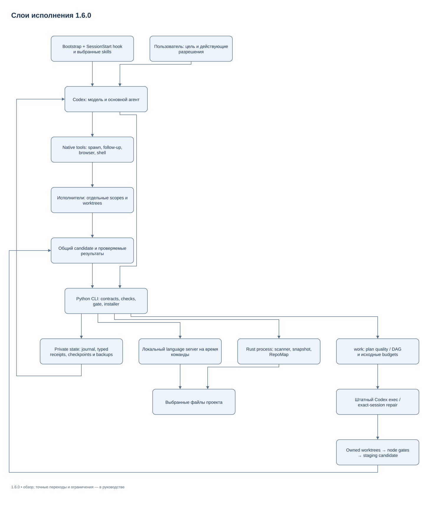
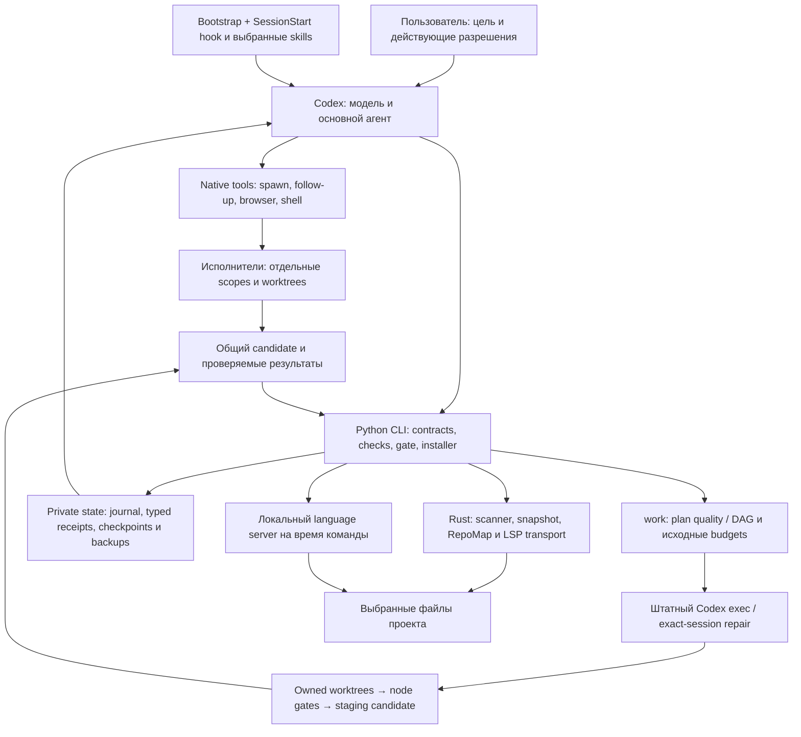
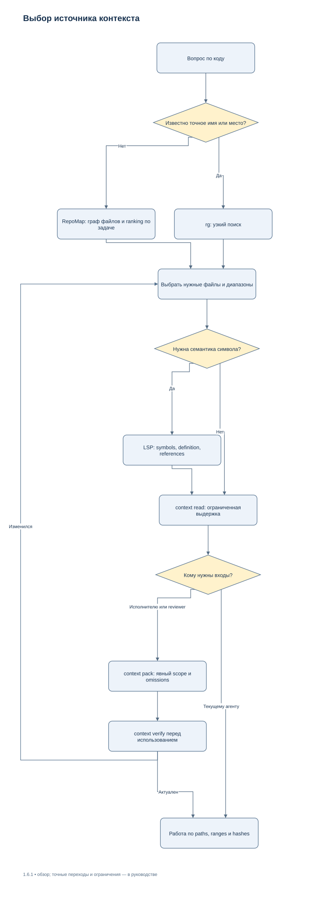
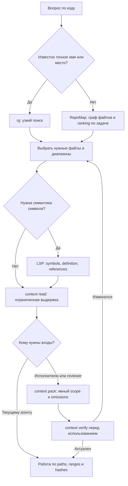
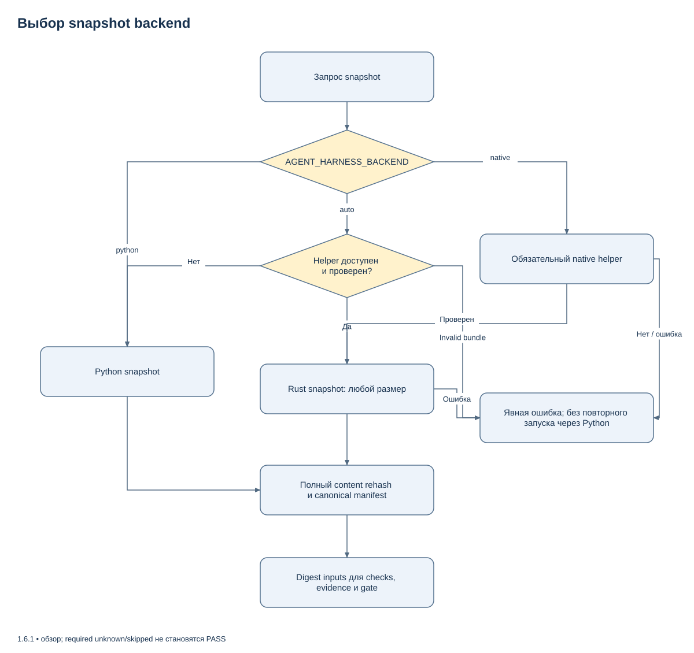
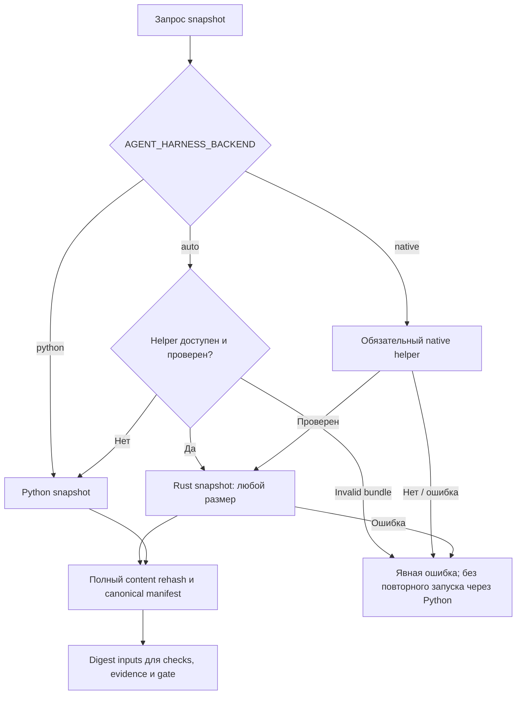
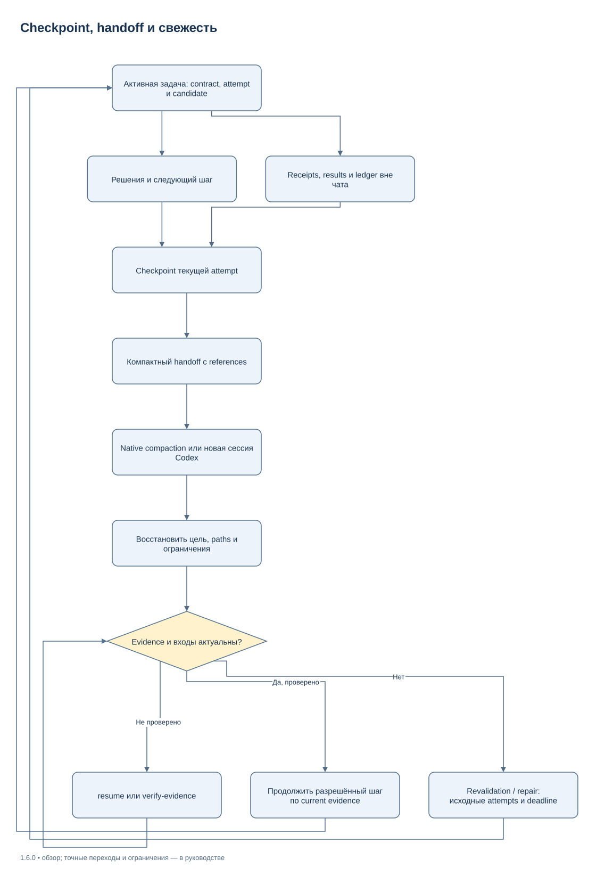
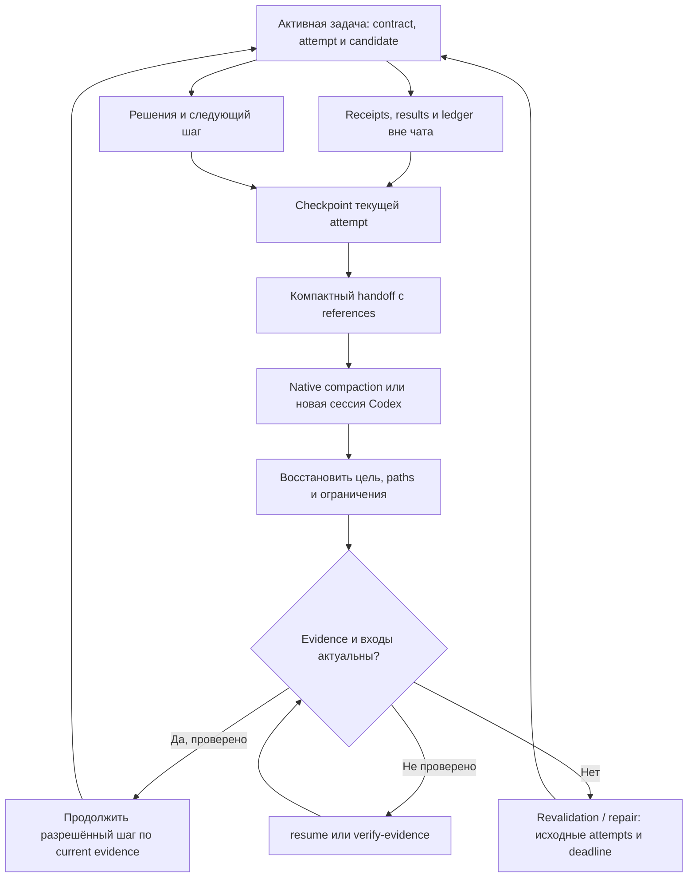

# Архитектура Native Agent Harness 1.6.0

[Индекс](INDEX.md) · [README](../README.md) · [CLI](CLI_REFERENCE_RU.md)

Harness сочетает штатное исполнение Codex с локальными инструментами для
поиска, проверок и восстановления состояния. Разделение позволяет адресно
читать код и проверять связь результата с входами; ускорение требует измерения.
Файловое состояние находится в явно выбранном private store; общая служба
и БД отсутствуют.

## 1. Кто исполняет работу

В 1.6.0 foreground control plane включает `supervisor.py`, транспорт
`codex_execution.py`, durable `supervisor_store.py` и `strict_yaml.py`.
Native SessionStart работает отдельно через `native_session.py` и не
запускает supervisor. Для managed contract v2 `plan_quality.py` проверяет
план до worker dispatch; node и final acceptance связываются с одним candidate.
Существующие `core.Run` и `runner` остаются механизмом snapshot/evidence/gate.
Модельный inference остаётся в Codex. Полный FSM и diagram:
[Execution Supervisor](EXECUTION_SUPERVISOR_RU.md). Ledger/memory/context:
[Memory](MEMORY_AND_CONTEXT_RU.md); DAG/worktrees: [Dynamic](DYNAMIC_AGENTS_RU.md).

[Редактировать в draw.io](diagrams/runtime-architecture.drawio) · [Все схемы](diagrams/README.md)

Mermaid source той же схемы

| Слой | Ответственность | Что он не подтверждает сам по себе |
| --- | --- | --- |
| Codex | Размышление, действия инструментами, native agents, работа в пользовательских permissions | Правильность результата без наблюдений |
| Bootstrap/skills/workflows | Направление агента к подходящему процессу и источникам | Обязательное исполнение каждой инструкции конкретной моделью |
| Python control plane | Валидация contracts/plans, command runner, receipts, gate, установка и LSP adapter | Полноту намерения пользователя или выдачу новых permissions |
| Rust helper | Inventory, metadata, content hashes, canonical snapshot и ограниченная карта символов | Полную семантику языка и ускорение model inference |
| Language server | Семантику проекта в пределах своей реализации и настроек | Полноту неиндексированного/неподдерживаемого кода |
| Private files | Состояние run, checkpoints и recovery evidence | Автоматическое продолжение без активного клиента |

CLI не содержит дополнительного LLM API client. `plan next` показывает ready nodes для native orchestration; `work` запускает штатные Codex exec/resume processes, владеет global slots и отдельными worktrees. Модельный runtime остаётся Codex.

### Связь с исходниками

| Контракт | Основные файлы |
| --- | --- |
| Запуск CLI | `tools/harness.py`, `src/agent_harness/cli.py` |
| Контракт, state, snapshot, gate | `core.py`, `validation.py`, `runner.py` |
| Совместимые native plans и briefs | `orchestration.py` |
| Foreground edit/repair и managed DAG | `supervisor.py`, `work_contract.py`, `scheduling.py`, `managed_execution.py` |
| Проверка плана и требований | `plan_quality.py`, `verified_flow.py`, `completion_eligibility.py` |
| Подготовка root-вызова и восстановление | `root_preparation.py`, `execution_receipts.py`, `dependency_commit.py` |
| SessionStart, checkpoint и native observations | `native_session.py`, `native_observability.py` |
| Exact sessions и owned processes/worktrees | `codex_execution.py`, `agent_lifecycle.py` |
| Strict YAML, journal и replay | `strict_yaml.py`, `supervisor_store.py` |
| Provenance, память и reducer | `execution_ledger.py`, `memory.py`, `context_reducer.py` |
| Optional conservative reuse | `input_closure.py`, `check_cache.py`, `python_runtime.py` |
| Engineering queries и measured serialization | `repomap_queries.py`, `format_bench.py` |
| Ограниченная выдача | `context.py`, `presentation.py`, `repo_map.py` |
| Выбор native backend | `native.py`, `native_cli.py` |
| Rust helper | `native/src/`, `native/Cargo.lock` |
| LSP и транзакция rename | `lsp.py`, `rename.py` |
| Установка и наблюдение настроек | `installation.py`, `diagnostics.py`, `file_io.py` |

Пути без префикса в таблице относятся к `src/agent_harness/`.

На Windows root binding использует полный `VolumeSerialNumber` и opaque
128-bit `FileId`, без fallback на усечённую `stat` identity. Перед чтением
проверяются ancestors и reparse boundaries; сравнение aliases выполняется
по физической идентичности. Совпадение строк пути не подменяет ownership и
source proof. Python и Rust используют согласованную snapshot projection.

## 2. Как данные попадают в контекст

[Редактировать в draw.io](diagrams/context-routing.drawio) · [Все схемы](diagrams/README.md)

Mermaid source той же схемы

RepoMap строит граф в памяти отдельного процесса. Синтаксические definitions и
references связывают файлы; ranking учитывает запрос и focus files. Пределы
числа файлов, bytes входа, bytes ответа и времени ограничивают стоимость
вызова. Результат карты помогает выбрать чтение и не заменяет точные
references языка. Неполная карта остаётся явно неполной.

Source packet — файл с выбранными исходниками и manifest. Он удобен для общего
контекста исполнителей, но не является shared mutable memory. При изменении
источника его пригодность нужно проверить. Excerpt хранит hash полного файла,
чтобы страницы можно было связать с одним содержимым. Ограничение вывода не
означает, что вычисление полного hash читает только показанные строки.

### Виды лимитов

| Лимит | Единица и назначение |
| --- | --- |
| `context map --max-bytes`, `context read --max-bytes` | Размер сериализованной JSON-выдачи в UTF-8 bytes |
| `context pack --max-bytes` | Бюджет исходного содержимого packet; envelope/manifest рассматриваются отдельно в CLI reference |
| `--max-files`, `--max-file-bytes`, `--max-total-bytes` | Ограничения входного объёма соответствующего инструмента |
| `status/handoff --max-output-bytes` | Размер краткого JSON-ответа |
| `tool_output_token_limit` Codex | Отдельный лимит retained tool output в native history |
| `model_auto_compact_token_limit` | Порог native compaction истории, выбранный пользователем |

Нельзя напрямую приравнивать 8192 bytes к 8192 tokens. Реальная стоимость
зависит от tokenizer, модели, дополнительных сообщений и поведения клиента.
Точные defaults и ограничения аргументов — в [CLI reference](CLI_REFERENCE_RU.md).

## 3. Где работает Rust и что сохраняет Python

[Редактировать в draw.io](diagrams/snapshot-backends.drawio) · [Все схемы](diagrams/README.md)

Mermaid source той же схемы

Наличие bundle проверяется по metadata/версии/протоколу и hash бинарника.
Повреждённый найденный helper не считается отсутствующим. Native timeouts и
protocol errors не превращаются в успешный Python fallback. `context map`
вызывает Rust независимо от выбора snapshot и требует helper.

Процессный cache хранит проверку неизменного установленного бинарника. Snapshot исходников каждый раз проверяет содержимое.
Оба backend должны возвращать одинаковый canonical manifest: это проверяет
`tools/check_native.py`, включая scope/ignore semantics и нестандартные paths.

Python сохранён там, где важнее явные state transitions и переносимая stdlib:
installer, contracts, subprocess runner, evidence/gate, bounded summaries,
LSP semantic adapter, Python fallback transport и recovery. Переход scanner в Rust не переносит reasoning модели
на локальный процессор. Методика [Performance/eval](PERFORMANCE_EVAL_RU.md) описывает
именно локальную часть; новых универсальных обещаний latency здесь нет.

## 4. Долгая задача и восстановление после compaction

[Редактировать в draw.io](diagrams/context-recovery.drawio) · [Все схемы](diagrams/README.md)

Mermaid source той же схемы

Источниками истины служат текущие файлы и проверяемые records. Handoff помогает
вспомнить состояние, но не выдаёт старую заметку за новое доказательство.
Checkpoint проверяется на integrity/binding; notes прошлой attempt не
становятся инструкциями текущей автоматически.

`status --summary` дешёв в сравнении с полным audit evidence. По умолчанию
свежесть может быть unknown. `--verify-evidence`/`resume` выполняют соответствующую
перепроверку и могут вернуть stale. Новая attempt отделяет новую проверку от
старого исхода. Состояние `running` допускает отсутствие ещё не записанного
`result.json`; повреждённый готовый результат не считается `passed`.

Native compaction с порогом 500000 остаётся ответственностью Codex. Private
files уменьшают потерю контекста при сжатии, но не продлевают window модели и
не запускают задачу после закрытия клиента. Подробнее:
[эксплуатация](OPERATIONS.md), [контекст](CONTEXT_AND_NATIVE_RU.md).

## 5. Приёмка, locks и восстановление записей

Command runner связывает разрешённый executable, inputs, reports и attempt.
Перед приёмкой gate повторно проверяет состояние под state lock. Изменение
accepted receipt, входов или незавершённой внешней операции делает прежний
acceptance непригодным. JSON boolean не равен number; required test case обязан
быть действительно выполнен. Подробная схема находится в
[ACCEPTANCE.md](ACCEPTANCE.md).

Installer и rename используют разные локальные транзакции, но общий принцип:
сначала проверка всех доступных входов и возможности записи, затем staged
изменение, readback и при необходимости компенсация. В installer сохраняются
поддерживаемые security metadata; в rename plan связан с исходными bytes.
Recovery receipt фиксирует исход, который нельзя подтвердить как restored.

Файловый lock координирует процессы harness. Сторонний редактор может менять
файл независимо; общий атомарный commit всей файловой системы не обещается.
Неизвестный исход сохраняется как recovery state, а не скрывается коротким
ответом ради token budget. Диаграммы транзакций:
[установка](../SETUP_RU.md), [LSP rename](LSP_RU.md).

## 6. Что хранится и что передаётся

| Область | Содержимое | Жизненный цикл |
| --- | --- | --- |
| Переносимый пакет | Source, docs, policies, skills, schemas, native bundles релиза | Версионируется; package root должен оставаться доступным после установки |
| Codex home / skills home | Managed bootstrap, роли, skills, config changes и `harness-machine.json` pointer в Codex home | Обновление и откат через manifest |
| Private installation state | Machine overlay, backups, manifests и recovery journals | Отдельно для устройства/профиля; не публикуется в Git |
| Private run | Contract, snapshots, evidence, ledger, checkpoints | Отдельно для задачи; достаточно для разбора и продолжения |
| Process memory | RepoMap graph, routing hint, transport buffers | Завершается вместе с командой |
| Optional status MCP | Только разрешённые metadata выбранного private store | Запускается клиентом по явной настройке; нет автоматического background install |

Raw evidence сохраняется отдельно от краткой выдачи. Ограниченный scan на
secret patterns помогает отсеять известные формы, но состав packet перед
внешней передачей всё равно выбирается осознанно. Локальная работа не требует
внешних telemetry, memory services или копирования chat history.

## 7. Где смотреть остальные диаграммы

| Вопрос | Документ |
| --- | --- |
| Как устанавливаются и откатываются настройки | [SETUP_RU](../SETUP_RU.md) |
| Откуда новый чат получает инструкции | [AUTOLOAD_RU](AUTOLOAD_RU.md) |
| Как идут попытки и восстановление run | [OPERATIONS](OPERATIONS.md) |
| Когда evidence достаточно для acceptance | [ACCEPTANCE](ACCEPTANCE.md) |
| Как проверяется и применяется rename | [LSP_RU](LSP_RU.md) |

Все схемы доступны в [галерее draw.io](diagrams/README.md): `.drawio` содержит
редактируемые узлы/связи, `.svg` — эквивалентная самостоятельная векторная версия
для просмотра. Mermaid source
сохранён рядом с объяснением в Markdown. Галерея связывает эти представления с
модулями реализации. Private PNG для визуального review не входят в поставку.
Редактирование диаграмм не требует изменений model/provider или runtime harness.
