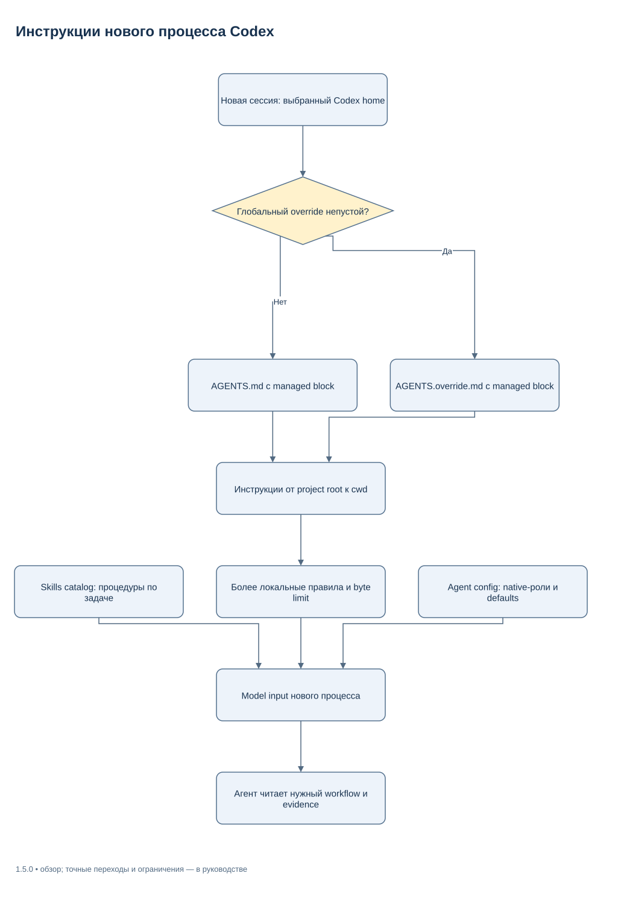
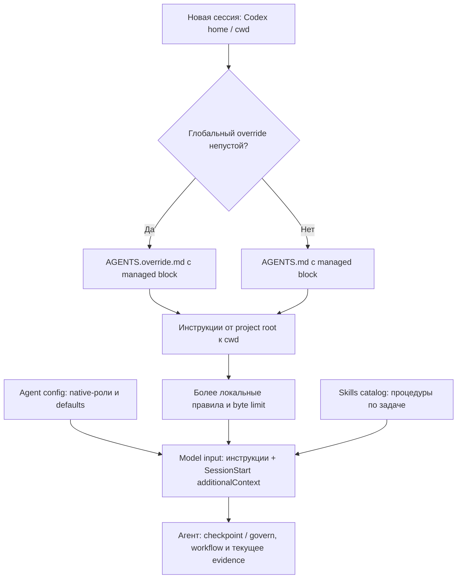

# Автоподключение в новых чатах и проектах

Текущий контракт релиза **1.6.1**, сверено **2026-11-09**. После установки в
конкретный локальный профиль Codex managed bootstrap обнаруживается клиентом
в новых сессиях. Команда «включи harness» для каждого проекта не требуется.
Подробные workflows/skills агент читает, когда задача требует соответствующей
процедуры. Это progressive disclosure, а не загрузка всех справочников целиком.

## Discovery инструкций

Установщик выбирает непустой глобальный `AGENTS.override.md` внутри Codex home;
если его нет или он пуст после удаления whitespace, выбирает `AGENTS.md`.
В выбранном файле обновляется только блок между `agent-harness:begin` и
`agent-harness:end`. Остальной пользовательский текст сохраняется.

При новом запуске клиент собирает глобальные, затем проектные и более локальные
инструкции. Для каждой области `AGENTS.override.md` имеет приоритет перед
`AGENTS.md`; учитываются правила fallback filenames клиента. Более близкая к
рабочему каталогу инструкция уточняет внешнюю. Установщик не переписывает
проектные `AGENTS.md` и не распространяет managed block по репозиториям.
Актуальные детали discovery — в
[официальной документации AGENTS.md](https://learn.chatgpt.com/docs/agent-configuration/agents-md).

[Редактировать в draw.io](diagrams/instruction-discovery.drawio) · [Все схемы](diagrams/README.md)

Mermaid source той же схемы

Bootstrap содержит version marker (`HARNESS_POLICY_VERSION`) и ссылки на
постоянный package root. Native-роли лежат в Codex home, пользовательские skills
по умолчанию — в `~/.agents/skills`. Это два разных механизма discovery:
роль задаёт native contract и effort, skill предоставляет повторяемую процедуру.
Их наличие не означает обязательный spawn на короткой задаче.

Каталог 1.6.1 включает `harness-doc-author` и `harness-doc-review`.
Skill выбирается по задаче; он не заменяет native-role TOML и не подтверждает
переключение уже открытого чата на новую политику. Документация и draw.io assets
читаются по ссылкам, а не вставляются в каждый model input.

SessionStart-группу и owned launcher добавляет штатный installer. После
установки проверьте handler и его trust через `/hooks`; ручная дополнительная
группа не нужна. Короткий packet содержит memory/ledger/reducer context,
а успешное `Harness bootstrap` даёт агенту session ID без повторного start.
Формат packet, fallback и продолжение описаны в
[native-сессии](NATIVE_SESSION_RU.md).

## Как подтвердить автоподключение

1. Выполните обычный `verify` с теми же `--codex-home`, `--skills-home` и
   `--state-dir`, что использованы при install. Ожидаемый статус установленной
   согласованной конфигурации — `structural_verified`.
2. Создайте пустую probe-папку и выполните `verify --native --cwd <probe>`.
   Успешный `native_input_verified` подтверждает startup и marker/version в
   model input **новых CLI-процессов**.
3. Для проверки project discovery повторите наблюдение в разрешённом проекте
   со своим `AGENTS.md`, затем в его вложенной папке с отдельным override.
   Проверяйте конкретные маркеры, отсутствие маркеров другого проекта и
   неизменность пользовательских файлов. Не сохраняйте полный приватный prompt
   только ради доказательства присутствия marker.
4. Откройте новую рабочую сессию и проверьте доступные роли/skills и необходимое
   поведение. Это отдельное наблюдение: сборка model input не доказывает
   успешную реализацию будущих задач или lifecycle дочерних агентов.

[SETUP_RU](../SETUP_RU.md) содержит исполнимые POSIX/PowerShell команды.
[CONFIGURATION_RU](CONFIGURATION_RU.md) объясняет источники параметров и почему
`doctor` не определяет фактическую модель/профиль текущей сессии.

## Если инструкции не появились

| Наблюдение | Что проверить |
|---|---|
| Marker отсутствует | Совпадает ли реальный `CODEX_HOME` с installation home; какой global override активен |
| Marker старой версии | Открыт ли новый процесс; выполнены ли apply и verify после обновления package |
| `verify` сообщает canonical diff | Не изменён ли owned role/skill или managed block; тот ли package root выбран |
| Новая папка видит чужие project rules | Реальный cwd/project root и цепочку локальных инструкций, не только global block |
| Нет роли/skill | Отдельные каталоги role/skills, возможности клиента и их фактический discovery |
| Инструкции усечены | `project_doc_max_bytes`, размер global/project инструкций и реальный model input |
| Путь policy больше не существует | Сохранён ли постоянный package root; не перемещена ли папка после install |

Установщик проверяет размер активного глобального файла относительно
`project_doc_max_bytes` (если поле отсутствует — 32768 bytes). Большая цепочка
проектных инструкций требует дополнительного наблюдения клиентского входа.
Файл больше 16 MiB, FIFO, symlink/reparse либо изменившийся во время чтения input
отклоняется установщиком/диагностикой; такой объект не считается пустым override.
Не обходите эту защиту удалением markers или state.

Другой профиль/устройство, WSL и remote-процесс требуют своей установки.
Локальные файлы не подключают hosted ChatGPT Work. Старый чат может хранить
предыдущий контекст; новая версия на диске не гарантирует hot reload.
GitHub хранит версии, но не запускает install в фоне.
