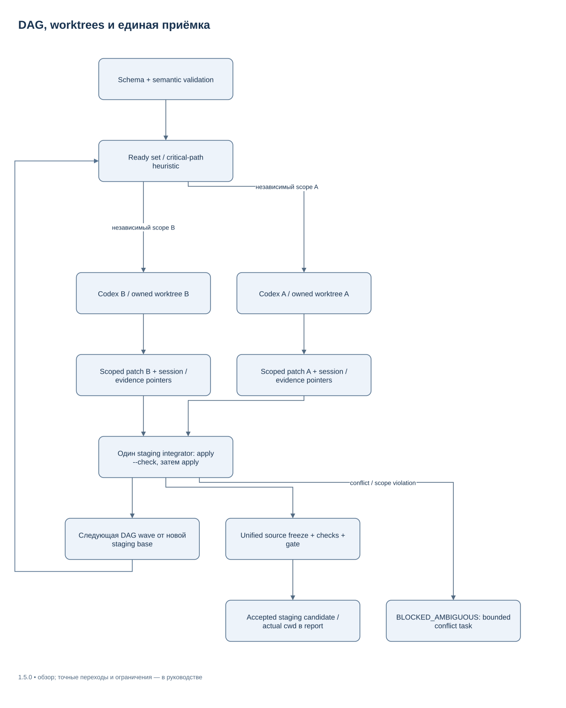
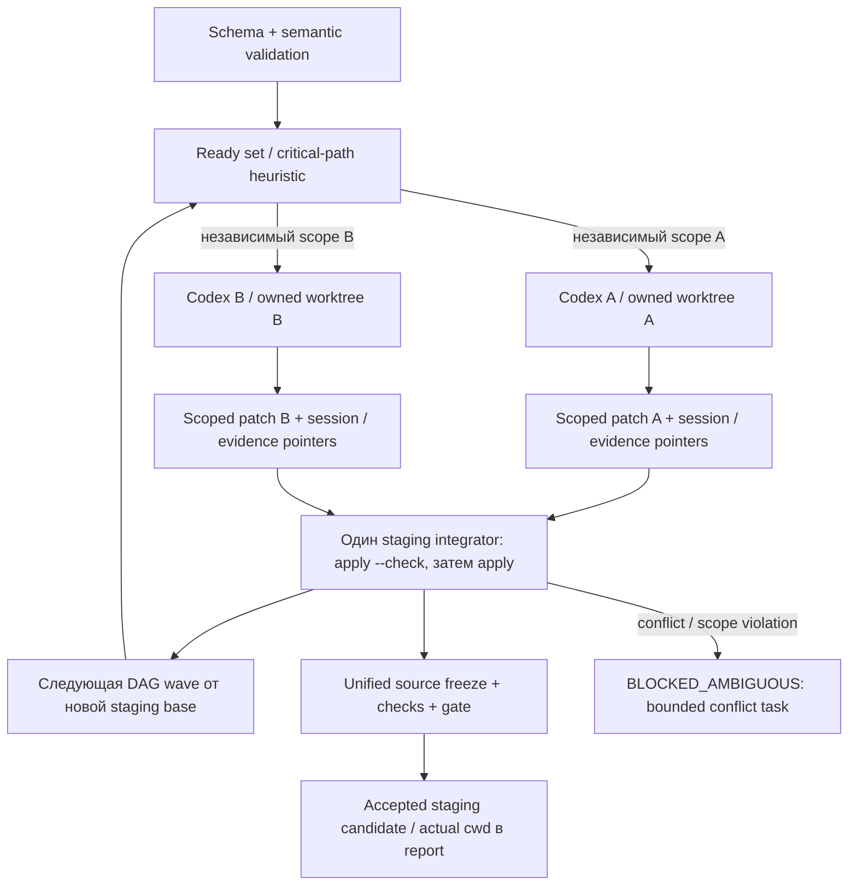

# Динамические агенты и DAG — 1.5.0

[Supervisor](EXECUTION_SUPERVISOR_RU.md) · [Координация](ORCHESTRATION_RU.md) · [Приёмка](ACCEPTANCE.md)

Harness использует два отдельных режима. Выбирайте один режим для work task;
native child cap и supervisor global quota имеют разную семантику.

| Режим | Кто управляет model sessions | Ограничение |
| --- | --- | --- |
| `mode: native` | Одна coordinator session Codex; её native children остаются под управлением Codex | Contract managed concurrency=1; установленный child cap=5 не включает primary |
| `mode: managed` | Supervisor запускает отдельные Codex exec/resume в принадлежащих run worktrees | Contract cap 1–5; global active model sessions≤5, включая planner, reviewer и integration owner |

Локальный Python controller не потребляет model slot. Другой managed run с
тем же `--state-dir` использует тот же OS-backed registry. Изолированные
state roots намеренно независимы; для общей квоты используйте один state root.

## План и условный spawn

Простой managed task с cap1 получает один bounded node. Для полезной
декомпозиции planner вызывается с `--output-schema` по
[`agent-plan.schema.json`](../schemas/agent-plan.schema.json), либо используется
явный `work start --plan PLAN.yaml`. План сохраняется в Strict YAML.

Supervisor проверяет уникальные task IDs, известные dependencies, отсутствие
циклов/self-dependency, acceptance IDs, read/write scopes, read-only reviewer,
исходные budgets и пересечения одновременно editable scopes. JSON syntax и
schema validity не заменяют эту semantic validation.



[Редактировать в draw.io](diagrams/managed-worktrees.drawio) · [Все схемы](diagrams/README.md)

<details>
<summary>Mermaid source той же схемы</summary>



</details>

Scheduler ранжирует ready nodes по оставшемуся критическому пути и impact.
Observed durations уточняют estimates. Spawn cost может исключить лишний
короткий параллельный node. Это heuristic, не точный ETA и не доказанный
оптимум. Заблокированные dependencies не порождают бесполезные sessions.
Контракт разрешает до пяти workers, но не требует запускать пять.

## Подавление рекурсивного native spawn

Managed workers получают локальные CLI overrides:

```text
codex -c agents.enabled=false -c features.multi_agent_v2=false exec --json ...
```

Overrides не меняют пользовательский `config.toml`. Флаги в `--help` сами по
себе не доказывают отсутствие native tools. Для managed cap>1 требуется
отдельное наблюдение доступных model tools, привязанное к binary hash, CLI
version, exact thread ID и неизменному JSONL artifact. Proof имеет ограниченную
актуальность; текущая policy — 24 часа. Формат и проверка находятся в
[`managed_execution.py`](../src/agent_harness/managed_execution.py).

```text
python tools/harness.py work start --contract TASK.yaml --cwd /absolute/clean-repo --run-dir /absolute/private/run --state-dir /absolute/private/state --plan PLAN.yaml --native-disabled-proof PROOF.yaml
```

Без проверяемого suppression proof конкурентный запуск прекращается до spawn
со статусом `BLOCKED_ENVIRONMENT`. Доступная альтернатива — native coordinator
или managed cap1. Prompt «не создавай агентов» полезен как task constraint,
но не заменяет проверку tools inventory. Создание sessions через connectors
остаётся запрещённым worker contract; supervisor не заявляет hook над всеми
встроенными tools Codex.

## Worktree isolation и интеграция

Managed mode требует clean исходный checkout. Dirty user tree сохраняется и
даёт blocker; harness не делает reset/stash/forced pull. Run создаёт отдельный
staging worktree и worktree каждого writer от явной base revision.
Mapping task→worktree→base→role сохраняется с ownership token.

Worker возвращает изменения через scoped patch. Untracked файлы включаются
только после проверки scope и исключения secret artifacts. Интегратор
последовательно делает `git apply --check`, затем применяет patch в staging.
Конфликт остаётся явной задачей, а не force overwrite. После объединения
существующий freeze/check/gate проверяет единое дерево заново.

Итоговый candidate остаётся в staging. `work report` показывает actual `cwd`
и original `source_cwd`; successful gate не переносит результат автоматически
в пользовательский checkout и не публикует ветку. Перенос/публикация требуют
действующего основания и отдельной проверки текущего дерева.

Worktree разделяет файловые writers, но не создаёт OS sandbox. Worker
наследует разрешения Codex и получает task scope. Reviewer запускается
read-only; обнаруженный patch reviewer отклоняется. Worktrees и evidence
сохраняются для inspection/recovery; автоматического удаления чужих paths нет.

Recovery сначала проверяет принадлежность staging/worker cwd текущему run:
base revision, role, task, repository common dir и ownership record. Проверка
предшествует resume модели и чтению patch из назначенного worktree. Подмена
сохранённого path внешним checkout не разрешает работать в нём. Потерянный
registry/checkpoint либо ещё живой orphan child сохраняет blocker и слот.

## Lifecycle и сбои

Agent YAML содержит role, contract hash, base/worktree, process creation
identity, exact thread ID, deadline, attempts, heartbeat/progress, log offsets
и checkpoint. Global model lease удерживается до завершения конкретного
process tree; PID-only или записанное `running: false` не освобождает writer.

Timeout/cancel сначала запрашивает мягкое завершение, затем использует
контролируемый terminate. Unknown outcome не считается ready или integrated.
Повторный foreground resume сверяет сохранённые процессы и actual source,
прежде чем разрешить новый writer. Финальные combined-test repairs выполняет
integration owner в прежнем staging cwd через exact session resume.

Планировщик сохраняет process identity и usage до перехода к workers.
При заданном token budget восстановление interrupted wave блокируется,
если полные usage receipts не были сохранены: restart не обнуляет расход.
Обычное восстановление без token cap сохраняет прежние attempts и deadline.

Сравнение single/2/3/5 требует одинаковых задач и учёта planner/spawn/merge/check
costs. До таких измерений дополнительная параллельность не означает ускорение.
