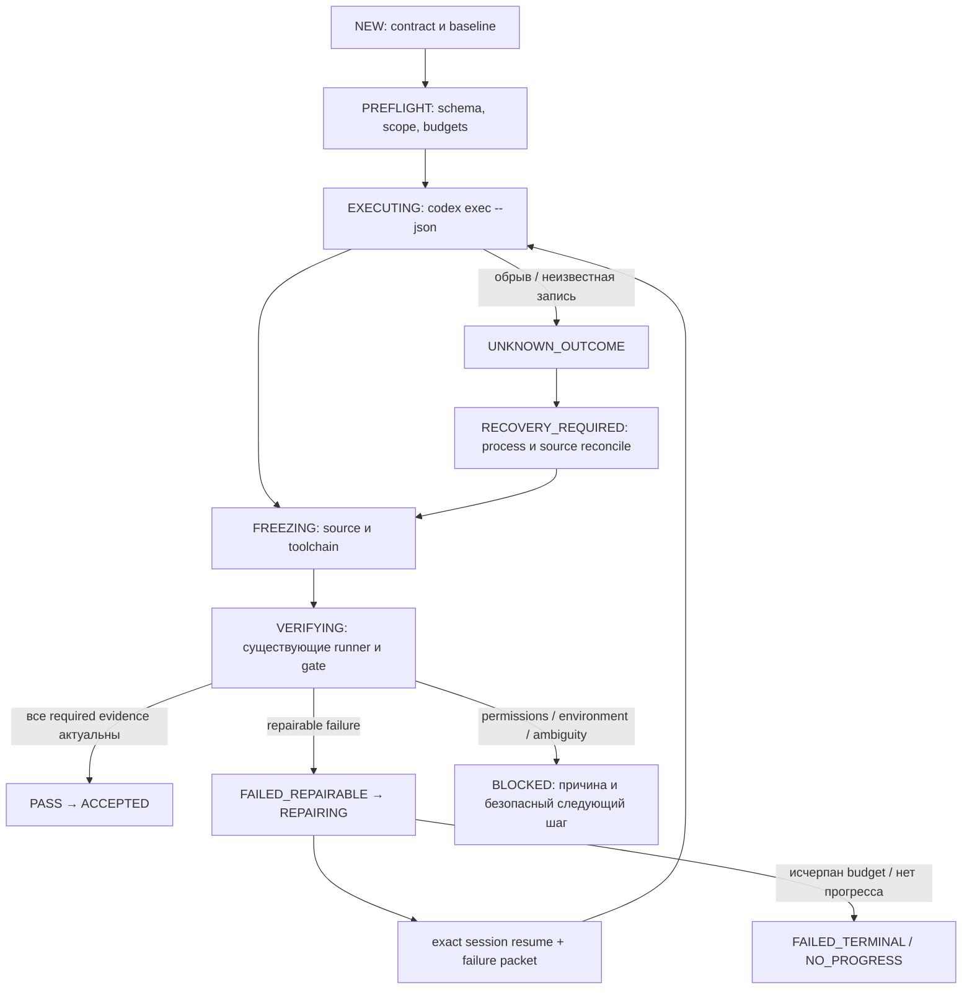

# Execution Supervisor — 1.5.1

[Индекс](INDEX.md) · [CLI](CLI_REFERENCE_RU.md) · [Форматы состояния](STATE_FORMATS_AND_MIGRATION_RU.md)

Supervisor выполняет локальный цикл «редактирование → снимок → независимая
проверка → исправление». Модель запускает установленный Codex CLI. Harness
не содержит дополнительный LLM API client, сервер или базу данных.

## Путь выполнения


[Редактировать в draw.io](diagrams/supervisor-repair.drawio) · [Все схемы](diagrams/README.md)

<details>
<summary>Mermaid source той же схемы</summary>



</details>

Это обзор основного пути. Допустимые переходы проверяет
[`supervisor.py`](../src/agent_harness/supervisor.py). Cancellation и timeout
могут прервать несколько фаз. Код выхода модели `0` и `turn.completed`
разрешают начать verification; они не означают accepted.

После model edit существующий `Run.freeze` фиксирует фактический candidate и
toolchain. `run_check` выполняет frozen argv, сохраняет receipts и logs.
`gate` проверяет scope, contract/attempt binding, актуальность source и evidence.
Во время frozen checks модельный writer не запускается на том же checkout.

## Контракт и запуск

Запускайте команды из package root. На Windows вместо `python` можно
использовать проверенный `py -3`; остальные аргументы одинаковы.
`TASK.yaml` и private run храните за пределами исходного проекта.

```yaml
schema_version: 1
task:
  id: fix-add
  objective: Исправить calc.add так, чтобы она складывала два числа.
  allowed_write_scopes:
    - calc.py
acceptance:
  - id: add-check
    kind: command
    required: true
    argv:
      - python
      - -c
      - "import calc; assert calc.add(2, 3) == 5"
    timeout: 30
budgets:
  max_attempts: 3
  max_concurrent_managed_agents: 1
  max_wall_seconds: 7200
  turn_timeout_seconds: 600
model:
  inherit_installed_codex_config: true
mode: native
memory: false
ledger: inform
```

Пример предполагает существующий Git checkout с `calc.py` и доступным Python.
Относительные argv исполняются из рабочего `cwd`. Для изолированного примера
выберите новую тестовую копию проекта. Не используйте production-файлы для smoke.

Внешние или ignored файлы, влияющие на acceptance, объявляйте в optional
`inputs`: объекты с абсолютным `path` и при необходимости `sha256`.
Эти ordinary files включаются в frozen evidence; изменение их bytes делает
прежнюю приёмку stale. Prompt получает объявленные inputs и исходные budgets.

```text
python tools/harness.py work start --contract TASK.yaml --cwd /absolute/repo --run-dir /absolute/private/run --state-dir /absolute/private/state
python tools/harness.py work status --run-dir /absolute/private/run --summary
python tools/harness.py work report --run-dir /absolute/private/run --format yaml
```

`work start` работает в переднем плане (foreground). Он не возвращает обещание
фонового выполнения и не создаёт daemon. Во втором терминале можно вызвать
read-only `work status` или `work watch`. `watch` по умолчанию проверяет локальное
состояние раз в 2 секунды, имеет timeout 3600 секунд и печатает новые generations.
Он не делает модельных запросов.

Все команды поддерживают `--help`. Для start/resume статус `ACCEPTED` даёт exit 0,
неуспешный результат — 1, обработанная ошибка — 2. Status/report требуют оценки
полей ответа: успешное чтение состояния не подтверждает его приёмку.

## Repair и восстановление

Initial edit учитывается как первая model attempt. Default — максимум три
попытки; повтор или restart не повышает исходные лимиты и не переносит deadline.
Failure classifier различает code/test, environment, permission, ambiguity,
stale evidence и unknown outcome. Одинаковая ошибка при неизменном snapshot в
последовательных попытках завершает цикл как `NO_PROGRESS`.

Исправимый `turn.failed` проходит `EXECUTING → FAILED_REPAIRABLE → REPAIRING`,
а не пропускает допустимый переход. Он расходует исходный attempt budget,
сохраняет signature/snapshot в failure history и требует точный session ID.
Отсутствие usage у такой попытки также учитывается при token budget.

### Подготовка root repair и reservation

Ошибка подготовки сохраняет тип причины, исходный phase и ссылку на ограниченный
sanitized causal artifact в `diagnostics/`. Текст exception служит диагностикой;
он не выбирает разрешения или stop category. В частности, одинаковые слова
`approval`, `deadline` или `NO_PROGRESS` не меняют typed outcome.

| Доказанная причина подготовки | Outcome |
| --- | --- |
| Повтор той же failure при неизменных inputs без новой hypothesis | `NO_PROGRESS` |
| Исчерпан исходный attempt/token budget | `FAILED_TERMINAL` |
| Истёк исходный wall deadline | `TIMED_OUT` |
| Недоступен необходимый executable/capability | `BLOCKED_ENVIRONMENT` |
| Требуется дополнительная authority | `BLOCKED_APPROVAL` |
| Integrity conflict или неизвестная внутренняя ошибка подготовки | `UNKNOWN_OUTCOME`, explicit recovery |
| Неоднозначное требование | `BLOCKED_AMBIGUOUS` |
| Usage coverage неизвестна при token cap | `BLOCKED_ENVIRONMENT`, usage остаётся unknown |
| Сохранён cancellation request | `CANCELLED` |

`REPAIRING → NO_PROGRESS` разрешён только с проверяемой basis из consecutive
failure history и current source. Causal artifact и journal fact публикуются
перед stop transition; сбой checkpoint не превращает исходную ошибку в
`Illegal transition`. Status показывает controlled recovery и diagnostic ref,
даже если последний сохранённый checkpoint ещё имеет `REPAIRING`.

Verification generation, root model reservation и invocation/usage учитываются
отдельно. `root_execution` показывает `verification_generation`,
`reserved_attempts`, `journal_reservations` и `invocation_intents`; intent означает
возможный dispatch, а не доказанный model turn. Обычный `Run.new_attempt` сохраняет
свои прежние CLI limits и no-progress semantics. Отдельный Supervisor helper
готовит verification generation по immutable journal intent/commit, сохраняет
origin baseline/history и проверяет оставшиеся исходные model/time budgets.
Одинаковое объяснение или отсутствие `candidate.json` не доказывает reuse.

В managed DAG первая generation фиксирует origin до workers. После интеграции
Supervisor готовит отдельную generation для текущего dispatch input: проверяет
ownership integration worktree, receipts, HEAD/tree, current frontier и quality
assessment. Исходный baseline сохраняется; старый bootstrap не становится
доказательством нового candidate. Поэтому число verification generations может
превышать число model reservations, в том числе после root repair.

Новая root reservation и точный slot binding записываются до checkpoint
`attempts_used`, затем публикуется invocation intent, затем вызывается adapter.
После crash до invocation intent свежая полная journal validation может доказать
отсутствие именно этого dispatch. Reconciliation сохраняет один UUID/attempt,
включая reservation на последнем разрешённом attempt. Перед освобождением точного
reserved/no-child slot journal фиксирует необратимую cancellation этого binding.
Crash после release с последующим independent reuse не разрешает менять чужой
slot: старый root получает новый binding в другом свободном slot. Active/changed
старый lease, неизвестный journal prefix или уже опубликованный invocation
intent требуют reconciliation; отсутствие PID не является no-dispatch proof.

Bounded ожидание пяти занятых slots даёт typed `BLOCKED_ENVIRONMENT`; истечение
исходного deadline остаётся `TIMED_OUT`, cancellation — `CANCELLED`. Неизвестная
ошибка slot/workspace acquisition сохраняется как controlled recovery с causal
artifact. Пойманная ошибка входа в workspace lease может освободить точный
unused slot только под его текущим живым OS guard, после свежей проверки writer,
journal, отсутствия связанного intent и неизменности slot row. Hard exit до
reservation оставляет unbound slot unresolved; такой исторический slot не
освобождается по отсутствию PID или новому свободному slot.

Root prompt сериализуется детерминированно до первой reservation. Replay
восстанавливает reserved attempt/session/UUID и проверяет полный prompt digest,
включая Memory/Ledger. Изменение optional context блокирует exact replay; context
не отбрасывается ради совпадения hash. В diagnostic не копируются prompt,
transcript, argv или environment; privacy refusal оставляет type/digest и явный
withheld marker. Неподтверждённый orphan attempt directory сохраняется. Только
точные operation/token и physical directory/file identities разрешают завершить
его публикацию; same bytes по знакомому пути недостаточно.

Если causal chain содержит структурированные command/argv/environment/prompt
атрибуты, rendered messages всей цепочки withheld: exception wrappers могут
копировать argv в `str(error)`. Artifact сохраняет type/digest и явное omission.

Перед публикацией core outputs Supervisor сохраняет отдельный journal fact
`root_core_preparation_files`: addressed manifest связывает каждый staged файл
с его physical identity, digest и identities всех output parents. Persistent
stage links доказывают владение state, contract, baseline, origin и shared-file
outputs после hard exit. Замена отдельного файла или вложенного каталога теми
же байтами блокирует recovery до новой reservation. State replace разрешён
только для точного прежнего inode, закреплённого до intent. Manifest и stages
не восстанавливаются догадкой при потере или конфликте; чужие файлы сохраняются.
Ownership markers для collections `attempts`/`contracts` и shared baseline
parents хранятся во внешнем controller namespace, сохраняя состав legacy
collections: в `attempts/` остаются только actual attempt directories.

`resume --new-attempt` после доказанного `NO_PROGRESS` создаёт структурированную
authority для новой hypothesis в оставшихся исходных пределах. Он не переписывает
старую reservation, не возвращает использованный budget и не переносит deadline.

Repair передаёт compact failure packet в `codex exec resume <exact-id>`.
`resume --last` не используется. Thread ID сохраняется при `thread.started`,
process identity включает PID и creation identity. На Windows используется
существующее process-tree containment; на POSIX — process group.

```text
python tools/harness.py work stop --run-dir /absolute/private/run --reason "owner requested stop"
python tools/harness.py work resume --run-dir /absolute/private/run
python tools/harness.py work resume --run-dir /absolute/private/run --repair-journal
```

`stop` записывает cancel request. Foreground owner завершает свой точный процесс
с grace period и контролируемым terminate; неизвестные записи требуют reconcile.
`resume` сверяет locks, process/session и фактическое дерево, затем проверяет его
до следующего model edit. Два конкурирующих resume не получают двух writers.
`--repair-journal` предназначен только для доказанно оборванного последнего
append: архив сохраняется, complete corrupt record не отбрасывается молча.

`SupervisorStore` сохраняет в RAM только проверенный head: sequence, hash и число
checkpoints. Append/commit повторно используют его под writer lock, если dev/inode,
mode, nlink, size, mtime и ctime журнала не изменились. Смена stamp сбрасывает cache
и требует полного bounded replay с проверкой schema/hash chain. Новый instance,
явный `events()` и `recover()` всегда читают весь журнал заново; persisted cache
доверия нет. Cache не хранит растущую копию событий. Лимит журнала 64 MiB остаётся
явным; recovery читает только этот bounded журнал и связанные checkpoints.
Это кооперативная сериализация, не защита от произвольного процесса того же user.

Terminal task не переоткрывается автоматически. Явная новая попытка использует
`work resume --new-attempt "причина"` и сохраняет прежние пределы. Accepted
candidate повторно проверьте через `work status --verify-evidence`.

### Входы и бюджеты при восстановлении

`inputs` допускает до 128 typed ordinary-file refs. Если check зависит от
ignored config или внешнего fixture, объявите его явно; снимок Git не выводит
такие зависимости из argv. Optional SHA-256 проверяется вместе с текущими bytes.
Явный check cwd должен быть внутри source checkout. В managed mode внутренние
абсолютные argv/report paths привязываются к staging; embedded исходный path
в строке кода отклоняется вместо проверки другого дерева.

`--new-attempt` не увеличивает max attempts, не переносит исходный deadline и
не обнуляет reported tokens. Для terminal task с исчерпанным budget нужен новый
явно разрешённый контракт. При неизвестном usage после controller interruption
и заданном `max_tokens` supervisor требует reconciliation и не продолжает вслепую.

Раннее восстановление managed run сначала создаёт/проверяет staging, и только
затем связывает с ним acceptance core. Проверяемый cwd, workspace lock и
отчёт обязаны описывать один candidate. Уже сохранённый core от другого cwd
не переназначается молча: такая история требует явной reconciliation;
`work status --verify-evidence` не подтверждает её как актуальный PASS.
После устранения managed environment blocker повторный resume возвращается
через `PREFLIGHT`: suppression proof, чистота ещё не скопированной исходной
рабочей копии и прежние бюджеты проверяются заново.

## Что видно пользователю

Status показывает phase, attempt/max, число подтверждённых required criteria,
reason, точный session ID, actual candidate cwd и `evidence_current`.
Это число критериев, не процент усилий и не ETA. Report дополняет его локальными
счётчиками wall-clock, turns, reported token usage, repairs и integration.
Отсутствующий usage остаётся `unavailable`/`null`; скрытые инструменты Codex
не превращаются в наблюдённые tool calls.

Полным usage считаются одновременно `input_tokens` и `output_tokens` как
целые неотрицательные числа; `0/0` допустим, `{}`, пропущенное поле и boolean —
нет. Частично наблюдённые counts сохраняются как частичные, не дополняются
выдуманными нулями. При `max_tokens` неполнота блокирует следующий spawn и
приёмку. Для старой истории действует отдельная
[граница accounting v2](STATE_FORMATS_AND_MIGRATION_RU.md#полнота-usage-после-аудита).

Token budget проверяется на границах model turns: CLI не предоставляет hard
limit для скрытого inference внутри turn. Неизвестный usage после interruption
не разрешает новую попытку или приёмку при заданном token budget. Spawn latency
измеряется отдельно от времени ожидания глобального slot.

Полные результаты находятся в private `verification/`, `codex/`, `journal/`;
человеческая сводка — `reports/summary.md`, handoff — `context/handoff.yaml`.
Дополнительные ограничения режима managed описаны в
[Dynamic Agents](DYNAMIC_AGENTS_RU.md).

## Durable execution correction candidate

Work-state v2 ввёл связь полного persisted plan с immutable invocation,
completion и integration receipts. Текущий новый managed run с work-contract v2
создаётся как work-state v3 с plan-quality policy; agent projections и другие
work paths сохраняют свои версии. Contract/plan остаются v2. Legacy work-state
v1/v2 читаются без автоматического upgrade. Usage v3 восстанавливается по уникальным
invocations; legacy v2 и unknown outcomes не становятся полным нулём.
Отсутствующий agent не делает обязательный plan node optional.
Final dependency guard имеет bounded transitive closure и общую lock order;
current validity относится к принятому поколению. Подробнее:
[Стабилизация](STABILIZATION_RU.md).

Schema2 managed выполняет отдельный fresh read-only final review после command
checks. Reviewer verdict и completion связаны с exact candidate; cached negative
verdict воспроизводится как negative. Неизменённый repair не становится unknown
лишь из-за отсутствия approval. Reviewer также входит в первоначальный budget.
Перед использованием результата или допуском зависимой работы все managed v2
роли (planner, worker, root, reviewer) проходят общий post-invocation guard:
известный terminal outcome, `process_tree_stopped is True`, точный intent/completion
subject и сохранённый accounting. Guard повторяется при replay и strict status.
Свободный global slot не разрешает зависимую работу при unresolved invocation;
другие runs могут использовать свои свободные slots. Known stopped failure
остаётся failure и допускает только исходную ограниченную repair policy.
False, null и отсутствие cleanup не становятся подтверждённой остановкой;
неверный тип отклоняется без release. Неизвестный исход adapter exception хранит
cleanup null, а не выдуманное false. Proven no-dispatch требует явного
`turn_started is False`, отсутствия usage и `cleanup is True`; противоречие
не разрешает новый intent. Legacy contract v1 сохраняет прежнюю admission policy.

Timeout каждой invocation равен минимуму оставшегося run deadline и исходного
`turn_timeout_seconds`; planner дополнительно ограничен 300 секундами, worker —
оставшимся deadline своего узла. Ожидание slot и подготовка не сбрасывают deadline.
Dependency closure/generation race может повторить preparation до трёх раз в
исходном deadline; source/integrity/physical-store ошибки не ретраятся.

## Verified contract v2

Для длинной managed-задачи доступен [verified task flow](VERIFIED_TASK_FLOW_RU.md): immutable mission, required packets, local/integrated node checks и current frontier. Contract/plan v1 сохраняют legacy integration-only semantics. Команды work start/resume/status прежние; новый mode выбирается version2 контракта, не увеличением concurrency.
