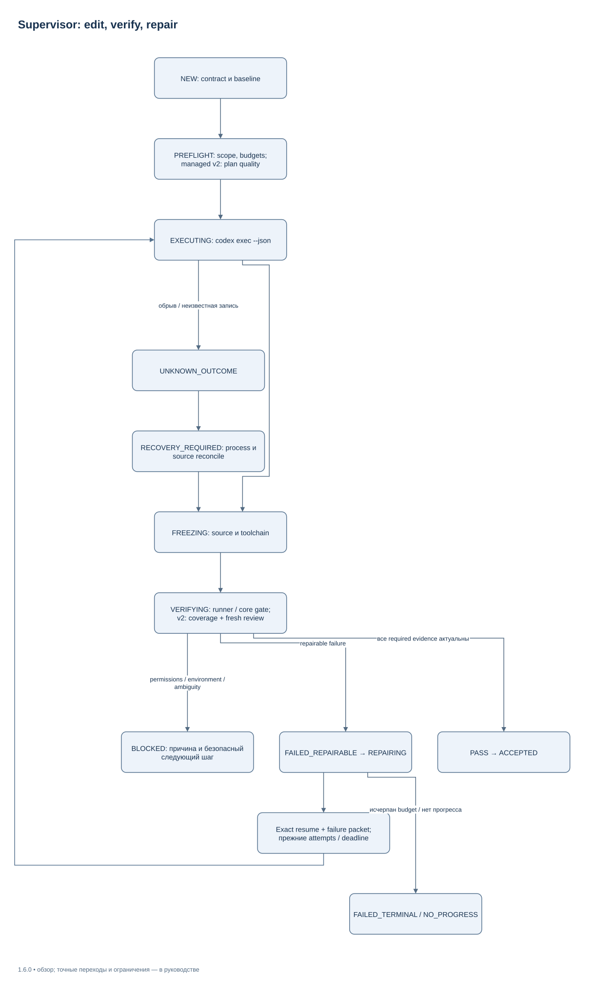
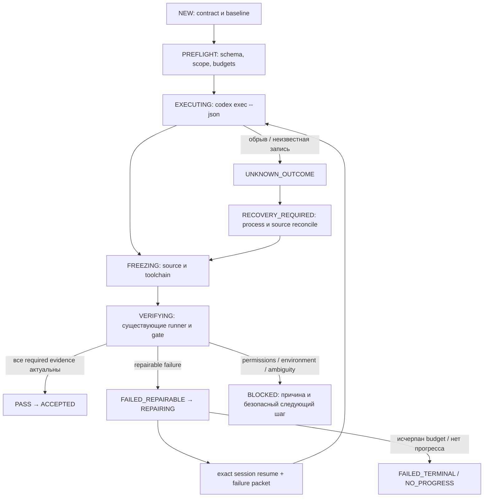

# Execution Supervisor — 1.5.1

[Индекс](INDEX.md) · [CLI](CLI_REFERENCE_RU.md) · [Форматы состояния](STATE_FORMATS_AND_MIGRATION_RU.md)

Supervisor выполняет локальный цикл «редактирование → снимок → независимая
проверка → исправление». Модель запускает установленный Codex CLI. Harness
не содержит дополнительный LLM API client, сервер или базу данных.

## Путь выполнения



[Редактировать в draw.io](diagrams/supervisor-repair.drawio) · [Все схемы](diagrams/README.md)

<details>
<summary>Mermaid source той же схемы</summary>



</details>

Это обзор основного пути. Допустимые переходы проверяет
[`supervisor.py`](../src/agent_harness/supervisor.py). Cancellation и timeout
могут прервать несколько фаз. Код выхода модели `0` и `turn.completed`
разрешают начать verification; они не означают accepted.

После model edit существующий `Run.freeze` фиксирует фактический candidate и
toolchain. `run_check` выполняет frozen argv, сохраняет receipts и logs.
`gate` проверяет scope, contract/attempt binding, актуальность source и evidence.
Во время frozen checks модельный writer не запускается на том же checkout.

## Контракт и запуск

Запускайте команды из package root. На Windows вместо `python` можно
использовать проверенный `py -3`; остальные аргументы одинаковы.
`TASK.yaml` и private run храните за пределами исходного проекта.

```yaml
schema_version: 1
task:
  id: fix-add
  objective: Исправить calc.add так, чтобы она складывала два числа.
  allowed_write_scopes:
    - calc.py
acceptance:
  - id: add-check
    kind: command
    required: true
    argv:
      - python
      - -c
      - "import calc; assert calc.add(2, 3) == 5"
    timeout: 30
budgets:
  max_attempts: 3
  max_concurrent_managed_agents: 1
  max_wall_seconds: 7200
  turn_timeout_seconds: 600
model:
  inherit_installed_codex_config: true
mode: native
memory: false
ledger: inform
```

Пример предполагает существующий Git checkout с `calc.py` и доступным Python.
Относительные argv исполняются из рабочего `cwd`. Для изолированного примера
выберите новую тестовую копию проекта. Не используйте production-файлы для smoke.

Внешние или ignored файлы, влияющие на acceptance, объявляйте в optional
`inputs`: объекты с абсолютным `path` и при необходимости `sha256`.
Эти ordinary files включаются в frozen evidence; изменение их bytes делает
прежнюю приёмку stale. Prompt получает объявленные inputs и исходные budgets.

```text
python tools/harness.py work start --contract TASK.yaml --cwd /absolute/repo --run-dir /absolute/private/run --state-dir /absolute/private/state
python tools/harness.py work status --run-dir /absolute/private/run --summary
python tools/harness.py work report --run-dir /absolute/private/run --format yaml
```

`work start` работает в переднем плане (foreground). Он не возвращает обещание
фонового выполнения и не создаёт daemon. Во втором терминале можно вызвать
read-only `work status` или `work watch`. `watch` по умолчанию проверяет локальное
состояние раз в 2 секунды, имеет timeout 3600 секунд и печатает новые generations.
Он не делает модельных запросов.

Все команды поддерживают `--help`. Для start/resume статус `ACCEPTED` даёт exit 0,
неуспешный результат — 1, обработанная ошибка — 2. Status/report требуют оценки
полей ответа: успешное чтение состояния не подтверждает его приёмку.

## Repair и восстановление

Initial edit учитывается как первая model attempt. Default — максимум три
попытки; повтор или restart не повышает исходные лимиты и не переносит deadline.
Failure classifier различает code/test, environment, permission, ambiguity,
stale evidence и unknown outcome. Одинаковая ошибка при неизменном snapshot в
последовательных попытках завершает цикл как `NO_PROGRESS`.

Исправимый `turn.failed` проходит `EXECUTING → FAILED_REPAIRABLE → REPAIRING`,
а не пропускает допустимый переход. Он расходует исходный attempt budget,
сохраняет signature/snapshot в failure history и требует точный session ID.
Отсутствие usage у такой попытки также учитывается при token budget.

Repair передаёт compact failure packet в `codex exec resume <exact-id>`.
`resume --last` не используется. Thread ID сохраняется при `thread.started`,
process identity включает PID и creation identity. На Windows используется
существующее process-tree containment; на POSIX — process group.

```text
python tools/harness.py work stop --run-dir /absolute/private/run --reason "owner requested stop"
python tools/harness.py work resume --run-dir /absolute/private/run
python tools/harness.py work resume --run-dir /absolute/private/run --repair-journal
```

`stop` записывает cancel request. Foreground owner завершает свой точный процесс
с grace period и контролируемым terminate; неизвестные записи требуют reconcile.
`resume` сверяет locks, process/session и фактическое дерево, затем проверяет его
до следующего model edit. Два конкурирующих resume не получают двух writers.
`--repair-journal` предназначен только для доказанно оборванного последнего
append: архив сохраняется, complete corrupt record не отбрасывается молча.

Terminal task не переоткрывается автоматически. Явная новая попытка использует
`work resume --new-attempt "причина"` и сохраняет прежние пределы. Accepted
candidate повторно проверьте через `work status --verify-evidence`.

### Входы и бюджеты при восстановлении

`inputs` допускает до 128 typed ordinary-file refs. Если check зависит от
ignored config или внешнего fixture, объявите его явно; снимок Git не выводит
такие зависимости из argv. Optional SHA-256 проверяется вместе с текущими bytes.
Явный check cwd должен быть внутри source checkout. В managed mode внутренние
абсолютные argv/report paths привязываются к staging; embedded исходный path
в строке кода отклоняется вместо проверки другого дерева.

`--new-attempt` не увеличивает max attempts, не переносит исходный deadline и
не обнуляет reported tokens. Для terminal task с исчерпанным budget нужен новый
явно разрешённый контракт. При неизвестном usage после controller interruption
и заданном `max_tokens` supervisor требует reconciliation и не продолжает вслепую.

Раннее восстановление managed run сначала создаёт/проверяет staging, и только
затем связывает с ним acceptance core. Проверяемый cwd, workspace lock и
отчёт обязаны описывать один candidate. Уже сохранённый core от другого cwd
не переназначается молча: такая история требует явной reconciliation;
`work status --verify-evidence` не подтверждает её как актуальный PASS.
После устранения managed environment blocker повторный resume возвращается
через `PREFLIGHT`: suppression proof, чистота ещё не скопированной исходной
рабочей копии и прежние бюджеты проверяются заново.

## Что видно пользователю

Status показывает phase, attempt/max, число подтверждённых required criteria,
reason, точный session ID, actual candidate cwd и `evidence_current`.
Это число критериев, не процент усилий и не ETA. Report дополняет его локальными
счётчиками wall-clock, turns, reported token usage, repairs и integration.
Отсутствующий usage остаётся `unavailable`/`null`; скрытые инструменты Codex
не превращаются в наблюдённые tool calls.

Полным usage считаются одновременно `input_tokens` и `output_tokens` как
целые неотрицательные числа; `0/0` допустим, `{}`, пропущенное поле и boolean —
нет. Частично наблюдённые counts сохраняются как частичные, не дополняются
выдуманными нулями. При `max_tokens` неполнота блокирует следующий spawn и
приёмку. Для старой истории действует отдельная
[граница accounting v2](STATE_FORMATS_AND_MIGRATION_RU.md#полнота-usage-после-аудита).

Token budget проверяется на границах model turns: CLI не предоставляет hard
limit для скрытого inference внутри turn. Неизвестный usage после interruption
не разрешает новую попытку или приёмку при заданном token budget. Spawn latency
измеряется отдельно от времени ожидания глобального slot.

Полные результаты находятся в private `verification/`, `codex/`, `journal/`;
человеческая сводка — `reports/summary.md`, handoff — `context/handoff.yaml`.
Дополнительные ограничения режима managed описаны в
[Dynamic Agents](DYNAMIC_AGENTS_RU.md).
