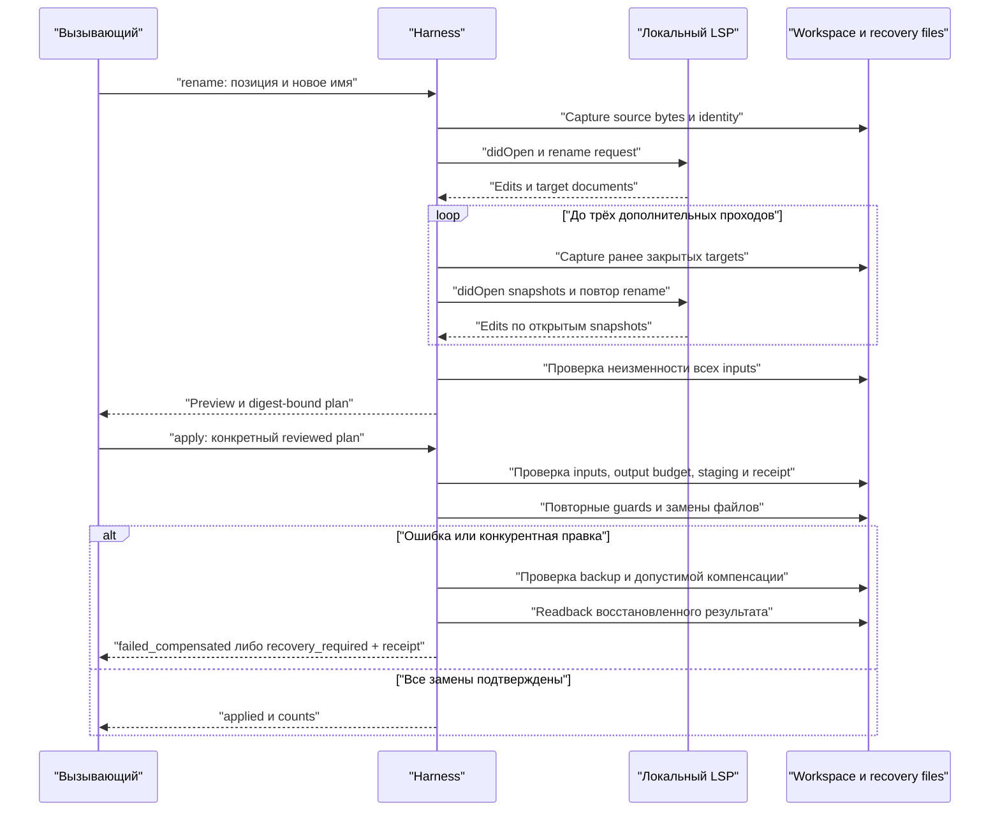

# Локальная навигация по коду и переименование — 1.4.2

`agent-harness code` запускает установленный language server на время одного
вызова. Доступны symbols, definition, references и переименование через
проверяемый план. Сервис, база данных и постоянный индекс harness не создаются.
Серверы не входят в Python-пакет и не устанавливаются автоматически.

Полный каталог flags/exit codes — [CLI reference](CLI_REFERENCE_RU.md#lsp-code).
Для выбора между `rg`, heuristic RepoMap и semantic LSP см.
[контекст](CONTEXT_AND_NATIVE_RU.md#что-выбрать). Результат language server не
обещает полноту проекта без корректных dependencies/configuration.

## Команды

```sh
agent-harness code doctor --root . --file lib.py
agent-harness code symbols --root . --file lib.py
agent-harness code definition --root . --file main.py --line 3 --column 9
agent-harness code references --root . --file lib.py --line 1 --column 5
agent-harness code rename --root . --file lib.py --line 1 --column 5 \
  --new-name welcome --output ../rename-plan.json
agent-harness code apply --root . --plan ../rename-plan.json
```

| Команда | Специальные параметры | Default / результат |
| --- | --- | --- |
| `doctor` | root, file, server, language, max-bytes | root=`.`; inventory, servers_started=0 |
| `symbols` | root, file | Document symbols; позиции запроса не нужны |
| `definition` | root, file, line, column | Location/LocationLink и SHA target |
| `references` | То же, optional exclude-declaration | includeDeclaration=true |
| `rename` | То же, new-name, optional output | Только preview; полный plan отдельно от wrapper |
| `apply` | root, plan, optional max-bytes | Без LSP-сервера; reviewed text edits |

У query defaults: timeout=20 секунд, max-bytes=8192. Optional server — JSON argv,
settings — JSON object, language — строка. Doctor/apply не принимают query-only
flags. Для source checkout замените prefix `agent-harness` на
`python tools/harness.py`; в PowerShell JSON quoting удобнее задавать через
переменную или вызывать Python subprocess с argv.

`--file` — относительный POSIX-путь внутри выбранного root. `--line` и
`--column` начинаются с 1. Column считает Unicode code points, не байты и не
UTF-16 units: emoji занимает одну пользовательскую колонку. На проводе позиции
преобразуются в UTF-16 согласно LSP. Смещение внутрь surrogate pair, за пределы
строки или внутрь UTF-8 символа отклоняется. CRLF и UTF-8 BOM сохраняются.

References по умолчанию включает объявление. `--exclude-declaration` передаёт
серверу соответствующий параметр. Определения и ссылки вне root не читаются;
ответ содержит число `outside_workspace_omitted`.

`doctor` проверяет доступность исполняемых файлов и known npm package metadata,
не запускает серверы и не объявляет runtime capabilities проверенными.

## Серверы

| Исходники | Автоматический выбор из PATH |
| --- | --- |
| Python `.py`, `.pyi` | `pyright-langserver --stdio`, затем `pylsp` |
| Rust `.rs` | `rust-analyzer` |
| TypeScript / JavaScript | `typescript-language-server --stdio` |
| C / C++ | `clangd` |
| Go `.go` | `gopls` |

Для явного выбора передайте argv в JSON:

```sh
agent-harness code symbols --root . --file lib.py \
  --server '["pyright-langserver","--stdio"]' --timeout 30
```

Команда запускается без shell. Для стандартных npm `.cmd`/`.bat` wrappers
`pyright-langserver` и `typescript-language-server` harness находит соседний
локальный или global-prefix `node_modules`, читает ограниченный `package.json`,
проверяет `bin` внутри пакета и запускает `node` с JS-файлом напрямую. Неизвестные
shell wrappers требуют явного executable + script argv. Для другого языка
можно указать `--language` вместе с `--server`.

Сервер получает root/workspaceFolders и точное содержимое открываемого файла.
Настройки проекта продолжает читать сам сервер. Необязательный `--settings`
принимает JSON object для LSP `workspace/configuration` и
`workspace/didChangeConfiguration`; например, поддерживаемые выбранным сервером
параметры анализа Python. Это не меняет Codex config, модель или permissions.

Локальный сервер — доверенная программа с правами запустившего пользователя.
Ограничения путей harness не являются OS sandbox для самого сервера.

## Готовность и точность результата

После initialize клиент открывает документ, выполняет documentSymbol barrier
при наличии capability и ограниченно ожидает завершения сообщённых progress
операций и периода тишины. Это полезнее одного initialize, но универсального
сигнала «весь проект полностью проиндексирован» в этом клиенте нет.
`readiness.complete_index_verified` поэтому остаётся `false`.

Результат навигации приходит от language server, включает хэши прочитанных
целевых файлов и повторную проверку их неизменности. Если ответ указывает на
закрытый файл, клиент захватывает его содержимое, отправляет didOpen и повторяет
запрос; старые диапазоны не связываются с новым SHA. Набор целей должен
стабилизироваться за три дополнительных прохода. Покрытие зависит от сервера,
его версии, конфигурации, зависимостей и границ workspace. Harness не заменяет
недоступные semantic references текстовым поиском под тем же названием. Если
сервера или capability нет, команда завершается с actionable ошибкой и code 2.

## Preview и применение rename

Обычный `code rename` не изменяет исходники. При появлении edits для закрытых
файлов клиент сначала захватывает их содержимое, отправляет didOpen, затем
повторяет rename. Набор затронутых файлов должен стабилизироваться за три
дополнительных прохода. Все захваченные файлы снова проверяются перед выдачей
плана.

Полный план содержит root binding, SHA-256, идентичность каждого исходного
файла, byte ranges и replacement text, хэши ожидаемых результатов и общий
digest. Он не содержит полных копий исходников. Digest проверяет целостность,
но не является подписью или отдельным разрешением на запись.

`--output` сохраняет полный план **вне root**, только по явному запросу,
без перезаписи существующего файла. `apply --plan` принимает именно этот файл.
Если полный план помещается в stdout, он также присутствует в поле `plan`;
внешняя оболочка ответа не является форматом plan-файла.



Loop выполняется только для обнаруженных неоткрытых targets; при нестабильном
наборе клиент отклоняет preview. После выдачи плана сессия LSP закрывается;
последующий apply работает с plan-файлом и текущими bytes, не повторяет semantic
анализ. Поэтому перед применением нужно проверить сам proposed rename и scope.

Apply проверяет весь план и все входы до замены первого файла, берёт общий
workspace lock для других harness apply, готовит временные файлы, сохраняет
recovery receipt и повторяет проверку перед каждой заменой. POSIX замены
привязаны к открытым дескрипторам каталогов. Замена каждого файла атомарна на
поддерживающей это файловой системе; **вся группа файлов не является глобально
атомарной**. Lock не блокирует редакторы и сторонние процессы; между последней
проверкой и OS-вызовом остаётся предел файловой системы без compare-and-swap.

При ошибке уже применённые файлы восстанавливаются, только если всё ещё
совпадают с записанным результатом. Обнаруженные конкурентные правки сохраняются.
Перед компенсацией проверяются тип, идентичность, размер, SHA и поддерживаемые
метаданные backup; после замены результат перечитывается. Повреждённый backup
оставляет `recovery_required`, а не запись об успешном восстановлении.
Возможные статусы:

| Статус | Значение |
| --- | --- |
| `applied` | Все замены подтверждены; обычно staging/backups очищены, возможные cleanup_warnings отражаются отдельно |
| `no_changes` | План не меняет содержимое файлов |
| `failed_compensated` | Операция не завершена; выполненные замены компенсированы |
| `recovery_required` | Не все файлы можно безопасно восстановить; сохранены backups и receipt |

Последние два статуса дают exit code 2. При `recovery_required` сначала
прочитайте `recovery_receipt`, текущие файлы и указанные backup paths. Не
перезаписывайте обнаруженные изменения пользователя. При неожиданном завершении
процесса до компенсации receipt и staging могут остаться для ручного разбора.
Автоматического фонового восстановления и отдельной команды `code recover` нет.
Receipt — данные для разбора; перед ручным восстановлением сопоставьте path,
before/after SHA, state, фактические bytes и метаданные. Не запускайте apply того
же stale plan вслепую. Старый план после компенсации
может стать stale из-за изменившейся идентичности файлов; создайте новый preview.

Даже при `--max-bytes 1024` ответ apply сохраняет фактический `status`, digest,
число файлов/edits/conflicts и `recovery_receipt`, если он есть. Подробная
диагностика сокращается до оставшегося бюджета, с учётом UTF-8 и CRLF. Если
минимальный ответ с точным recovery path не помещается, apply отклоняется до
staging и записи исходников; увеличьте `--max-bytes`.

## Метаданные и ограничения файлов

- Запрещены credential/generated paths по общей политике source context,
  symlink/reparse components, выход за root, бинарные и не-UTF-8 файлы.
- Rename работает только с существующими regular files с одной hard link.
  Create/delete/move resource operations, annotated edits, повторные документы
  и overlapping/ambiguous edits отклоняются.
- На Linux сохраняются mode, executable bits, uid и gid. Файлы с xattrs/ACL
  или специальными platform flags отклоняются до записи. Убирать эти метаданные
  ради команды не нужно: используйте редактор, который их сохраняет.
- На Windows staging получает DACL исходного файла до записи содержимого;
  публикация через `ReplaceFileW` не включает флаги игнорирования ошибок ACL.
  Legacy/modern inheritance обрабатываются отдельно; exact DACL readback нужен
  до записи staging и после замены. Неизвестный исход даёт `recovery_required`
  с backup, даже при неизменных bytes/stat. Native API сохраняет поддерживаемые
  attributes и streams. Изменение
  владельца, SACL и все особенности сторонних файловых систем не обещаются.
- Безопасное применение metadata в этой версии ограничено Linux и Windows.
  На других POSIX-платформах navigation доступна; для rename используется явный
  отказ до изменений вместо неподтверждённого сохранения ACL.

## Лимиты и завершение процесса

`--timeout` задаёт общий бюджет LSP-сессии: по умолчанию 20 секунд,
допустимо 0,1–120. Завершение добавляет короткую попытку shutdown/exit, затем
принудительное завершение дерева и ожидание процесса. POSIX использует отдельную
process group, Windows — private kill-on-close Job Object. Серверные requests
configuration/progress обрабатываются, а `workspace/applyEdit` отклоняется.

Stdout выдаёт компактный UTF-8 JSON. `--max-bytes` по умолчанию 8192,
диапазон 1024–262144; лимит включает JSON escaping и до двух байтов финального
CRLF. При усечении остаются `total_items`, `returned_items`, `truncated`.
Усечённый rename preview не выдаёт частичный объект под видом полного плана:
`plan_included=false`; сохранённый через `--output` план остаётся полным.

Другие лимиты: 8 MiB на исходный файл, 64 MiB на захваченные navigation inputs,
64 MiB суммарных before/after bytes rename, 256 файлов, 10000 edits/items,
16 MiB на RPC frame и plan-файл, 64 MiB на входящий RPC stream. Stderr постоянно
дренируется; в памяти остаётся до 64 KiB, в ответе — только byte count и признак
усечения. Это ограничения входа и буферов, не общий лимит RSS или OS sandbox.

## Проверки и происхождение

`tests/test_lsp_safety.py` дополнительно проверяет закрытые targets, нестабильный
набор, late edit, повреждённый/подменённый backup, readback восстановления и
минимальный recovery output budget; `tests/test_packet_safety.py` — bounded
packet input, FIFO/raced FIFO и изменение во время чтения.

`tests/test_lsp.py` проверяет настоящий stdio протокол через локальный fixture
server: configuration requests, прогресс, Unicode, таймауты, blocked stdin,
stderr, cleanup дерева, JSON/CRLF budget, сохранение планов, stale inputs,
symlink race и компенсацию IO/concurrency ошибок. Windows-only проверка сравнивает
DACL после normal apply и compensated failure.

Опциональный integration test запускает установленный Pyright при явно заданном
`HARNESS_TEST_LSP_SERVER` (JSON argv): cross-file references, rename preview,
apply и definition после изменения. Без этой переменной тест помечен skipped,
а semantic runtime не считается проверенным.

Архитектура локальных symbol tools вдохновлена
[Serena / SolidLSP](https://github.com/oraios/serena/tree/ede329aaf0c824bea75455a2926f01420d7aa620).
Здесь самостоятельная stdlib-реализация LSP-клиента; исходники Serena и SolidLSP
не копировались и не включены в поставку. Устанавливаемые пользователем серверы
сохраняют собственные лицензии.

Первичные спецификации:
[LSP 3.17](https://microsoft.github.io/language-server-protocol/specifications/lsp/3.17/specification/),
[WorkspaceEdit](https://github.com/microsoft/language-server-protocol/blob/gh-pages/_specifications/lsp/3.17/types/workspaceEdit.md),
[ReplaceFileW](https://learn.microsoft.com/en-us/windows/win32/api/winbase/nf-winbase-replacefilew).
