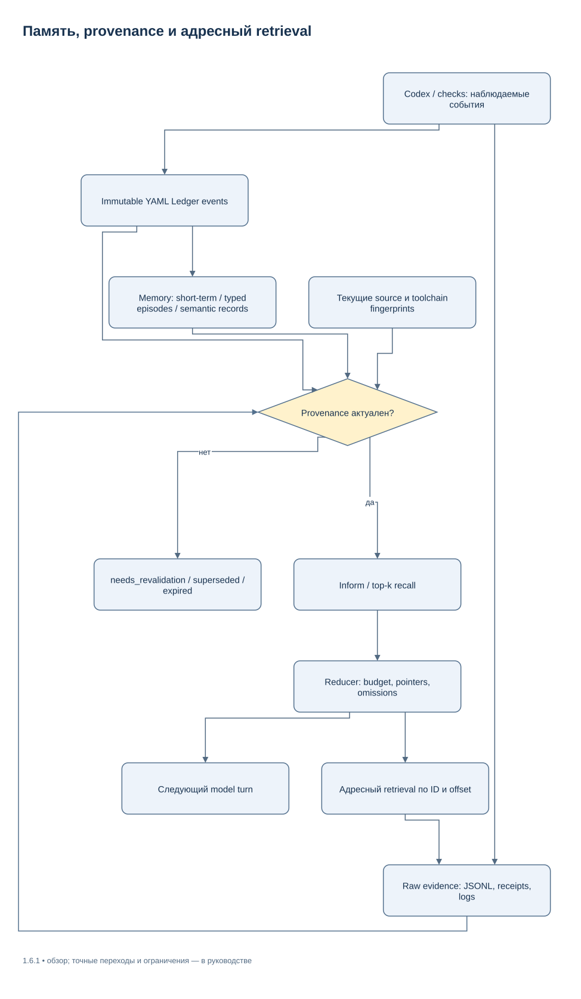
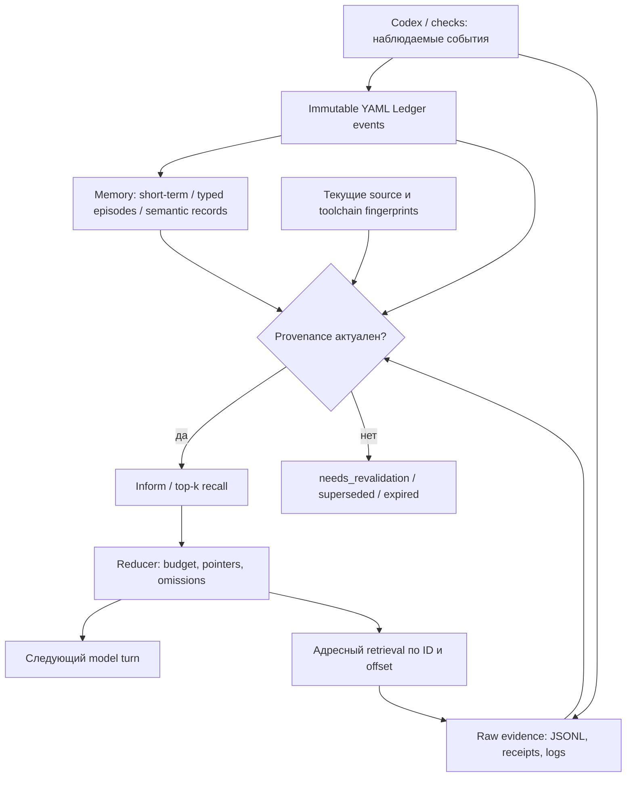

# Ledger, память и контекст — 1.6.0

[Supervisor](EXECUTION_SUPERVISOR_RU.md) · [CLI](CLI_REFERENCE_RU.md) · [Оценка](PERFORMANCE_EVAL_RU.md)

Ledger хранит проверяемые наблюдения о выполнении. Память переносит нужные
наблюдения между этапами одной repository identity. Reducer ограничивает
пакет, который возвращается модели. Их состояние остаётся локальными файлами;
vector DB, embeddings, listener и обязательный JS runtime отсутствуют.



[Редактировать в draw.io](diagrams/memory-provenance.drawio) · [Все схемы](diagrams/README.md)

<details>
<summary>Mermaid source той же схемы</summary>



</details>

Для локального native-чата доступен [компактный session adapter и SessionStart hook](NATIVE_SESSION_RU.md).
Hook упаковывает уже полученный reducer packet в поддержанный клиентом JSON
`hookSpecificOutput.additionalContext`. Полный serialized UTF-8 budget включает
escaping и CRLF; optional omissions ведут к сохранённому пакету, обязательная
часть не обрезается. Bootstrap scope обычного SessionStart без agent-полей
не меняет исходную unknown/unbound identity observer.

## Provenance и свежесть

Запись связана с local repository identity, revision, whole-tree snapshot,
file hashes и при необходимости toolchain digest. Identity использует
канонический локальный путь репозитория/Git common directory. Собственные
worktrees одного репозитория могут разделять namespace; другой clone или проект
с тем же именем не получает память автоматически.

Проверка консервативна: смена revision, branch, snapshot или объявленных
dependencies требует revalidation. Один Git SHA не подменяет dirty/untracked
source bytes. `provenance_for` ограничивает подробный file inventory и явно
сообщает `omitted_file_count`; whole-tree digest остаётся привязкой всех входов.
Для file/symbol event payload digest должен совпасть с объявленным file digest.

Только `valid` поступает в verified facts. `needs_revalidation`, `superseded`,
`rejected` и `expired` остаются историей. Verified episode содержит
`evidence_refs` с ID, path и SHA-256 исходных receipts; повторный recall проверяет
эти bytes. Изменившийся или исчезнувший receipt не подтверждает старый вывод.
Заявленные `evidence_ids` и ID в `evidence_refs` обязаны совпадать точно и без
дубликатов; каждая ссылка проверяется. Старые записи с неполным покрытием
остаются читаемыми, но при recall получают `needs_revalidation`.
Память — недоверенные данные: найденная инструкция отключить tests не получает
policy authority и не расширяет permissions.

## Ledger: inform и advisory govern

[`execution_ledger.py`](../src/agent_harness/execution_ledger.py) поддерживает
typed events `file_read`, `symbol_examined`, `command`, `check`, `failure`,
`repair_hypothesis`, `decision`, `state_transition`. Authoritative events
неизменяемы; `index.yaml` можно пересобрать.

Inform добавляет компактные актуальные факты, unresolved failures, examined
files и stale counters. Passed check без доступного content-bound evidence
не выдаётся за текущую independently verified проверку.

Govern возвращает `allow`, `suggest_reuse`, `deny_unsafe`,
`requires_revalidation` или `unknown`. Возможность повторного использования
`rg` требует одинакового запроса, purpose, полного input closure,
toolchain/config/env fingerprints и неизменного сохранённого результата.
Новый файл инвалидирует даже прежнее «не найдено».
`inform` и `govern` применяют одну проверку действительности: явный отзыв,
`supersedes` и статусы rejected/expired/needs_revalidation исключают reuse
даже при совпадении command fingerprint и неизменных исходниках.

Git status/diff/index, время, сеть, package install, неизвестные side effects,
edit/commit/publish/delete/send/process control не подавляются по старому PASS.
Вызывающий код может принудительно запросить fresh read для новой цели.
Проверки acceptance по умолчанию выполняются заново; отдельный
[`CheckCache`](../src/agent_harness/check_cache.py) требует явного allowlist,
полного proof. Cache v3 допускает только изолированные literal Python probes
через текущий interpreter с `-I -S`: constant print либо чтение относительного
UTF-8 файла и сравнение с константой. Произвольные tests, imports и opaque
commands не кэшируются. Перед записью и чтением proof заново проверяются source,
binary и environment; physical closure включает hidden/ignored inputs.
Неполная closure, links, special files и превышение bounds дают miss.
Final runner/gate остаются authority и выполняют обязательные проверки заново.

Дополнительно требуется доказанная startup/runtime closure. Текущая optional
policy поддерживает только отдельный Windows bundle с matching trusted Python
binary, конечным набором local runtime DLL, единственным relative ZIP в
versioned `._pth` и проверенными stdlib modules. Проверяются и bytes, и отсутствие
alternate `._pth`/`pyvenv.cfg`. Обычные global/venv/POSIX interpreters не дают
полного доказательства и не кэшируются. Ничего устанавливать для acceptance
не требуется: unsupported случай выполняется заново. Эта граница покрыта
реальным positive bundle и изменениями startup config, DLL и ZIP.

| Proof | Текущие конечные bounds | При превышении |
| --- | --- | --- |
| Physical input closure | 256 files, 128 directories, 1 MiB/file, 8 MiB total, 2 s | `requires_revalidation` / cache miss |
| Optional Windows runtime closure | 16 files, 16 MiB/file, 32 MiB total, 5 s | Cache proof отклоняется |

Physical inventory проверяет bytes и перечень entries, включая hidden/ignored
и Git administration; новый файл также инвалидирует прежнее отсутствие match.
Это намеренно узкая возможность для маленьких контролируемых probes. Она не
обещает cache arbitrary repository, test suite или runtime, установленного извне.

Для контролируемого `rg` reuse нужны явные `--no-config --no-ignore-parent
--no-ignore-global --no-ignore-vcs`, разрешённые search flags и относительные
пути внутри cwd. Govern не дописывает flags сам. Внешние paths, stdin,
`--hidden`, `--no-ignore`, `--follow` и неизвестные flags требуют fresh execution.

**Граница интеграции:** supervisor не перехватывает все встроенные tools Codex.
Govern является advisory для этих tools. Значение contract `ledger: govern`
не создаёт глобальный hook или OS sandbox. API govern может обслуживать явно
контролируемые вызовы; count suppressed не равен доказанной экономии токенов.

```text
python tools/harness.py work ledger show event-ID --run-dir /absolute/private/run --offset 0 --limit 4096
python tools/harness.py work ledger rebuild --run-dir /absolute/private/run
```

ID берётся из сохранённого event или inform packet. `show` возвращает bounded
UTF-8 fragment, content digest, total bytes и `next_offset`. Следующая страница
использует возвращённый offset; произвольный offset внутри UTF-8 символа
отклоняется. Возвращённый текст помечен как untrusted observation.

Secret guard не считает весь длинный путь к собственному журналу единым
opaque token: для отдельного структурированного значения, подтверждённого
как существующий обычный абсолютный local path, проверяются компоненты.
Known credential patterns и значения credential environment variables
проверяются во всех строках, включая декодированные JSON escapes и paths.
Имя поля `path` не даёт обхода. Links/reparse, неизвестные или несуществующие
path-like строки, UNC и длинные opaque components не получают исключения.
Настоящий отказ Ledger остаётся явной ошибкой; checkpoint завершения модели
сохраняется до этой вспомогательной записи.

При неуспешной acceptance-проверке компактная диагностика не записывается в
Ledger как вложенная JSON-строка. Она сохраняется отдельным неизменяемым YAML
packet; событие содержит краткий факт, pointer и digest этого packet. Содержимое
проверяется до записи, поэтому ссылка на безопасный файл не скрывает секреты
внутри него. Следующая repair-попытка получает прежнюю краткую диагностику;
полные журналы не размножаются в контексте. Повторные проверки создают отдельные
packets и не перезаписывают прежние evidence.

Только этот путь acceptance явно разрешает распознавание абсолютных путей
в двух формах диагностики: Python traceback и compiler location с line/column.
Путь должен существовать, быть обычным local path без links/reparse и находиться
внутри текущего candidate либо private run. Проверяется каждый его компонент,
а весь исходный текст сначала проходит known/environment credential checks.
Это временное представление для entropy-проверки: сохранённый текст не меняется.
Неизвестные формы, произвольная prose/JSON-строка, URI, чужие roots и несуществующие
пути не получают исключения. Работа ограничена 64 diagnostic spans на packet;
общий `sanitized` без явного opt-in остаётся строгим. При выключенном Ledger
дополнительный packet и эта проверка не создаются.

## Три уровня памяти

| Уровень | Содержимое | Проверка актуальности |
| --- | --- | --- |
| Short-term | Goal, constraints, checkpoint, active task, failures, files, next step, exact session и reported budgets | Current provenance и handoff reconciliation |
| Episodic | Problem signature, hypothesis/fix/root cause, observed outcome, symbols, receipt refs, trust и expiration | Source/toolchain плюс evidence bytes; default top-k=3, допустимо 1–3 |
| Semantic | Architecture/decisions/conventions в YAML и derived Markdown, relation graph | Claim source, revision/digest, actor, confidence, last checked |

Default `memory` зависит от версии work contract: `false` для v1 и `true`
для v2. Явное значение сохраняется; `memory: false` отключает записи через
API `Memory`. Native session adapter отдельно вызывает `Memory(enabled=True)`. Search локален: signatures/tags/terms и bounded
ranking; неподтверждённые идеи возвращаются отдельно как
`historical_hypothesis`. Никакого автоматического cross-repo import нет.
Semantic records создаются явным API; supervisor не выдумывает архитектурные
решения из любого successful run.

```text
python tools/harness.py work memory show episode-ID --store /absolute/private/state/memory --repository-identity REPOSITORY_SHA256 --limit 4096
python tools/harness.py work memory rebuild --store /absolute/private/state/memory --repository-identity REPOSITORY_SHA256
```

`REPOSITORY_SHA256` — сохранённая identity, не текущий commit SHA. Rebuild
восстанавливает index, relations и derived docs из authoritative YAML records.
Повреждённый authoritative record требует диагностики; он не становится
достоверным через пересборку index.

## Context Reducer и выбор tools

[`context_reducer.py`](../src/agent_harness/context_reducer.py) объединяет
дубликаты с first/last occurrence и count. Большой successful log заменяется
status/exit/fingerprint/evidence ID/pointer. Failure status и signature
сохраняются; stale snippets не становятся verified facts. Пропуски и
`next_offset` явны. Required contract/constraints при превышении бюджета
вызывают отказ с требованием chunking вместо скрытой обрезки.

Default budgets заданы отдельно: file snippet, error packet, RepoMap, memory,
handoff, agent context и tool result. Они измеряются UTF-8 bytes с резервом
Windows CRLF; bytes не равны model tokens. Raw evidence хранится отдельно.
Reducer не изменяет скрытую native history или compaction Codex.

Начинайте с узкого `rg`/direct file lookup. Для неизвестных связей используйте
ограниченный Rust RepoMap; для semantic definitions/references — on-demand LSP.
Четыре engineering query возвращают version-bound paths/lines/ranks и paging:

```text
python tools/harness.py repomap related-tests --root /absolute/repo --target src/auth.py --revision HEAD
python tools/harness.py repomap trace-to-code --root /absolute/repo --trace-file /absolute/private/trace.txt --revision HEAD
python tools/harness.py repomap change-impact --root /absolute/repo --changed src/auth.py --revision HEAD
python tools/harness.py repomap symbol-context --root /absolute/repo --symbol validate_token --path src/auth.py --revision HEAD --use-lsp
```

`--revision` должен обозначать текущий checkout; для иной revision используйте
её worktree. Results связываются также с actual tree digest. Ranking не
гарантирует полноту import graph; dynamic links могут отсутствовать. Trace
парсится как данные и не исполняется. Отсутствующий/stale LSP даёт явно
heuristic fallback. Stale line ranges не являются основанием для rename/edit.

TOON остаётся optional input representation. Условия измерения и fallback
описаны в [Performance Eval](PERFORMANCE_EVAL_RU.md). Пользовательский
`model_auto_compact_token_limit=500000` эти механизмы не уменьшают.

## Разделение source, evidence и presentation

Версия 1.6.0 проверяет полный snapshot до compact details. Source-current
self-report выдаётся как current observation, verified facts требуют allowlisted
core verifier receipt и current evidence lifecycle. Typed namespace не выбирает
первую запись при bare-ID collision. Corrupt optional foreign record изолируется;
corrupt required own checkpoint блокирует recovery. Packets удерживают immutable
recordsets для omitted items, queries используют snapshot inventory и LF lines.
[Стабилизация](STABILIZATION_RU.md) · [CLI](CLI_REFERENCE_RU.md).

`Memory.record_file_fact` и `record_symbol_fact` используют закрытые deterministic
builders: physical root/project, reader policy, один полный ordinary file и
проверяемые negative dependencies. Symbol builder фиксирует Python parser version
и уникальность декларации. Изменение чужого файла не инвалидирует такой узкий
факт; его собственного input или parser policy — инвалидирует. Это не closure
поведения приложения. Facts читаются через typed kind `fact`.

Derived checkpoint index имеет scan/byte/deadline/returned/inventory caps,
generation-bound continuation и проверяет actual selected bytes. Corrupt index
перестраивается ограниченно, partial scan не называется complete inventory.
Private limits настраиваются явным CAS через `context-config`; реальные scan
metrics сохраняются в retrieval receipt. Default не обещает hard OS syscall latency.

Native handoff всегда удерживает текущие `goal`, `goal_digest`,
`goal_generation` и `constraints` в indivisible `required`, независимо от
source/evidence freshness. Digest — SHA256 точных UTF-8 bytes цели; session ID
связывает её с текущей задачей. Это advisory контекст, не новая authority.
Если обязательные данные с outer envelope не помещаются, операция явно
возвращает `BUDGET_TOO_SMALL`; увеличьте `--max-bytes`. Значение 2048 — допустимая
нижняя граница запроса, а не гарантия вместимости длинных целей и путей.

Session публикация сохраняет immutable `generation-N-DIGEST.json` с metadata и
checkpoint, затем durable `pending-generation.json`, checkpoint mirror и
committed head `session.json`. Head проверяет digest собственного checkpoint,
его goal generation и immutable generation bytes. Прерывание после pending
даёт `SESSION_RECOVERY_REQUIRED`, включая случай уже опубликованного head:
сохраните marker, generation и прежние records для диагностики и repair;
не удаляйте marker и не повторяйте side effects вслепую. Автоматический repair
этого состояния пока не предоставлен. `goal-update --operation-id ID` позволяет
повторить завершённую CAS операцию с исходным expected generation; новые входы
с тем же ID отклоняются. Replay также проверяет обязательный собственный checkpoint.
Replay допустим только при совпадении текущего source snapshot и сохранённого
полного post-commit proof Memory/Ledger/own/foreign observations; измеренное время
scan не является input. Изменение или incomplete proof даёт
`STALE_OPERATION_REPLAY`, сохраняя исходный receipt. Для актуального контекста
запросите новый handoff без старого operation ID. Старые receipts без полного
proof остаются immutable history и не переиспользуются как текущий handoff.
Memory proof требует явного списка ровно трёх уникальных scan observers:
`episodes`, `semantic`, `facts`, каждый с `complete=true`. Отсутствие, пустой
список, duplicate/unknown group или malformed observer не доказывает полноту.
Каждый replay также заново проверяет полный outer UTF-8 envelope по запрошенному
`--max-bytes`, включая вызов Python API; меньший бюджет не переписывает receipt.

Для отдельного разрешённого repair reconcile выполняется под `session.lock`:
сначала сверяются marker/generation digest и session/project binding, затем
head и checkpoint mirror с immutable committed generation. Если head остался
прежним, единственный rollback input — его immutable checkpoint; если head уже
новый, оба файла должны совпасть с pending generation. Любое третье состояние
или отсутствие bytes сохраняет блокировку. До снятия marker также проверяется
исход completed operation receipt и Ledger: неизвестную операцию не исполняют
повторно. Обычный resume эти repair writes не выполняет; без отдельного repair
допустима новая сессия с заново указанной разрешённой целью и сохранением всех
старых recovery records. Память сама не разрешает повтор неизвестных side effects.

Ledger проверяет exact uniqueness/membership derived index и filename/event-ID
binding всех authoritative events. Rebuild ограничен 10000 events, 32 MiB actual
read bytes и cooperative deadline 5 s на scan/read phase; corrupt authoritative
event даёт `LEDGER_EVENT_CORRUPT`, превышение — `LEDGER_SCAN_BOUND`.
Python symbol verifier обходит AST итеративно (100000 nodes); optional parser
или verifier failure даёт unknown и никогда verified fact.
Core executable identity использует общий с runner streaming `file_hash`,
без отдельного лимита 16 MiB, с повторной проверкой фактических bytes.

RepoMap fallback без `rg` отражает пропущенные source bytes/encoding/reads в
typed `skipped_sources`, `truncation_reasons`, `results_complete=false` и
`total_results=null`. Source bound — 262144 bytes; counts относятся к увиденным
результатам, не к неизвестному полному множеству. POSIX snapshot явно отклоняет
`//...` root как `UNSUPPORTED_ROOT_SPELLING` до выбора backend/inventory;
используйте один начальный slash. Windows UNC spelling сохраняется; no-follow
граница не заменяется разрешением symlinks.
