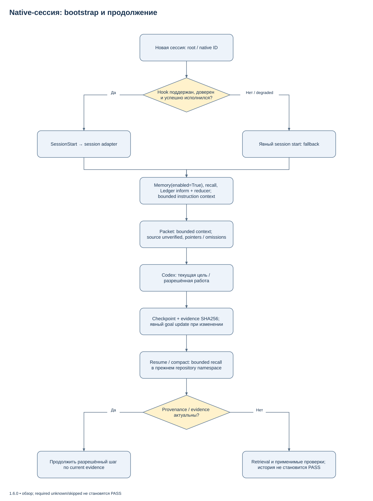
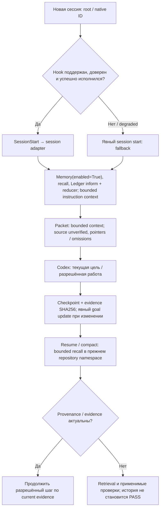

# Native-сессии без ручного bootstrap

`python tools/session.py start --root <cwd> --goal <короткая цель>` вызывает
настоящие `Memory(enabled=True)`, recall, Ledger inform и Context Reducer без
модели и supervisor. Wheel устанавливает entrypoint `agent-harness-session`.
Private state выбирается по `$CODEX_HOME/harness-machine.json` (по умолчанию
`~/.codex`); содержимое source, prompt и transcript в заметки не копируется.

По умолчанию stdout содержит один структурированный JSON до 4096 UTF-8 bytes.
`--max-bytes 2048` уменьшает бюджет; обязательные ограничения не обрезаются.
Совместимая оболочка сохраняет `session`, `root`, `evidence` и `packet`.
`packet.required.raw_pointer` ведёт к полным результатам ограниченного retrieval и
SHA256 evidence, `packet.required.packet_pointer` — к сохранённому пакету. Пропуски и
stale counters явные. Bootstrap, checkpoint и govern используют ограниченную
привязку `bounded_context`: cwd/repository identity, revision и hashes файлов
AGENTS.md/AGENTS.override.md в цепочке предков. Обход дерева исходников и домашнего
каталога не выполняется. Память не является приёмкой.

Если длинные пути не помещаются, адаптер сначала убирает повторный digest из
`recordset_ref`: полный SHA256 уже содержится в `id` после `recordset-`.
Если этого недостаточно, вывод имеет форму `{"packet": ...}` без повторения
служебных полей. Маркер `packet.required.path_encoding = "base_relative_v1"`
означает, что `root`, `raw_pointer` и `packet_pointer` заданы относительно
единственного абсолютного `packet.required.path_base`. Python helper
`native_session.packet_path(packet, field)` читает обе формы и запрещает выход
за базу. Обязательные goal, constraints и identity hashes остаются в пакете;
реальная нехватка бюджета возвращает `BUDGET_TOO_SMALL`. Старые абсолютные
адреса, ссылки recordset, checkpoints и operation receipts продолжают читаться.
Если проект и private state находятся на разных дисках, маркер
`service_relative_v1` оставляет `root` абсолютным, а `path_base` указывает
каталог native-сессии; относительно него заданы только служебные pointers.

После существенного результата:

```sh
agent-harness-session checkpoint --session <native-ID> --note 'Проверено поведение' --next 'Ревью' --evidence <receipt.json>
```

Для явно контролируемого вызова `govern --session <ID> --argv-json '["rg","symbol"]'
--effect read_only` возвращает advisory-решение без исполнения команды.

## Ограничения bootstrap context

Проверяется до32 каталогов текущего cwd и его предков, только два явно заданных
instruction-файла в каждом; до64KiB на файл и256KiB суммарно. Сохраняются hashes,
статусы отсутствия/недоступности и явные omissions. Пути предков представлены
компактно через `context_path_encoding=ancestor_relative_v1`; это metadata scope,
а не разрешение читать произвольные пути. Глобальный Codex config и инструкции
вне этой цепочки в bounded proof не входят; штатный клиент загружает их отдельно.

`inventory_complete=false` и `file_inventory_complete=false` относятся к source
inventory. `context_complete` описывает только заданные instruction-пути.
`source_inventory_not_collected` остаётся явным omission даже при полном context.
Смена instruction bytes или привязки cwd меняет context digest. Изменения других
исходников таким digest не подтверждаются.

Own checkpoint можно восстановить как недоверенное наблюдение с
`source_validity=unverified`. Bounded context не разрешает повторное использование
произвольных read/check результатов или признание source facts актуальными.
Неизменность core evidence проверяется отдельно; revoked evidence не возвращается
как текущее. Существующие full-snapshot записи читаются консервативно и требуют
source revalidation. Полные snapshot/check/gate и `verify-result` сохраняют
проверку фактического candidate; bootstrap не подменяет их приёмку.

## Жизненный цикл native-сессии



[Редактировать в draw.io](diagrams/native-session.drawio) · [Все схемы](diagrams/README.md)

<details>
<summary>Mermaid source той же схемы</summary>



</details>

## Автоматический запуск в локальном Codex

Штатный `install` создаёт управляемую группу SessionStart в `hooks.json`
рядом с активным `config.toml` и owned launcher `agent-harness-hook.py`.
Launcher запускает session adapter с JSON-событием на stdin. Не добавляйте
вторую группу вручную после установки: duplicate handler вызывает конфликт.
Порядок работы — install dry-run → install `--apply` → verify → `/hooks`,
trust команды и новый процесс Codex. Existing foreign hooks сохраняются.

Следующий JSON — **ручной fallback** для профиля без установленного managed
handler, а не дополнительный шаг обычной установки. Перед последующим
управляемым install стороннюю группу нужно явно принять через
`--adopt-hook-sha256 SHA256`; смысл hash и dry-run описаны в
[установке](../SETUP_RU.md#физические-границы-установки). Не создавайте
дубликат существующей группы.

```json
{
  "hooks": {
    "SessionStart": [{
      "matcher": "^(startup|resume|clear|compact|fork)$",
      "hooks": [{
        "type": "command",
        "command": "python3 /absolute/package/tools/session.py hook",
        "timeout": 30,
        "additionalContextLimit": 5000
      }]
    }]
  }
}
```

Замените путь реальным установленным package root; `python3` должен иметь Python
3.11+. Это явный пример команды, не новая настройка автозагрузки. Сначала сохраните
backup, затем в новом локальном Codex выполните `/hooks`, проверьте команду и
доверьте её штатным интерфейсом. Изменённое определение требует нового trust.
Проверьте сам запуск новым процессом: одних файлов и прямого вызова hook недостаточно.
Не включайте dangerous trust bypass и не редактируйте внутреннюю базу trust.

Hook получает только cwd/native session ID/source; цель bootstrap фиксирована,
поэтому не нужно сохранять prompt. Ближайшие checkpoint и bounded recall помогают
продолжению; конкретную цель и результат агент уточняет checkpoint в ходе работы.
Повторный resume/compact сохраняет уже записанный checkpoint и проверяет свежесть;
тот же native ID с другим cwd получает другой namespace. Hook не расширяет
полномочия, не перехватывает tools и не обещает hot reload. При успешном сообщении
`Harness bootstrap` агент использует переданный ID без повторного `start`.
Если hook отсутствует/не доверен/завершился ошибкой, применяется явный `start`.

Локальный hook не устанавливает hosted/cloud orchestration, другой `CODEX_HOME`
или чужое устройство. Уже открытый чат не доказывает загрузку новых hooks.
Никакие model/provider/effort, permissions или compaction settings не меняются.

## Контракты native-контекста в 1.6.1

Generic hook сохраняет explicit active goal; отдельный `goal-update` требует
expected generation. Checkpoint принимает устойчивый `--operation-id` для
повтора после broken pipe. Evidence note сохраняет typed refs; старый note
без current status chain остаётся observation.

Обычный SessionStart Codex с проверенными session ID, cwd и source, без agent-полей
и parent session, запускает bootstrap в локальном root scope. Это решение не
подставляет agent ID/type в observer: исходная unknown/unbound identity сохраняется.
Явные child/unknown/null type или parent без устойчивого agent ID возвращают
degraded; устойчивые child ID имеют отдельные namespaces. SubagentStart не заменяет
SessionStart. Явный `start` остаётся fallback. Наличие hooks.json не доказывает trust,
invocation или task acceptance. `status`, `intake`, `verify-result` и bounded
recordset retrieval описаны в [CLI](CLI_REFERENCE_RU.md) и
[контрактах стабилизации](STABILIZATION_RU.md).

CLI `hook` возвращает закрытый JSON `hookSpecificOutput` с
`hookEventName: "SessionStart"` и строкой `additionalContext`, содержащей
`Harness bootstrap` и native packet. Бюджет проверяет весь UTF-8 JSON, escaping и
резерв CRLF до записи stdout. При переполнении optional context заменяется явным
pointer на уже сохранённый полный packet; все `packet.required` и внешние
session/root/evidence сохраняются. Если обязательная часть не помещается,
возвращается валидный degraded-контекст `BUDGET_TOO_SMALL` с
`required_context: "not_delivered"`; обязательные поля не обрезаются и bootstrap
не повторяется для уменьшения вывода. Чистый `hook_packet` и CLI start/checkpoint
сохраняют прежний формат.

Новые observer/operation/bridge receipts v2 содержат actual package build digest
(Python, schemas, vendored runtime) и отдельный loaded producer digest. V1 readers
сохраняют unknown; новый schema marker не повышает trust старой записи.
`agent-harness-session status --root ROOT --session ID --verify-evidence`
сохраняет identity/coverage и recorded
verdict при потере linked core run, выдавая current acceptance unknown и stable
missing/unavailable reason вместо потери всего отчёта.
