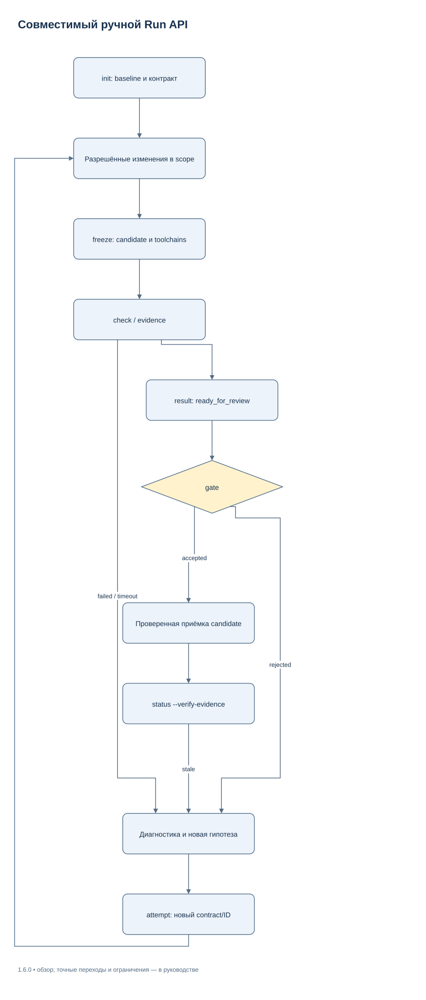
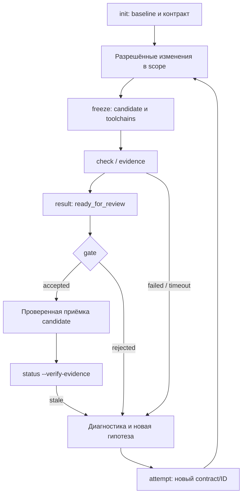

# Эксплуатация совместимого Run API — 1.5.1

Для foreground исполнения Codex используйте новый
[Execution Supervisor](EXECUTION_SUPERVISOR_RU.md): `work start/status/watch/resume/stop/report`.
Этот документ сохраняет совместимый ручной API `init/freeze/check/gate`.
Его JSON receipts не заменяются произвольной YAML-конвертацией.

Короткую самостоятельную задачу выполняйте напрямую. Сохраняемый Run полезен для
длительной, делегированной или возобновляемой работы с разрешённым сохранением.
CLI сохраняет контракт, inputs и evidence; native agents и внешние операции
остаются под управлением основного чата. Полный каталог флагов —
[CLI_REFERENCE_RU](CLI_REFERENCE_RU.md), условия принятия — [ACCEPTANCE](ACCEPTANCE.md).

В этом руководстве `Run` означает ручной JSON API. Автоматические managed
model sessions, Strict YAML state и staging worktrees принадлежат namespace
`work`; не подставляйте его `state.yaml` в legacy `Run`/MCP reader. Для обоих
путей required checks выполняются заново на принятом candidate.

## Последовательность работы

1. Выберите разрешённый workspace и приватный run store **вне source workspace**.
   Контракт задаёт цель, permissions, scope, applicable checks, бюджет и входы.
2. `init` сохраняет начальный baseline. Выполните разрешённые изменения в scope.
3. `freeze` фиксирует итоговый candidate и toolchain manifest. После него не
   меняйте candidate во время required checks/gate.
4. `check` выполняет frozen argv; `evidence` сохраняет другие виды доказательств.
   Owner может передать `result` со статусом ready_for_review.
5. Root вызывает `gate`. Только accepted verdict вместе с текущими inputs и
   evidence является основанием для инженерной приёмки.
6. `status --verify-evidence` сверяет сохранённую приёмку. Для продолжения
   сохраните checkpoint; после прерывания выполните reconciliation через resume.



[Редактировать в draw.io](diagrams/legacy-run.drawio) · [Все схемы](diagrams/README.md)

<details>
<summary>Mermaid source той же схемы</summary>



</details>

Это схема основного пути, не формальный конечный автомат всех полей state.
Например, evidence отдельно не повышает state до ready_for_review, а gate может
проверить complete checks без owner result. `result` не является обязательным
искусственным шагом для прямой работы root.

## Полный локальный пример

Пример ниже можно сохранить как `demo_run.py` **вне репозитория** и выполнить:

```text
python demo_run.py /absolute/path/to/agent-harness /absolute/new/private-demo
```

Скрипт переносим между Linux и Windows: использует только Python stdlib, прямой
argv и `sys.executable`. Первый аргумент — существующий полный source package;
второй — новый каталог, который скрипт создаст эксклюзивно. Реальный профиль Codex,
его config, модель, permissions и native threads не затрагиваются. Требуется
Python 3.11+; Git, Cargo и language server для этого примера не нужны.

Цель fixture — проверить механику проверки функции и сохранения доказательств.
Content assessment здесь честно описывает выполненное сравнение точных исходных
байтов; его нельзя переносить как содержательное review произвольного проекта.
Скрипт не печатает заранее придуманные digests или accepted: он проверяет реальные
ответы CLI и завершится ошибкой, если ожидаемый переход не состоялся.

```python
from pathlib import Path
import json
import subprocess
import sys

package = Path(sys.argv[1]).resolve(strict=True)
base = Path(sys.argv[2]).resolve()
base.mkdir(parents=True, exist_ok=False)
source = base / "source"
source.mkdir()
private = base / "private"
private.mkdir()
run_dir = private / "run"
cli = package / "tools" / "harness.py"

original = "def add(a, b):\n    return a + b\n"
(source / "calc.py").write_bytes(original.encode("utf-8"))
report = private / "unit-a1.json"
contract_path = private / "contract.json"

def save(name, value):
    path = private / name
    path.write_text(json.dumps(value, ensure_ascii=False, indent=2), encoding="utf-8")
    return path

def invoke(*args, expected=0):
    completed = subprocess.run(
        [sys.executable, str(cli), *map(str, args)],
        capture_output=True, text=True, encoding="utf-8", check=False,
    )
    if completed.returncode != expected:
        raise RuntimeError((args, completed.returncode, completed.stdout, completed.stderr))
    value = json.loads(completed.stdout)
    label = "-".join(str(arg) for arg in args[:1])
    save(label + "-last-output.json", value)
    return value

check_code = (
    "import importlib.util,json,sys; from pathlib import Path; "
    "spec=importlib.util.spec_from_file_location('fixture_calc','calc.py'); "
    "module=importlib.util.module_from_spec(spec); spec.loader.exec_module(module); "
    "assert module.add(2,3)==5; "
    "Path(sys.argv[1]).write_text(json.dumps({'passed':True}),encoding='utf-8'); "
    "print('PASS add')"
)
contract = {
    "schema_version": 1,
    "run_id": "local-demo",
    "task_id": "verify-add",
    "attempt_id": "a1",
    "workflow": "change",
    "process_level": "standard",
    "goal": "Verify the isolated add fixture and retain exact evidence",
    "cwd": str(source),
    "permissions": ["read", "write", "test"],
    "scope": {"write_paths": ["calc.py"], "exclude": ["__pycache__/**"]},
    "budget": {"max_attempts": 3},
    "checks": [
        {
            "id": "unit", "kind": "command", "required": True,
            "argv": [sys.executable, "-I", "-B", "-c", check_code, str(report)],
            "timeout": 10,
            "assertions": [{"stream": "stdout", "regex": "PASS add"}],
            "reports": [{"path": str(report), "format": "json", "equals": {"passed": True}}],
        },
        {
            "id": "source-observation", "kind": "content", "required": True,
            "criteria": ["exact_fixture"],
        },
    ],
}
save("contract.json", contract)
invoke("init", "--run-dir", run_dir, "--contract", contract_path)
frozen = invoke("freeze", "--run-dir", run_dir)
checked = invoke("check", "--run-dir", run_dir, "--check", "unit")
assert checked["status"] == "passed"

observed = (source / "calc.py").read_bytes().decode("utf-8")
assert observed == original
artifact = private / "observed-source.txt"
artifact.write_text("Compared calc.py with the exact documented fixture:\n" + observed, encoding="utf-8")
evidence_path = save("content-evidence.json", {
    "kind": "content", "status": "satisfied",
    "method": "agent_assessment", "assessor": "documentation-fixture",
    "assessment": "The script read calc.py and compared it with the explicit expected fixture.",
    "criteria": {"exact_fixture": "Exact source string equality was observed before recording evidence."},
    "artifact_paths": [str(artifact)],
})
invoke("evidence", "--run-dir", run_dir, "--check", "source-observation", "--record", evidence_path)
state = invoke("status", "--run-dir", run_dir)
owner_result = save("owner-result.json", {
    "run_id": contract["run_id"], "task_id": contract["task_id"], "attempt_id": "a1",
    "contract_digest": state["contract_digest"], "candidate_digest": frozen["candidate_digest"],
    "status": "ready_for_review", "summary": "Fixture check and source observation completed.",
    "limitations": "Local fixture only; no native agent, external service or visual assessment.",
    "next_safe_step": "Root can inspect artifacts and run gate.",
    "evidence_ids": ["unit", "source-observation"],
})
invoke("result", "--run-dir", run_dir, "--record", owner_result)
verdict = invoke("gate", "--run-dir", run_dir)
assert verdict["verdict"] == "accepted"
current = invoke("status", "--run-dir", run_dir, "--verify-evidence", "--summary")
assert current["evidence_current"] is True
invoke("checkpoint", "--run-dir", run_dir,
       "--note", "Exact fixture passed; evidence and actual verdict are retained.",
       "--next", "Read handoff, inspect actual files, then choose the next authorized task.")
invoke("handoff", "--run-dir", run_dir)

# A later source edit makes the old acceptance stale; it is not silently reused.
(source / "calc.py").write_bytes((original + "# changed after acceptance\n").encode("utf-8"))
stale = invoke("status", "--run-dir", run_dir, "--verify-evidence", expected=1)
assert stale["evidence_current"] is False
assert stale["recorded_status"] == "accepted"
contract["attempt_id"] = "a2"
contract["checks"][0]["argv"][-1] = str(private / "unit-a2.json")
contract["checks"][0]["reports"][0]["path"] = str(private / "unit-a2.json")
save("contract.json", contract)
invoke("attempt", "--run-dir", run_dir, "--contract", contract_path,
       "--reason", "Source comment changed after acceptance; freeze and checks must be repeated.")
print(json.dumps({"run_dir": str(run_dir), "verified_a1_verdict": verdict["digest"],
                  "a1_became_stale": True, "current_attempt": "a2",
                  "next_step": "Freeze and rerun applicable checks; a2 is not accepted."}, indent=2))
```

Все contract/evidence/result JSON остаются в выбранном private каталоге. Внутри
run находятся `contracts/`, `origin-baseline.json`, `attempts/a1/candidate.json`,
`toolchains.json`, `checks/*/result.json`, copied artifacts/logs, `gates/`,
`results/` и `checkpoints/`. Последний вывод явно различает реально принятую `a1`
и новую ещё не принятую `a2`. Повторный запуск требует нового каталога.

### Почему пример устроен так

`scope.write_paths` разрешает только calc.py; test reports и run store находятся
снаружи source. Иначе они загрязняли бы snapshot во время check. Исключение
`__pycache__/**` задано явно, а `-I -B` изолирует inherited Python injection и
не создаёт bytecode. Даже локальный subprocess исполняет код с правами пользователя;
contract permissions — процессный контроль работы, а не OS sandbox.

Report path уникален для попытки. JSON `passed:true` проверяется как boolean;
`passed:1` дал бы failed. Копирование настоящего артефакта обязательно и для
content; один текст «всё хорошо» без proof не является complete evidence.
Owner result связывается с реально возвращёнными digests, не с placeholders.

## Status, handoff и возобновление

| Запрос | Что проверяет | Чего результат не подтверждает |
| --- | --- | --- |
| `status` | Полный текущий source/input snapshot против candidate | Integrity уже сохранённых logs/reports: evidence_current остаётся null, пока не проверена accepted evidence |
| `status --summary` | Ту же проверку inputs, сокращённое представление | Экономию локального хеширования или стоимость токенов модели |
| `status --verify-evidence` | Accepted verdict, exact receipt set, artifacts, toolchains, dependencies, current source | Новый check/gate или доступность runtime клиента |
| `handoff` | Ограниченные сохранённые metadata/checkpoint bindings | Свежесть workspace; checkpoint current означает binding, не актуальные source bytes |
| `handoff --verify-evidence` | Metadata плюс текущий source/evidence путь | Native resume той же сессии |
| `resume` | Inputs, process identities, artifacts/checkpoint integrity, owners/unknown operations | Автоматическое продолжение или фактическое закрытие native threads |

`status`/`handoff` read-only. `resume` **изменяет state**: потерянный running
process помечается interrupted, незакрытые native owners требуют reconciliation;
при проблемах status становится blocked, accepted снимается. Живой процесс не
дублируют. Для native owners нужен новый реальный backend inventory; один локальный
PID/ref или запись idle не являются доказательством завершения.

## Попытки, locks и ошибки

`attempt` требует тот же run_id/task_id, новый уникальный attempt_id, reason и
валидный контракт. Старые contracts/checks/results/gates сохраняются по своим
каталогам. Для нового attempt требуются собственные freeze/checks/evidence.
Исходный scope baseline run сохраняется, поэтому новая попытка не узаконивает
ранее посторонние изменения. max_attempts/deadline не сбрасываются новым агентом.
Две одинаковые failed signatures и прежняя reason требуют новой диагностики.

Переход attempt берёт leases старого и нового workspace/namespace в стабильном
порядке, затем state lock. Поэтому старая команда не может стартовать после
перехода на read-only contract; непосредственно перед spawn contract/attempt
повторно сверяются, и регистрация process выполняется в той же state-транзакции.
Долгая команда держит workspace lease, но не держит state lock всё время.

Git subdirectories одного checkout разделяют workspace lock; реальные worktrees
независимы. Для non-Git callers согласуйте одинаковый корень и resource namespace.
Общие tests/build ports/GPU задавайте `check.resources`; при необходимости укажите
общий абсолютный resource_lock_root вне source. Lock защищает cooperating harness
writers, не блокирует редакторы и не является OS security boundary.

Постоянный `.guard` anchor и временный JSON lease — разные объекты. Не удаляйте
anchor у активного процесса. При Resource busy выясните владельца/process identity,
а не снимайте lock вслепую. Обычное освобождение снимает lease; stale receipts
сохраняются при штатном восстановлении lock. Перед обновлением пакета завершите
активные команды прежней версии.

`check --cancel-file F` наблюдает существование файла; автоматического удаления
флага нет. Timeout/cancel завершает owned process tree (private group на POSIX,
Job Object на Windows), сохраняет частичные logs и отрицательный result. Failed,
timeout, budget_exhausted, cancelled, validation_timeout и inputs_changed не passed.
Незавершённая команда без complete result тоже не прошла проверку. Не повторяйте
тот же immutable check ID в attempt: исправление требует новой попытки.

Gate проверяет blocking operations по наблюдённому state и перед публикацией
повторно сравнивает **весь актуальный state** в state-транзакции. Если во время
проверки появилась unknown operation, возвращается rejected; позднее сравнение
не стирает эту operation. Перед повтором внешнего commit/push/deploy/сообщения с
неизвестным outcome сначала наблюдайте фактический итог и запишите proof через
operation confirmed/failed. Outcome ledger сам операцию не выполняет.

## Интеграция результатов

Каждый writer получает отдельный checkout/worktree и конкретные write claims.
Shared JSON ограничивается allowed records; shared YAML требует frozen validator
adapter. Root единолично интегрирует commits/patches и сериализует generated outputs.
При дефекте верните прежнему owner check ID, exact candidate, log, expected и scope;
follow-up текст не обновляет checkout. Сохраните dirty работу и безопасно приведите
его inputs к текущему candidate. [Планирование](ORCHESTRATION_RU.md) не заменяет
последующие общие интеграционные gates.

## Диагностика установки и откат

Полный install/update/rollback путь находится в [SETUP](../SETUP_RU.md). `doctor` не
читает credentials; `verify --native` проверяет выбранный local parser и marker,
но runtime discovery/spawn/cwd/result/behavior требуют отдельных наблюдений.
Local TOML не подтверждает настройки hosted Work. Не меняйте provider/security
или permissions ради зелёной диагностики.

Rollback проверяет installed copies/backups и текущие bytes/metadata. Чужие edits
сохраняются. `rollback_failed_compensated` означает неуспех с компенсацией этой
попытки; `rollback_failed_recovery_required` требует сверить journal и перечисленные
конфликты. По умолчанию rollback отменяет последний update, uninstall проходит всю
сохранённую install history; private runs и evidence не удаляются автоматически.
Отдельная manual restore старой копии поверх новых user edits недопустима.

Для rename recovery используйте отдельный [LSP receipt](LSP_RU.md#preview-и-применение-rename),
для installer recovery — его transaction journal. Это разные форматы и locks.
Приватные manifest/evidence, machine overlay, абсолютные пути и credentials не
включаются в переносимый package. На другой ОС отдельно проверьте реальные paths,
line endings, executables и cancellation; отсутствие наблюдения сохраняйте unknown.

## Проверка обновлённого candidate

После обновления сохраните actual source/build identity и выполните полный suite,
release check, isolated install/upgrade/rollback и нужные live integrations.
Новый hook definition требует штатного review/trust в новом клиенте; hot reload
не обещается. Versioned pending migration завершается explicit recovery;
не удаляйте lease или журнал вручную. [Runbook](STABILIZATION_RU.md).
