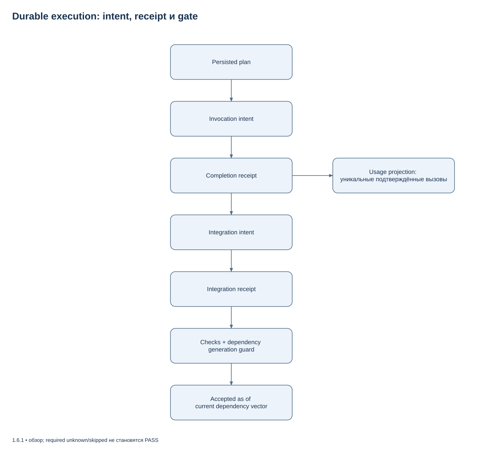
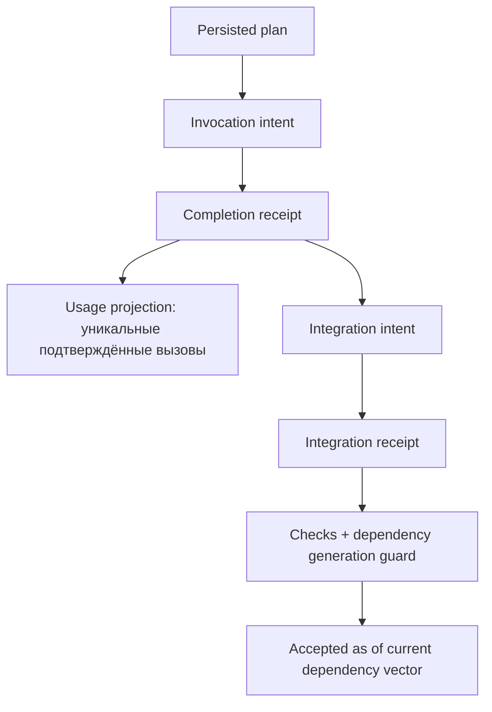

# Стабилизация исполнения и native-контекста

Эти контракты включены в опубликованный релиз **1.6.0** после линии 1.5.1.
[Состав и результаты выпуска](RELEASE_NOTES_1.6.0.md) закреплены его тегом и
отдельным `VERIFICATION.json`. Публикация пакета не подтверждает все
platform/client/evaluation gates.
Required skipped/not_run/unknown не равны PASS; baseline logs не принимают новый SHA.

## Исполнение

Work contract/plan v2 задаёт mission и проверяемые узлы. Новые managed runs
используют work-state v3 с plan-quality assessment; совместимый state v2
сохраняет persisted DAG и invocation/completion/integration receipts. Intent не доказывает dispatch; unknown outcome требует reconciliation.
Usage v3 считает уникальные подтверждённые вызовы. Null и legacy не становятся
нулём; token cap блокирует dispatch и приёмку при неизвестном покрытии.
Backend hard cap без подтверждённой capability не объявляется.

Gate закрепляет транзитивную dependency closure, берёт locks в общем порядке и
перечитывает поколения перед публикацией. Поздняя правка upstream сохраняет
исторический verdict, но делает current verification stale. Cooperative locks
и worktree не являются OS sandbox.



[Редактировать в draw.io](diagrams/durable-execution.drawio) · [Все схемы](diagrams/README.md)

<details>
<summary>Mermaid source той же схемы</summary>



</details>

## Контекст и native

Полный snapshot проверяется до compact details: omitted detail не означает
удалённый файл. Source-current observation и independently verified fact
разделены. Legacy confidence не повышает trust. Evidence проверяет bytes,
subject и status chain; revoked либо потерянный receipt не подтверждает факт.

Memory IDs имеют kind; bare ID разрешается только при единственном совпадении.
Packets сохраняют recordset/omission references; cursor связан с неизменяемой
проекцией. Queries используют snapshot inventory, NUL paths и LF line model.
Unicode separators внутри строки не изменяют номера строк.

Native остаётся observer. Неоднозначный callback сохраняется unbound и не
может менять root goal. Generic hook сохраняет explicit active goal. Если
root/agent association не доказана, SessionStart возвращает degraded; явный
`agent-harness-session start` остаётся fallback. Hook не запускает другой runtime.
Actual lifecycle/trust qualification требует клиента, а не Python fixture.
Verification bridge связывает сессию с существующим accepted isolated core run:
`execution_owner=codex_native`, `verification=core_gate`.

## Миграция

```text
agent-harness work migrate --run-dir /absolute/private/run --expected-generation 7
agent-harness work migrate --run-dir /absolute/private/run --expected-generation 7 --apply --expected-plan-digest PLAN_SHA256
agent-harness work migrate --run-dir /absolute/private/run --expected-generation 8 --recover migration-OPERATION_ID
```

Поддержан адресный work-state v1→v2. Используйте фактические generation/operation
из private intent. Backups и intent сохраняются до versioned head; pending
migration блокирует supervisor до explicit recovery. Исторические checkpoints,
core JSON и installer chain не переписываются. Baseline writer отказывает на
v2; usage сохраняет `legacy_history_unverified`, даже при нулевых totals.
Backup не разрешает destructive downgrade после новых side effects.

Memory migration создаёт typed manifest без удаления legacy originals. GC
удерживает records при unknown external reachability; bootstrap ничего не чистит.

## Форматы и evaluation

Automatic TOON требует concrete model/provider, route/config digest, client
binary, template/evaluator/build, data/shape и complete sample receipts.
Synthetic callback не разрешает production selection. Alias installed,
null fingerprints и потерянный completion дают JSON fallback. Receipt действует
один день в наблюдаемом identity scope; невидимые server-side обновления модельной
revision не объявляются обнаруженными.

```text
agent-harness work format-bench --input TABLE.yaml --render --evaluation MEASURED.yaml --evidence-dir /absolute/private/samples
agent-harness work benchmark validate --manifest benchmark-manifest.yaml --assets-root /absolute/private/assets
agent-harness work benchmark schedule --manifest benchmark-manifest.yaml --assets-root /absolute/private/assets --output schedule.yaml
agent-harness work benchmark report --manifest benchmark-manifest.yaml --assets-root /absolute/private/assets --trials trials.yaml
```

Benchmark CLI проверяет local assets, frozen IDs/schedule, grade bindings и
paired accounting. Отдельный persisted Python driver использует существующие
Supervisor/CodexAdapter и explicit budget authority; его production isolation
registry пока пуст, actual model dispatch закрыт до qualification. CLI не
загружает datasets и не доказывает operational isolation. Все пять suites показываются отдельно;
synthetic accounting не становится реальным экспериментом. Official cohort
assets, квалифицированный solve runner/network/evaluator boundary, согласованный
общий budget и actual runs остаются обязательными условиями G4. До них evaluation
scope незавершён. Экономия без реального измерения не заявляется.

## Проверки

F01/F02: execution durability и dependency commit corpus. F03/F04/F05/F12:
boundary corpus. F06–F11/F13–F17: context/native corpus. F18: format identity
corpus. Отказы сопровождаются разрешёнными positive controls. Полный suite,
release check и независимое ревью выполняются после интеграции. Linux/Windows,
Python 3.11/3.13, native bundle и actual LSP/MCP/Codex имеют отдельные результаты.
