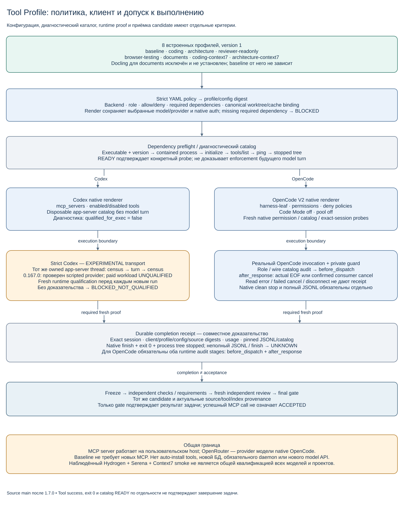
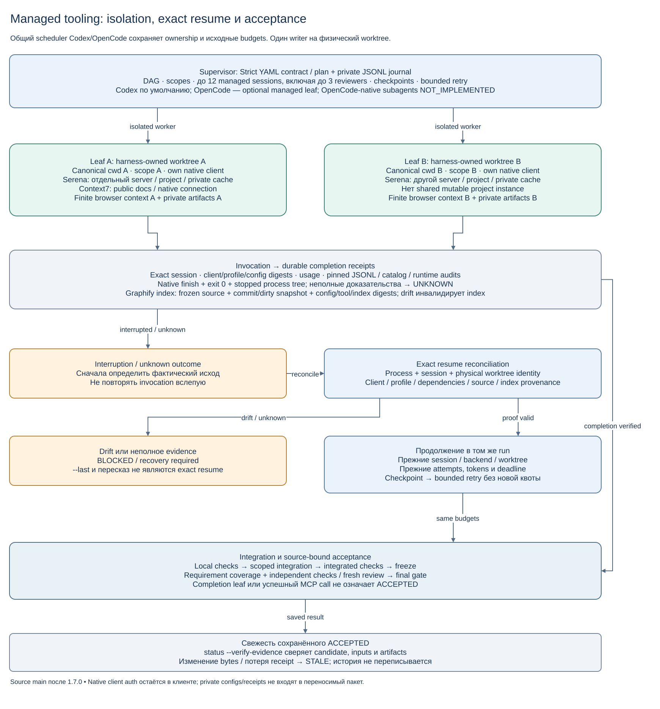
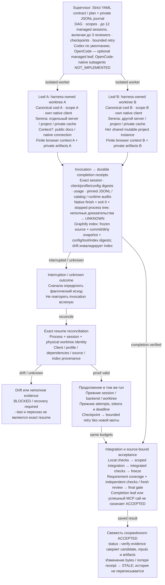

# Эксплуатация Tool Profiles: от настройки до проверенного результата

[README](../README.md) · [Профили](TOOL_PROFILES_RU.md) ·
[Codex](CODEX_MCP_RU.md) · [OpenCode](OPENCODE_RU.md) ·
[Форматы](STATE_FORMATS_AND_MIGRATION_RU.md) · [Приёмка](TOOLING_ACCEPTANCE_RU.md)

Руководство предназначено оператору локального CLI и владельцу managed run.
Оно описывает optional tooling текущих исходников после 1.7.0;
отличия от опубликованного ZIP закреплены в [Unreleased notes](RELEASE_NOTES_NEXT.md). Установка core, настройка внешнего инструмента, допуск execution
backend и приёмка задачи имеют отдельные критерии. Ни один из этих шагов
не публикует релиз.

## 1. Компоненты и поток данных



[Открыть редактируемую схему](diagrams/tool-profile-pipeline.drawio).

```mermaid
flowchart TD
    profiles["8 встроенных профилей, version 1<br/>baseline · coding · architecture · reviewer-readonly<br/>browser-testing · documents · coding-context7 · architecture-context7<br/>Docling для documents исключён и не установлен; baseline от него не зависит"]
    policy["Strict YAML policy → profile/config digest<br/>Backend · role · allow/deny · required dependencies · canonical worktree/cache binding<br/>Render сохраняет выбранные model/provider и native auth; missing required dependency → BLOCKED"]
    probe["Dependency preflight / диагностический catalog<br/>Executable + version → contained process → initialize → tools/list → ping → stopped tree<br/>READY подтверждает конкретный probe; не доказывает enforcement будущего model turn"]
    codex["Codex native renderer<br/>mcp_servers · enabled/disabled tools<br/>Disposable app-server catalog без model turn<br/>Диагностика: qualified_for_exec = false"]
    oc["OpenCode V2 native renderer<br/>harness-leaf · permissions · deny policies<br/>Code Mode off · pool off<br/>Fresh native permission / catalog / exact-session probes"]
    cxdeny["Strict Codex — EXPERIMENTAL transport<br/>Тот же owned app-server thread: census → turn → census<br/>0.167.0: проверен scripted provider; paid workload UNQUALIFIED<br/>Fresh runtime qualification перед каждым новым run<br/>Без доказательства → BLOCKED_NOT_QUALIFIED"]
    ocguard["Реальный OpenCode invocation + private guard<br/>Role / wire catalog audit → before_dispatch<br/>after_response: actual EOF или confirmed consumer cancel<br/>Read error / failed cancel / disconnect не дают receipt<br/>Native clean stop и полный JSONL обязательны отдельно"]
    pin["Durable completion receipt — совместное доказательство<br/>Exact session · client/profile/config/source digests · usage · pinned JSONL/catalog<br/>Native finish + exit 0 + process tree stopped; неполный JSONL / finish → UNKNOWN<br/>OpenCode: before_dispatch всегда; при подключённых MCP: before_dispatch + after_response"]
    gate["Freeze → independent checks / requirements → fresh independent review → final gate<br/>Тот же candidate и актуальные source/tool/index provenance<br/>Только gate подтверждает результат задачи; успешный MCP call не означает ACCEPTED"]
    bounds["Общая граница<br/>MCP server работает на пользовательском host; OpenRouter — provider модели native OpenCode.<br/>Baseline не требует новых MCP. Нет auto-install tools, новой БД, обязательного daemon или нового model API.<br/>Наблюдённый Hydrogen + Serena + Context7 smoke не является общей квалификацией всех моделей и проектов."]
    profiles --> policy
    policy --> probe
    probe -->|"Codex"| codex
    probe -->|"OpenCode"| oc
    codex -->|"execution boundary"| cxdeny
    oc -->|"execution boundary"| ocguard
    cxdeny -->|"required fresh proof"| pin
    ocguard -->|"required fresh proof"| pin
    pin -->|"completion ≠ acceptance"| gate
```

<details>
<summary>Та же схема в Mermaid</summary>



</details>

Strict YAML профиль задаёт backend, роли, MCP servers, CLI dependencies,
allowlists и ограничения индекса. `tools dry-run` проецирует его в конфигурацию
штатного клиента. `tools check` проверяет доступность dependency процессов.
`tools catalog` наблюдает отдельный диагностический каталог. Supervisor перед
каждым реальным запуском отдельно проверяет execution boundary и сохраняет
provenance. После исполнения исходный acceptance pipeline фиксирует candidate,
запускает независимые проверки, review и gate.

| Компонент | Владелец и данные | Граница доказательства |
| --- | --- | --- |
| `tool_profiles.py` | Закрытая policy, digest, renderer | Корректная конфигурация не доказывает её enforcement |
| `tooling_probe.py` | Contained MCP process, initialize/tools/list/ping | Probe завершается; его каталог не является будущим каталогом модели |
| `execution.py` | Backend/profile/role/worktree binding, capability checks | Required dependency или capability блокирует dispatch при отказе |
| `opencode_qualification.py` | Native catalog, permissions, private guard, session proof | `before_dispatch` обязателен всегда; `after_response` дополнительно при подключённых MCP |
| `codex_tool_catalog.py` | Disposable app-server thread и native MCP filtering | Диагностика не квалифицирует отдельный `codex exec` |
| `execution_receipts.py` | Intent/completion/check/review records и artifact hashes | Intent не доказывает dispatch; completion не доказывает принятую задачу |
| `supervisor.py`, `managed_execution.py` | DAG, quotas, worktrees, integration и repair | Зелёный tool call не отменяет failed independent check |
| `runner.py`, `verified_flow.py` | Freeze, проверки candidate, requirements, final gate | Изменение inputs после проверки делает evidence устаревшими |

Для OpenCode с подключёнными MCP completion proof требует matching
`before_dispatch` и `after_response` для runtime context. При отсутствии
подключённых MCP требуется `before_dispatch`; отсутствие `after_response`
само по себе не означает ошибку. Native finish, полный JSONL и cleanup
остаются обязательными независимо от наличия MCP.

Файлы таблицы находятся в [src/agent_harness](../src/agent_harness).
Архитектура использует существующие private files и journal. Общий MCP proxy,
новая база данных и постоянный background daemon не добавляются.

## 2. Матрица native/managed

Матрица описывает механизмы исходного кода. Она не является отчётом о готовности
конкретного компьютера. Требуются подходящая версия клиента, доступные
dependencies и свежая квалификация выбранной роли.

| Сценарий | Codex | OpenCode V2 |
| --- | --- | --- |
| Native чат и собственные children клиента | Прежний native flow; cap клиента задаётся отдельно | Harness native multi-agent не реализован |
| Managed leaf без нового профиля | Совместимый baseline | Optional adapter, только после native qualification |
| MCP policy render | `mcp_servers`, enabled/disabled tools, connection readiness | `mcp.servers`, per-agent permissions, запрет pooled sessions и Code Mode |
| Диагностический effective catalog | App-server ephemeral thread без model turn | Native pre-turn rehearsal без provider dispatch |
| Строгий tooling dispatch | Отдельный owned stdio app-server transport; fresh native qualification, diagnostic catalog её не даёт | При успешной qualification и guard каждого реального invocation |
| Reviewer read-only | Отдельный StrictCodexAdapter с native tool ceiling и exact-file read context; обязательна квалификация | Аудированный набор read tools, отрицательные native probes, guard |
| Shell/компилятор внутри leaf | Baseline сохраняет прежние permissions; strict boundary запрещает shell | В квалифицированном managed leaf запрещён; checks запускает supervisor |
| Exact resume | Сохранённый конкретный session ID и прежняя identity | Сохранённый `--session`, проверка истории, root/profile/client binding |
| Output schema | Штатный механизм Codex | Нет native `--output-schema`; prompt instruction и последующая core validation |
| Общая квота | До 12 managed sessions, в том числе до 3 reviewers | Та же квота; отдельного второго пула нет |

`SUPPORTED` означает реализованный путь, `QUALIFIED` — проверенный конкретный
runtime и сценарий, `READY` — результат определённой текущей проверки.
`BLOCKED_NOT_QUALIFIED`, `NOT_AVAILABLE`, `not_run` и `skipped` не равны PASS.
Fixture tests проверяют механизм harness; native tests проверяют указанный
клиент. Ни те, ни другие не доказывают доступ к выбранной платной модели.

Strict Codex transport остаётся EXPERIMENTAL API. На Linux/Codex 0.167.0
проверены source read и exact session restart/history через local scripted
provider; установленная конфигурация получила READY для coding + Serena и
read-only reviewer. Каждый новый project/run обязан заново получить native
proof, иначе действует `BLOCKED_NOT_QUALIFIED`. Платный Codex workload не
квалифицирован. Большие tooling packets без exact external read grants также
блокируются до dispatch.
Подробнее — [Codex](CODEX_MCP_RU.md#строгий-managed-transport-отдельная-граница).

Лимит 12 — верхняя граница supervisor, а не требование запускать 12 процессов.
Contract может задать меньшую конкуренцию; scheduler учитывает dependencies,
scope conflicts, оставшиеся budgets и занятые slots. Reviewer входит в общие
12. Child cap native Codex не суммируется с managed slots как второй scheduler.
Подробности — [Dynamic agents](DYNAMIC_AGENTS_RU.md).

## 3. Установка core и discovery инструментов

Core устанавливается по [SETUP_RU](../SETUP_RU.md): doctor → install dry-run →
просмотр targeted diff → install apply → verify → повторный install с
`unchanged` → отдельная native verification при необходимости. Используйте
постоянный package root. Уже открытая сессия не получает hot reload от
изменения файлов. Model/provider/effort и permissions сохраняются.

Portable команды ниже входят в пакет. Локальные operator helpers
`codex-harness` и `opencode-harness` — private machine overlay, не часть CLI/ZIP.
Их наличие, auth/config и host paths нельзя считать prerequisite другой машины.
Не копируйте эти helpers вместо documented execution contract.

Для команд ниже cwd — package root, `HARNESS_PROJECT` — существующий исходный
checkout, `HARNESS_PRIVATE` — отдельный существующий private каталог вне него
и вне пользовательских Codex/OpenCode configs. Например, в POSIX shell:

```bash
HARNESS_PROJECT=/absolute/project
HARNESS_PRIVATE=/absolute/private/tooling-attempt
python tools/harness.py tools --help
python tools/harness.py tools list
python tools/harness.py tools dry-run --profile baseline --backend codex --root "$HARNESS_PROJECT"
python tools/harness.py tools check --profile baseline --backend codex --root "$HARNESS_PROJECT"
```

`dry-run` возвращает нормализованный profile, `profile_digest`, native config,
`effective_config_digest`, `applied:false` и `client_catalog_verified:false`.
Baseline не содержит внешних MCP/CLI dependencies. Его `check:READY` означает
отсутствие отказавших dependencies, а не проверку модели или reviewer isolation.
На Windows задайте переменные PowerShell `$HarnessProject`, `$HarnessPrivate`
и замените `python` на установленный `py -3`; argv флаги одинаковы.

Для optional инструмента сначала проверьте **локальные** `--version` и `--help`.
Установщик core не скачивает Serena, Graphify, Context7, ast-grep, Playwright
или Docling. Recipes внешних packages зависят от реально выбранной версии.
Не подставляйте случайную найденную команду в required профиль.

| Потребность | Выбор | Что проверить |
| --- | --- | --- |
| Symbols/references | `coding` или custom Serena profile | Help подтверждает `--project`; отдельный stdio process и private cache на worktree |
| Архитектурный граф | `architecture` или custom graph profile | Verified builder argv, frozen source/index receipt и invalidation |
| Структурная миграция | ast-grep CLI | Version signature именно ast-grep; targeted diff, scans и независимые checks |
| Документация API | `coding-context7`/`architecture-context7` либо custom profile | Anonymous public reads, audited IDs, private Node environment и native connection |
| Browser acceptance | `browser-testing` | Реальный managed runner с profile/artifact binding; один установленный Playwright недостаточен |
| Конвертация документов | Optional `documents` | Только по отдельной потребности и квалификации; Docling не нужен обычной разработке |

На 2026-11-17 отдельно проверены native Serena 2.1.0 (две concurrent stdio
sessions), Context7 4.6.0 (public reads), Graphify-Labs/graphify, distribution `graphifyy` 0.9.111 (actual index и
toolchain drift), ast-grep 0.51.3 (native migration и independent regression),
official Playwright MCP 0.0.85 (семь реальных browser scenarios). Это scoped
qualification, не разрешение пропустить checks нового проекта.
После SSE EOF/cancel исправления отдельно наблюдён реальный Hydrogen/Flex turn
с Serena + Context7, post-response audit и process cleanup. Это не full workload
acceptance; optional tools на Windows этим Linux proof не квалифицированы. Подробности и
границы — [матрица приёмки](TOOLING_ACCEPTANCE_RU.md).

Если оператор исключил Docling, оставьте `documents` невыбранным и запишите
`skipped: operator choice` в private qualification report. Это не дефект
baseline. Отсутствующая required dependency выбранного профиля остаётся BLOCKED.
В текущей поставке работ Docling явно исключён по выбору оператора и не
устанавливался. Browser profile до задания exact origins и absolute runtime
paths остаётся `CONFIG_REQUIRED`.

Native OpenRouter model entries настраиваются отдельно: [пошаговый пример
трёх вариантов](OPENCODE_RU.md#пошагово-выбрать-один-из-трёх-openrouter-вариантов).
Он сохраняет global defaults и не добавляет model/provider в Tool Profile.
MCP процессы и их private state находятся на машине клиента; OpenRouter
предоставляет модель, а не среду запуска локальных tools.

## 4. Настроить и проверить профиль

Посмотрите [полный пример профиля](TOOL_PROFILES_RU.md#формат). Сохраните custom
YAML как ordinary private file. В `tool_profile` закрепляйте ID/version и
absolute path; relative path сделал бы resume зависимым от случайного cwd.

```bash
python tools/harness.py tools show --profile /absolute/private/project-tools.yaml --backend opencode --root "$HARNESS_PROJECT"
python tools/harness.py tools check --profile /absolute/private/project-tools.yaml --backend opencode --root "$HARNESS_PROJECT"
python tools/harness.py tools catalog --profile /absolute/private/project-tools.yaml --backend opencode --root "$HARNESS_PROJECT"
```

`check` проверяет command/help/version и MCP transport. Для required server
должны пройти live initialization, catalog и post-catalog connection probe.
Unknown/duplicate tools, missing required tool, timeout и disconnect сохраняют
конкретный отказ. Optional missing server исключается из grants с причиной,
а не подменяется фиктивным подключением.

`catalog` в OpenCode запускает native rehearsal и удаляет временные artifacts
после диагностики. Для сохранения bounded evidence используйте уже созданный
private каталог:

```bash
python tools/harness.py tools qualify --profile reviewer-readonly --backend opencode --role reviewer --root "$HARNESS_PROJECT" --evidence-dir "$HARNESS_PRIVATE"
```

Команда не отправляет model turn. Результат rehearsal имеет
`qualified_for_exec:false` и `reusable_as_authorization:false`: supervisor
перед реальным dispatch квалифицирует конкретные worktree/role/model/config
и включает runtime guard. Нельзя перенести JSON результата на другой запуск.
Final reviewer policy повторно проверяется после ожидания/admission model slot
и непосредственно до dispatch: истёкший proof или drift за время ожидания
не сохраняет допуск от старого preflight.

Для Codex `tools catalog --backend codex` создаёт disposable app-server без
копирования пользовательского auth. Native MCP filtering наблюдается в этом
thread. Ограничения shell, wrappers, plugins и reviewer execution проверяются
отдельно. `tools qualify --backend codex` использует отдельный native strict
verifier, а не повышает trust диагностического каталога. При отсутствии
необходимого proof выполнение остаётся `BLOCKED_NOT_QUALIFIED`.

`tools apply` сохраняет **новый** per-run fragment; это не установка в профиль:

```bash
python tools/harness.py tools apply --profile baseline --backend codex --root "$HARNESS_PROJECT" --output "$HARNESS_PRIVATE/tool-config.toml" --apply
```

Повтор с тем же destination отказывает. Parent должен существовать, destination
должен находиться вне source/user config. Команда не меняет auth, модель,
provider или глобальную безопасность. Digest fragment фиксирует bytes
конфигурации; он сам не доказывает effective precedence следующего клиента.

## 5. Включить профиль в существующий contract

Добавляйте execution selection к полному contract, который уже содержит цель,
scope, budgets и required acceptance. Это fragment, не самостоятельный contract:

```yaml
tooling_schema_version: 1
execution:
  backend: opencode
  tool_profile:
    id: baseline
    version: 1
review_execution:
  backend: opencode
  tool_profile:
    id: reviewer-readonly
    version: 1
```

Используйте `mode: managed`, `memory: true` и `ledger: inform`. Native OpenCode
children не поддерживаются. Для custom profile добавьте его absolute `path`.
Выбор отдельных task nodes можно закрепить в tooling variant agent plan;
contract-level выбор не создаёт дополнительный scheduler. Managed contract v2
сохраняет mission/requirement IDs, local/integration checks и plan-quality gate.
Добавление tooling не заменяет эти обязательные поля.

После подготовки private contract/plan запустите стандартный foreground flow:

```bash
python tools/harness.py work start --contract /absolute/private/contract.yaml --plan /absolute/private/plan.yaml --cwd "$HARNESS_PROJECT" --run-dir /absolute/private/work-run --format json
python tools/harness.py work status --run-dir /absolute/private/work-run --verify-evidence --format json
```

Первая команда **вызывает модель**, занимает общий slot и может менять
разрешённый source scope. Она приведена для разрешённой реализации, не как
диагностическая команда. Required preflight failure должен произойти до model
dispatch. Exit 0 `work start/resume` означает ACCEPTED, exit 1 — наблюдённый
неуспех, exit 2 — parameter/integrity/capability failure.

## 6. Isolation, interruption и exact resume



[Открыть редактируемую схему](diagrams/tooling-isolation-resume.drawio).

<details>
<summary>Та же схема в Mermaid</summary>



</details>

Каждый managed writer получает harness-owned Git worktree, свой cwd и scope.
Внешний stdio MCP запускается в этом worktree; private cache не разделяется
с конкурентным mutable project state. В OpenCode managed leaf shell, Code Mode,
skills, subagent и native worktree tools не входят в grants. Тесты и компиляторы
выполняет независимый command runner supervisor.

После interruption сначала прочитайте status/report. `work resume` сверяет
identity прежнего процесса и всего process tree, journal, backend executable,
session ID, worktree ownership, profile/config digests и source/index provenance.
Unknown outcome не допускает слепой повтор model call. `--last` и новая сессия
с пересказом не являются exact resume.

```bash
python tools/harness.py work status --run-dir /absolute/private/work-run --verify-evidence --format json
python tools/harness.py work report --run-dir /absolute/private/work-run --format json
python tools/harness.py work resume --run-dir /absolute/private/work-run --format json
```

Resume вызывает модель только после обязательной reconciliation и в исходных
лимитах. Attempts/deadline/token cap не обнуляются. Если требуется явный retry,
используйте поддержанный `--new-attempt REASON` с проверенной новой гипотезой.
Не удаляйте lock, session file или journal, чтобы обойти отказ.

## 7. Диагностика по границе отказа

| Наблюдение | Причина и следующий шаг |
| --- | --- |
| Executable missing / wrong version signature | Проверьте PATH и version/help выбранного binary; `sg` может быть Linux setgroups |
| Startup / initialize failure | Сверьте argv, cwd, transport и несекретные env names; сохраните ограниченный stderr |
| MCP probe READY, client catalog blocked | Probe был отдельным соединением; исследуйте native client connection и precedence |
| Missing required tool | Сверьте реальные IDs/schema с allowlist; не снижайте required policy ради зелёного статуса |
| Reviewer blocked | Нужны native enforcement и negative probes; readOnlyHint/prompt не заменяют границу |
| `STALE_GRAPH_INDEX` | Повторно заморозьте текущий source, перестройте индекс verified argv и проверьте новый receipt |
| Profile/config/client drift при resume | Сохраните старый receipt; не продолжайте под прежним digest с новыми inputs |
| Runtime catalog receipt missing / changed | Completion не подтверждён; повторное чтение status не восстанавливает потерянную историю |
| Required browser runner unavailable | Оставьте BLOCKED; browser startup без bound artifacts не доказывает acceptance |
| Сохранённый ACCEPTED, свежий status STALE | Проверяйте inputs, tool artifacts, checks и candidate; recorded status — история |
| Incomplete последний journal append | `--repair-journal` допустим лишь для доказанно неполного последнего append; затем reconciliation |
| Optional dependency NOT_AVAILABLE | Сохраните reason/fallback; не называйте необязательную отсутствующую проверку passed |

Rollback tooling означает возврат к согласованному baseline в новом run либо
отдельный явный переход с сохранением истории. Это не ручная замена work-state
v4 на v2/v3. Global configs не изменялись от `tools apply`; удаление credentials
не нужно. Исходные installation rollback/backups обслуживает installer.

## 8. Что передать на review

Передайте source commit/tree или точный dirty snapshot, contract/profile digests,
версию и hash клиента, роли/worktrees, результаты dependency/native probes,
execution/completion refs, runtime catalog hashes, check results и gate report.
Укажите skipped/not_run/blocked и реальные boundaries. Private paths и логи
остаются в private evidence, секреты и модельные стенограммы в пакет не входят.

Подтверждённый tool call и завершённая модельная сессия — входы для приёмки.
Готовность результата подтверждают freeze, независимые проверки, свежий review,
coverage обязательных требований и final gate на том же candidate.
