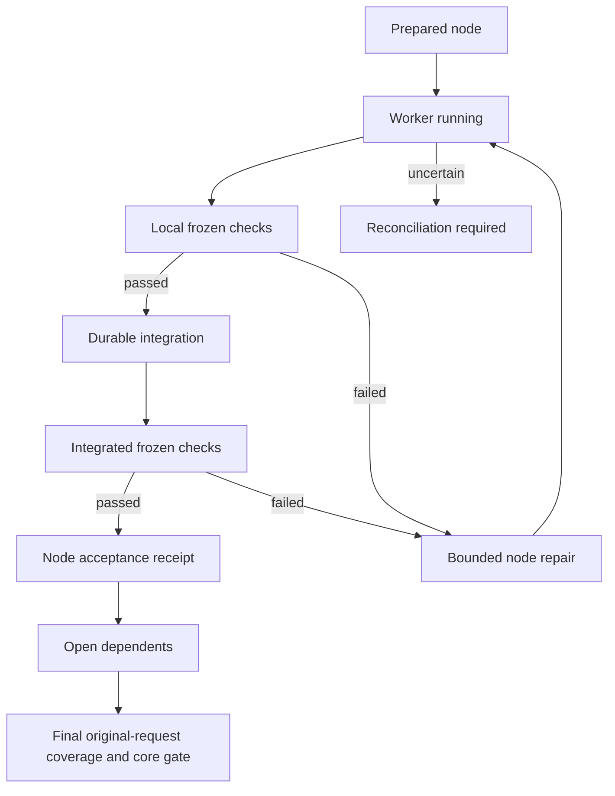

# Проверяемая очередь задач

Managed work contract `schema_version: 2` включает проверку каждого связного
результата до открытия зависимой работы. `schema_version: 1` сохраняет прежний
режим integration + final gate. Его `integrated` не называется `verified`.
Версии contract и plan обязаны совпадать; старый writer отвергает новый contract.
Настройки модели, permissions и native compaction этот механизм не меняет.

## Исходная задача и текущая работа

Координатор составляет контракт из полного разрешённого запроса. Пользователь
не обязан вручную писать YAML или выдавать каждый следующий этап. Для небольшой
самостоятельной задачи остаётся прямое выполнение. Для длинной managed-задачи
координатор сохраняет исходную задачу в явно разрешённом private task storage,
выделяет requirements и executable checks, затем запускает существующий `work`.
Секреты и закрытые client transcripts не считываются для построения контракта.

В v2 обязательны `mission` и `node_checks`. Mission содержит `id`, `generation`,
`original_request`, `global_constraints`, `non_goals` и `requirements`. У требования
есть `id`, `text`, `provenance`, `kind`, `required`, `acceptance_ids`. Acceptance IDs
обозначают frozen финальные критерии. Обязательные требования не могут ссылаться
на optional checks. Источник требования не зависит от source snapshot: изменение
кода делает старым evidence, а не отменяет ограничение пользователя.

`node_checks` использует формат command checks из `acceptance`, включая
`argv`, `timeout`, reports и assertions. Здесь нужны required executable checks.
Неподдержанный semantic oracle не становится пустым PASS. Общие финальные checks
остаются в `acceptance` и выполняются на одном итоговом candidate.

Managed plan v2 содержит `generation`, `mission_digest` и полный DAG. Каждый узел дополнительно
содержит `requirement_ids` и `checks: {local: [check-id], integration: [check-id]}`.
Оба списка непустые и ссылаются на frozen `node_checks`. Нельзя принять план,
который потерял mandatory requirement. Это структурная гарантия покрытия
реестра, а не доказательство полноты извлечения требований из естественного языка.
Свежий final reviewer отдельно сравнивает исходный запрос, реестр и результат.

При cap1 v2 требует настоящий validated plan: отсутствие explicit `--plan`
направляет задачу к штатному structured planner. Cap1 ограничивает конкурентность,
но не подменяет декомпозицию одним implicit giant node. Planner получает полный
mission и указание выбирать связные проверяемые outcomes. Размер узла определяется
его критерием, зависимостями и риском. Универсальных спринтов по времени/числу строк нет.
Frozen dispatched contracts не переписываются на resume. Явный
`work mission-update --run-dir <run> --contract <new.yaml> --reason <authorized-change>`
публикует immutable successor contract через существующий journal/checkpoint head.
Новый mission сохраняет ID, увеличивает generation ровно на1 и задаёт previous_digest
прошлой mission. Исходные deadline, attempts и usage сохраняются; расширение scope,
permissions и budgets отклоняется. Старые plan/agent/core projections остаются
историей и не становятся текущими receipts. Продолжение выполняет
`work resume --run-dir <run> --plan <new-plan.yaml>` либо structured planner.
Plan generation отличается от mission generation, но mission_digest обязан совпасть.
Pre-commit crash оставляет прежний head; committed head выбирает весь новый контракт.
Отсутствующая projection восстанавливается существующим journal recovery.

## Пакет и transport

Worker получает текущий outcome, полный mission/global constraints, frozen checks,
scope, dependency vector, deadline, remaining attempts и последние failures.
Final reviewer получает исходную задачу, полный план и coverage. Эти required
данные не конкурируют с optional memory recall за право существовать.

Прямой prompt ограничен 24000 UTF-8 bytes. Большой пакет сохраняется целиком в
immutable private context files; prompt содержит manifest с SHA256, byte counts,
offsets и списком обязательных частей. Предел полного пакета — 1 MiB; часть —
32768 bytes с границами UTF-8. Перед writes требуется прочитать все части обычными
file tools. Изменённая/недоступная часть требует остановки. Такой transport
доказывает предоставление правильных bytes, а не понимание их моделью.
Квалификация конкретного native client/tool transport требует отдельного наблюдения.

Packet construction и adapter argv preflight выполняются до model slot/intent.
Превышение hard bound даёт `NOT_DISPATCHED`. После intent только явный adapter
`NotDispatched` допускает completion `dispatch_state: not_dispatched_proven`.
Его usage `not_applicable`, без выдуманных counters или model invocation.
Обычный exception после adapter invocation остаётся unknown даже без наблюдаемого PID.
Такой slot нельзя освободить или повторить writer по одному отсутствию процесса.

## Переходы и приёмка

Prepared agent projection сохраняется до wave publication. Recovery может
восстановить отсутствующий never-dispatched projection из frozen plan только
при отсутствии authoritative side-effect records. Missing projection с возможным
dispatch требует reconciliation. Process identity, terminal outcome, tree cleanup,
usage coverage, integration и requirement acceptance — разные факты.

Local gate использует существующий `Run.freeze`, runner и gate, проверяет outputs
и frozen command definitions на worker checkout. Затем существующая integration
транзакция связывает completion, patch bytes, ownership и exact pre/post Git tree.
Integrated gate проверяет фактический merged candidate. Зависимая работа получает
вектор current node acceptance refs. Он повторно проверяется при использовании.

Начальная политика консервативна: новый integrated source инвалидирует широкие
proofs и вызывает revalidation. Узкий reuse пока не обещается без полного closure.
Current receipts не строятся из одного текста `passed`; raw core evidence,
toolchain, definitions и candidate revalidated. Повтор completion не удваивает usage.

Known stopped repairable worker failure допускает следующую ограниченную попытку.
Partial usage остаётся отдельным свойством и при строгом token cap может запретить
новую попытку. Cancellation, permission denial, exhausted budgets и uncertain
cleanup не превращаются в transient retry. Local failure ремонтируется в исходном
worker context. После integrated failure прежний checkout/evidence сохраняются,
новая owned repair worktree берётся от фактического integrated base; исходные
deadline/attempt accounting продолжаются.

Новые managed runs закрепляют final review v3 и execution receipt v2; legacy
review v1/v2 и receipt v1 сохраняют прежние схемы. Contract и plan остаются v2.
Final review возвращает полный `requirements` verdict с реальными evidence IDs
и `unrepresented_requirements` для пропусков исходной задачи. Missing/duplicate IDs,
неизвестные evidence refs, negative findings и непокрытые требования запрещают
approval. После этого общий core gate проверяет все обязательные финальные критерии.
Status с `--verify-evidence` проверяет raw node/final evidence заново; stale proof
не сохраняет ACCEPTED. Хорошие receipts не компенсируют слабую спецификацию oracle.

Строка `accepted` требует непустой `evidence_ids` на уровне review v3 и coverage
receipt v2. Required и любое включённое в executable plan optional требование
нельзя отложить. Optional без узлов в frozen plan controller представляет как
`deferred`, с пустым evidence и причиной
`Optional requirement has no executable node in the frozen plan`. Reviewer может
сохранить эту причину или дописать к ней буквальный разделитель `; ` и непустое
уточнение, например `; no additional output was promised.`. Замена причины,
пустое/пробельное уточнение и произвольный текст вместо controller base запрещены.
Текст причины не разрешает deferral: requiredness, frozen plan и evidence
проверяются отдельно. Свежий review, cached reuse и strict status используют
одну проверку; evidence уже принятого optional требования остаётся обязательным.

Native interactive session сохраняет mission/checkpoint и предоставляет advisory
projection. Этот пакет не контролирует каждый внутренний native continuation и
не обещает исполнение после закрытия клиента. Hard managed frontier относится к
явному foreground supervisor.

## Проверки и сравнение

Runtime scenarios находятся в `tests/test_verified_flow.py`; crash/boundary/context
controls — в соответствующих targeted tests. Fixtures не являются real model runs.
[Task-flow experiment](TASK_FLOW_EXPERIMENT_RU.md) фиксирует последующий matched
эксперимент. Из сокращения bytes и детерминированных tests не следует экономия
модельных tokens, рост качества или production qualification платформы.

Custom Codex transport может реализовать `preflight(prompt, **mode_options)` для локальной проверки до slot/intent. Decorator делегирует его реальному backend, сохраняя environment и deadline; унаследованный argv не подменяет подготовленный transport. Known stopped worker/root/reviewer failures различаются с unknown dispatch; fresh retries повторно проверяют исчерпание исходного token budget на границе каждой новой invocation.

Решение repair и обработанная completion связаны явно: crash после REPAIRING или подготовки core attempt не считает ту же failure второй попыткой. Worker failures учитываются отдельно по work item; остановка по NO_PROGRESS сохраняется до нового допустимого input. Cleanup null не освобождает global slot.

## Plan-quality policy и state v3

Новый managed run с contract v2 использует work-state v3. Версии независимы:
agent-plan v2 и work-contract v2 остаются закрытыми и неизменными; execution
receipt остаётся v2, quality policy и assessment имеют собственную версию 1.
Новый reader `work-state.v3.schema.json` читает исторические v1/v2 checkpoints.
Старый `work-state.schema.json` сохранён побайтно и отвергает новый head v3.

До первого worker intent controller резервирует planning round и проверяет
mandatory mapping, DAG, scopes, единственного writer, непустые outcome/checks.
Затем существующая настроенная reviewer role с purpose `plan_quality` отдельно
оценивает связность outcomes, самостоятельную upstream acceptance, смысл checks,
владение shared interfaces и atomicity. Concurrency cap 1 не оправдывает один
расплывчатый node; один обоснованный связный outcome не дробится по числу файлов.
Модель, provider, effort, permissions и native compaction не меняются; второго
model runner нет.

Пояснения находятся в assessment по `node_id`, включая dependency rationale,
atomicity/indivisibility, local/integration checks, owner/consumers, scope,
review handoff и budget. Эти поля не добавляются в agent-plan v2. Непустая строка
пояснения содержит хотя бы один непробельный символ. Controller проверяет exact
mission generation/digest, contract, plan revision/digest, policy version/digest,
input digest, round и pinned output-schema bytes; он повторяет deterministic
checks и сопоставляет IDs/scopes/checks. Сам текст `approved` не разрешает работу.
Assessment не заменяет node checks и отдельный final review.
Controller повторно проверяет proof после preflight/wait перед каждым worker/root
intent и после внешних checks/reviewer перед final publication. Потеря уже
опубликованного artifact блокирует работу; resume не восстанавливает его молча.

Policy/schema/input/assessment сохраняются как immutable content-addressed
artifacts с authoritative journal pins и execution receipt
`plan_quality_assessment`. У receipt ровно одиннадцать полей payload; дополнительная
binding-информация находится в assessment/input и immutable intent refs. Перед
использованием completion действует общий R03 guard: известный outcome, cleanup
строго `True`, точный subject и accounting. Unknown cleanup не освобождает slot и
не допускает workers. Missing/corrupt raw stdout или конфликт того же receipt ID
не дают синтезировать approval.

Round ограничен исходным `budgets.max_attempts`; `work start --max-planning-rounds N`
может только уменьшить этот предел. Counter сохраняется в журнале и state,
резервируется до deterministic validation и не обнуляется при session/mission/plan
revision. Даже отвергнутый explicit plan расходует round, но не запускает worker
или semantic reviewer. Его ошибка остаётся объяснимым stop. `requires_revision`
даёт bounded feedback следующему planner; original mission и frozen requiredness
не переписываются. Известный stopped assessor failure может получить bounded retry
в новом round того же plan revision; unknown outcome не повторяется. Все реальные
planner/reviewer calls входят в исходные usage/token/wall guards. Deadline не
перезапускается, turn timeout действует на каждый вызов.

Byte-identical task content, checks, dependencies и scopes не становится новой
гипотезой из-за generation/revision/session bump или другого более снисходительного
judge. Controller сравнивает semantic fingerprint с ранее опубликованными
`requires_revision`, проверяя их exact raw/input/schema chain; administrative
поля generation/previous_digest не сбрасывают отказ. Это точная проверка одинаковых
данных, не oracle эквивалентности естественного языка. Повтор без изменения
гипотезы останавливается до нового semantic call; exhaustion имеет отдельный stop.

Crash после completion, assessment artifact или receipt восстанавливает exact
publication без нового model call и двойного usage. ID, generation и timestamp
assessment receipt связаны с исходной completion. Резервирование round также
восстанавливается из authoritative event, а не увеличивает counter второй раз.
Для новой headless creation prepared artifact + journal intent предшествуют
contract/policy/первому checkpoint. Только явный повтор того же `work start`/create
восстанавливает exact material с исходными run ID, started_at, deadline, counters
и limit; изменённые inputs или bytes блокируются. Обычный status/resume не создаёт
pins или head из file presence. Hard process exit — отдельный fixture control,
не qualification power loss.

Legacy v1/v2 read/status/resume сохраняют прежнюю policy и показывают
`legacy_not_assessed`; они не получают assessment `passed` и не пишут новые schemas.
Явный quiescent v2→v3 upgrade — отдельная version-bound операция
[миграции](STATE_FORMATS_AND_MIGRATION_RU.md), сохраняющая историю и оставшиеся
budgets. Новый pending head блокирует старый writer до bootstrap publication;
финальный head требует новой текущей assessment, а не ретроактивного approval.

`work status --verify-evidence` независимо проверяет quality даже при root-repair
entry, final gate и cached review. `progress.coverage_counts` разделяет
`mandatory.accepted/total` и `optional.accepted/deferred/planned/total`: deferred
не входит в accepted numerator. `optional.planned` считает все включённые в plan
обещанные optional requirements, включая уже accepted; это отдельная ось,
поэтому planned не складывается с accepted/deferred как непересекающийся статус.
Quality status отдельно показывает policy,
rounds/revision, current/stale/missing assessment; stage counter основан на journal.
Downstream admission отображается по текущему verified frontier, а не одному
integration flag. Current outcome/phase, unresolved invocation/cleanup,
candidate/evidence, usage/deadline, stop reason и next allowed action не превращают
unknown required gate в 100%. Native observer остаётся наблюдением и не называется
managed-verified.

Контролируемые subprocess fixtures проверяют protocol и controller admission.
Они не доказывают качество настоящих model judgements или реального Codex client;
такая qualification остаётся отдельной работой W19/W20.
