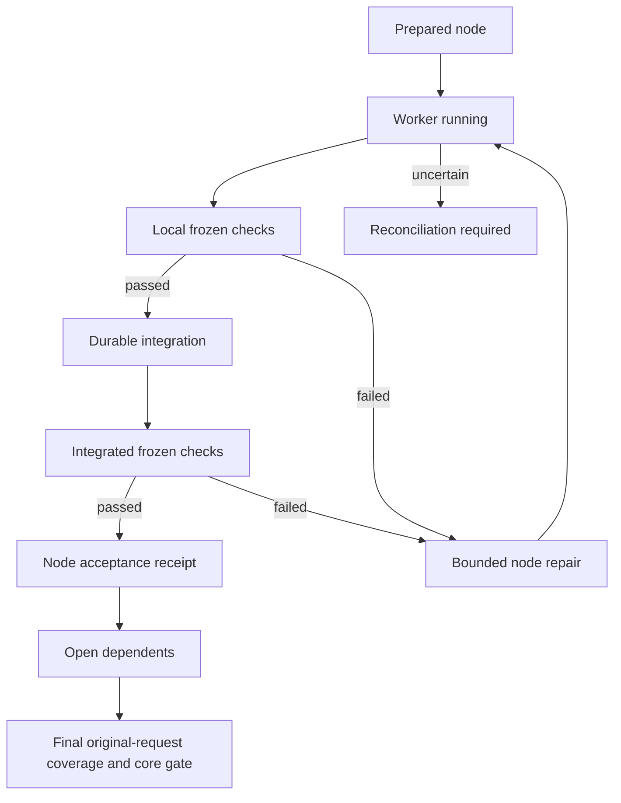

# Проверяемая очередь задач

Managed work contract `schema_version: 2` включает проверку каждого связного
результата до открытия зависимой работы. `schema_version: 1` сохраняет прежний
режим integration + final gate. Его `integrated` не называется `verified`.
Версии contract и plan обязаны совпадать; старый writer отвергает новый contract.
Настройки модели, permissions и native compaction этот механизм не меняет.

## Исходная задача и текущая работа

Координатор составляет контракт из полного разрешённого запроса. Пользователь
не обязан вручную писать YAML или выдавать каждый следующий этап. Для небольшой
самостоятельной задачи остаётся прямое выполнение. Для длинной managed-задачи
координатор сохраняет исходную задачу в явно разрешённом private task storage,
выделяет requirements и executable checks, затем запускает существующий `work`.
Секреты и закрытые client transcripts не считываются для построения контракта.

В v2 обязательны `mission` и `node_checks`. Mission содержит `id`, `generation`,
`original_request`, `global_constraints`, `non_goals` и `requirements`. У требования
есть `id`, `text`, `provenance`, `kind`, `required`, `acceptance_ids`. Acceptance IDs
обозначают frozen финальные критерии. Обязательные требования не могут ссылаться
на optional checks. Источник требования не зависит от source snapshot: изменение
кода делает старым evidence, а не отменяет ограничение пользователя.

`node_checks` использует формат command checks из `acceptance`, включая
`argv`, `timeout`, reports и assertions. Здесь нужны required executable checks.
Неподдержанный semantic oracle не становится пустым PASS. Общие финальные checks
остаются в `acceptance` и выполняются на одном итоговом candidate.

Managed plan v2 содержит `generation`, `mission_digest` и полный DAG. Каждый узел дополнительно
содержит `requirement_ids` и `checks: {local: [check-id], integration: [check-id]}`.
Оба списка непустые и ссылаются на frozen `node_checks`. Нельзя принять план,
который потерял mandatory requirement. Это структурная гарантия покрытия
реестра, а не доказательство полноты извлечения требований из естественного языка.
Свежий final reviewer отдельно сравнивает исходный запрос, реестр и результат.

При cap1 v2 требует настоящий validated plan: отсутствие explicit `--plan`
направляет задачу к штатному structured planner. Cap1 ограничивает конкурентность,
но не подменяет декомпозицию одним implicit giant node. Planner получает полный
mission и указание выбирать связные проверяемые outcomes. Размер узла определяется
его критерием, зависимостями и риском. Универсальных спринтов по времени/числу строк нет.
Frozen dispatched contracts не переписываются на resume. Явный
`work mission-update --run-dir <run> --contract <new.yaml> --reason <authorized-change>`
публикует immutable successor contract через существующий journal/checkpoint head.
Новый mission сохраняет ID, увеличивает generation ровно на1 и задаёт previous_digest
прошлой mission. Исходные deadline, attempts и usage сохраняются; расширение scope,
permissions и budgets отклоняется. Старые plan/agent/core projections остаются
историей и не становятся текущими receipts. Продолжение выполняет
`work resume --run-dir <run> --plan <new-plan.yaml>` либо structured planner.
Plan generation отличается от mission generation, но mission_digest обязан совпасть.
Pre-commit crash оставляет прежний head; committed head выбирает весь новый контракт.
Отсутствующая projection восстанавливается существующим journal recovery.

## Пакет и transport

Worker получает текущий outcome, полный mission/global constraints, frozen checks,
scope, dependency vector, deadline, remaining attempts и последние failures.
Final reviewer получает исходную задачу, полный план и coverage. Эти required
данные не конкурируют с optional memory recall за право существовать.

Прямой prompt ограничен 24000 UTF-8 bytes. Большой пакет сохраняется целиком в
immutable private context files; prompt содержит manifest с SHA256, byte counts,
offsets и списком обязательных частей. Предел полного пакета — 1 MiB; часть —
32768 bytes с границами UTF-8. Перед writes требуется прочитать все части обычными
file tools. Изменённая/недоступная часть требует остановки. Такой transport
доказывает предоставление правильных bytes, а не понимание их моделью.
Квалификация конкретного native client/tool transport требует отдельного наблюдения.

Packet construction и adapter argv preflight выполняются до model slot/intent.
Превышение hard bound даёт `NOT_DISPATCHED`. После intent только явный adapter
`NotDispatched` допускает completion `dispatch_state: not_dispatched_proven`.
Его usage `not_applicable`, без выдуманных counters или model invocation.
Обычный exception после adapter invocation остаётся unknown даже без наблюдаемого PID.
Такой slot нельзя освободить или повторить writer по одному отсутствию процесса.

## Переходы и приёмка

Prepared agent projection сохраняется до wave publication. Recovery может
восстановить отсутствующий never-dispatched projection из frozen plan только
при отсутствии authoritative side-effect records. Missing projection с возможным
dispatch требует reconciliation. Process identity, terminal outcome, tree cleanup,
usage coverage, integration и requirement acceptance — разные факты.

Local gate использует существующий `Run.freeze`, runner и gate, проверяет outputs
и frozen command definitions на worker checkout. Затем существующая integration
транзакция связывает completion, patch bytes, ownership и exact pre/post Git tree.
Integrated gate проверяет фактический merged candidate. Зависимая работа получает
вектор current node acceptance refs. Он повторно проверяется при использовании.

Начальная политика консервативна: новый integrated source инвалидирует широкие
proofs и вызывает revalidation. Узкий reuse пока не обещается без полного closure.
Current receipts не строятся из одного текста `passed`; raw core evidence,
toolchain, definitions и candidate revalidated. Повтор completion не удваивает usage.

Known stopped repairable worker failure допускает следующую ограниченную попытку.
Partial usage остаётся отдельным свойством и при строгом token cap может запретить
новую попытку. Cancellation, permission denial, exhausted budgets и uncertain
cleanup не превращаются в transient retry. Local failure ремонтируется в исходном
worker context. После integrated failure прежний checkout/evidence сохраняются,
новая owned repair worktree берётся от фактического integrated base; исходные
deadline/attempt accounting продолжаются.

Final review v2 возвращает полный `requirements` verdict с реальными evidence IDs
и `unrepresented_requirements` для пропусков исходной задачи. Missing/duplicate IDs,
неизвестные evidence refs, negative findings и непокрытые требования запрещают
approval. После этого общий core gate проверяет все обязательные финальные критерии.
Status с `--verify-evidence` проверяет raw node/final evidence заново; stale proof
не сохраняет ACCEPTED. Хорошие receipts не компенсируют слабую спецификацию oracle.

Native interactive session сохраняет mission/checkpoint и предоставляет advisory
projection. Этот пакет не контролирует каждый внутренний native continuation и
не обещает исполнение после закрытия клиента. Hard managed frontier относится к
явному foreground supervisor.

## Проверки и сравнение

Runtime scenarios находятся в `tests/test_verified_flow.py`; crash/boundary/context
controls — в соответствующих targeted tests. Fixtures не являются real model runs.
[Task-flow experiment](TASK_FLOW_EXPERIMENT_RU.md) фиксирует последующий matched
эксперимент. Из сокращения bytes и детерминированных tests не следует экономия
модельных tokens, рост качества или production qualification платформы.

Custom Codex transport может реализовать `preflight(prompt, **mode_options)` для локальной проверки до slot/intent. Decorator делегирует его реальному backend, сохраняя environment и deadline; унаследованный argv не подменяет подготовленный transport. Known stopped worker/root/reviewer failures различаются с unknown dispatch; fresh retries повторно проверяют исчерпание исходного token budget на границе каждой новой invocation.

Решение repair и обработанная completion связаны явно: crash после REPAIRING или подготовки core attempt не считает ту же failure второй попыткой. Worker failures учитываются отдельно по work item; остановка по NO_PROGRESS сохраняется до нового допустимого input. Cleanup null не освобождает global slot.
