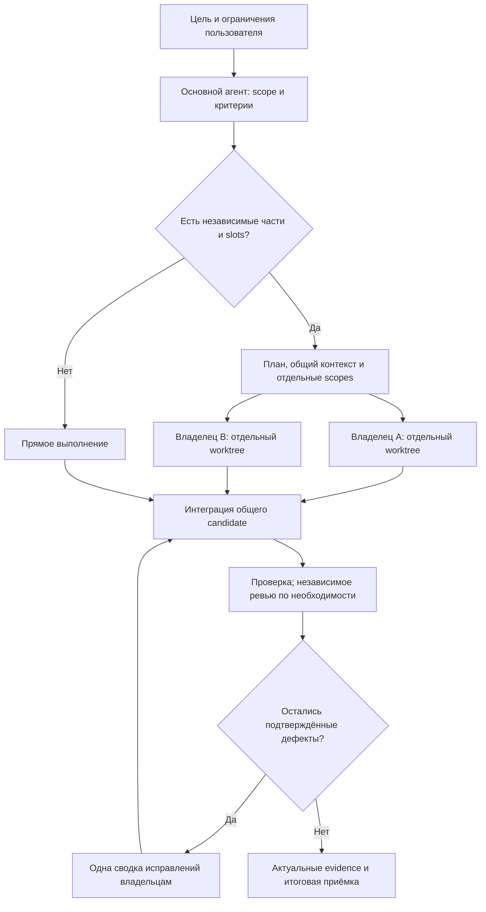

# Редактируемые диаграммы 1.6.1

[Индекс документации](../INDEX.md) · [Архитектура](../ARCHITECTURE_RU.md)

Здесь находятся 16 схем действующих руководств. `.drawio` — незапакованный XML
с редактируемыми shapes/connectors; `.svg` — самостоятельная векторная версия
с обычным текстом. Mermaid source сохранён в соответствующем Markdown под
раскрываемым блоком. Во всех трёх представлениях должны совпадать узлы, связи,
условия и подписи. Для просмотра SVG не нужны draw.io, JavaScript или сеть.

В 1.6.0 добавлены отдельные схемы native-сессии, verified task flow и durable
receipts. Обзорные схемы обновлены для SessionStart, plan-quality gate, node
acceptance и восстановления в пределах исходных budgets. Схема показывает
контракт поведения; она не является подтверждением прохождения runtime gates.

| Просмотреть SVG | Редактируемый source | Объяснение и Mermaid source | Реализация |
| --- | --- | --- | --- |
| [Задача, исполнители и приёмка](task-delivery.svg) | [.drawio](task-delivery.drawio) | [Задача, исполнители и приёмка](#task-delivery-mermaid), Mermaid #1 | [orchestration.py](../../src/agent_harness/orchestration.py), [runner.py](../../src/agent_harness/runner.py) |
| [Установка, проверка и откат](installation-recovery.svg) | [.drawio](installation-recovery.drawio) | [SETUP_RU.md](../../SETUP_RU.md), Mermaid #1 | [installation.py](../../src/agent_harness/installation.py) |
| [Слои исполнения 1.6.1](runtime-architecture.svg) | [.drawio](runtime-architecture.drawio) | [Архитектура](../ARCHITECTURE_RU.md), Mermaid #1 | [supervisor.py](../../src/agent_harness/supervisor.py), [native_session.py](../../src/agent_harness/native_session.py), [core.py](../../src/agent_harness/core.py) |
| [Выбор источника контекста](context-routing.svg) | [.drawio](context-routing.drawio) | [Архитектура](../ARCHITECTURE_RU.md), Mermaid #2 | [context.py](../../src/agent_harness/context.py), [repo_map.py](../../src/agent_harness/repo_map.py), [lsp.py](../../src/agent_harness/lsp.py) |
| [Выбор snapshot backend](snapshot-backends.svg) | [.drawio](snapshot-backends.drawio) | [Архитектура](../ARCHITECTURE_RU.md), Mermaid #3 | [native.py](../../src/agent_harness/native.py), [core.py](../../src/agent_harness/core.py) |
| [Checkpoint, handoff и свежесть](context-recovery.svg) | [.drawio](context-recovery.drawio) | [Архитектура](../ARCHITECTURE_RU.md), Mermaid #4 | [core.py](../../src/agent_harness/core.py), [presentation.py](../../src/agent_harness/presentation.py) |
| [Инструкции нового процесса Codex](instruction-discovery.svg) | [.drawio](instruction-discovery.drawio) | [Autoload](../AUTOLOAD_RU.md), Mermaid #1 | [installation.py](../../src/agent_harness/installation.py), [diagnostics.py](../../src/agent_harness/diagnostics.py) |
| [Native-сессия: bootstrap и продолжение](native-session.svg) | [.drawio](native-session.drawio) | [Native-сессия](../NATIVE_SESSION_RU.md), Mermaid #1 | [native_session.py](../../src/agent_harness/native_session.py), [native_observability.py](../../src/agent_harness/native_observability.py) |
| [Совместимый ручной Run API](legacy-run.svg) | [.drawio](legacy-run.drawio) | [Operations](../OPERATIONS.md), Mermaid #1 | [core.py](../../src/agent_harness/core.py), [runner.py](../../src/agent_harness/runner.py) |
| [Gate и повторная проверка evidence](acceptance-gate.svg) | [.drawio](acceptance-gate.drawio) | [Acceptance](../ACCEPTANCE.md), Mermaid #1 | [runner.py](../../src/agent_harness/runner.py) |
| [Supervisor: edit, verify, repair](supervisor-repair.svg) | [.drawio](supervisor-repair.drawio) | [Supervisor](../EXECUTION_SUPERVISOR_RU.md), Mermaid #1 | [supervisor.py](../../src/agent_harness/supervisor.py), [failure_policy.py](../../src/agent_harness/failure_policy.py) |
| [Managed v2: DAG и единая приёмка](managed-worktrees.svg) | [.drawio](managed-worktrees.drawio) | [Dynamic agents](../DYNAMIC_AGENTS_RU.md), Mermaid #1 | [managed_execution.py](../../src/agent_harness/managed_execution.py), [verified_flow.py](../../src/agent_harness/verified_flow.py) |
| [Managed v2: проверяемый план и исполнение](verified-task-flow.svg) | [.drawio](verified-task-flow.drawio) | [Verified task flow](../VERIFIED_TASK_FLOW_RU.md), Mermaid #1 | [plan_quality.py](../../src/agent_harness/plan_quality.py), [verified_flow.py](../../src/agent_harness/verified_flow.py), [completion_eligibility.py](../../src/agent_harness/completion_eligibility.py) |
| [Durable execution: intent, receipt и gate](durable-execution.svg) | [.drawio](durable-execution.drawio) | [Stabilization](../STABILIZATION_RU.md), Mermaid #1 | [execution_receipts.py](../../src/agent_harness/execution_receipts.py), [dependency_commit.py](../../src/agent_harness/dependency_commit.py) |
| [Память, provenance и retrieval](memory-provenance.svg) | [.drawio](memory-provenance.drawio) | [Memory/context](../MEMORY_AND_CONTEXT_RU.md), Mermaid #1 | [execution_ledger.py](../../src/agent_harness/execution_ledger.py), [memory.py](../../src/agent_harness/memory.py), [context_reducer.py](../../src/agent_harness/context_reducer.py) |
| [LSP rename: preview, apply и recovery](lsp-rename.svg) | [.drawio](lsp-rename.drawio) | [LSP](../LSP_RU.md), Mermaid #1 | [lsp.py](../../src/agent_harness/lsp.py), [rename.py](../../src/agent_harness/rename.py) |

<a id="task-delivery-mermaid"></a>

## Задача, исполнители и приёмка

Схема показывает выбор прямого выполнения или независимых исполнителей,
общую интеграцию, проверку и возврат подтверждённых дефектов владельцам.
[SVG](task-delivery.svg) и [редактируемый XML](task-delivery.drawio) представляют
тот же поток.

<details>
<summary>Mermaid source той же схемы</summary>



</details>

## Как обновить схему

1. Сверьте фактические состояния, переходы и ограничения по указанным модулям.
2. Откройте `.drawio` в draw.io Desktop либо редактируйте незапакованный XML
   инструментом, сохраняющим shapes/connectors и их IDs.
3. Обновите узлы/связи и соответствующий Mermaid block в руководстве.
4. Экспортируйте SVG через draw.io. Для изменения только подписи допустима
   синхронная правка SVG text и editable XML без изменения геометрии; новую
   схему можно подготовить как эквивалентные XML/SVG из одной модели графа.
5. Проверьте структуру и фактически отрендерите SVG. Просмотрите весь изменённый
   граф и подписи; exit 0, XML validity и наличие файла не заменяют visual review.
   Сохраните source/export SHA-256, renderer/argv и просмотренный артефакт в
   private evidence, а не в публичном пакете.
6. Проверьте Markdown links и отсутствие private paths, remote images/fonts,
   scripts, `foreignObject` и непереносимых `file:` links в XML/SVG. При visual
   defect исправьте обе версии и повторите render/review.

Пример экспорта из package root при доступном CLI draw.io Desktop:

```sh
drawio --export --format svg --theme light --embed-svg-fonts false --border 24 --timeout 30 --output docs/diagrams/supervisor-repair.svg docs/diagrams/supervisor-repair.drawio
drawio --export --format png --theme light --border 24 --timeout 30 --output /absolute/private/supervisor-repair.png docs/diagrams/supervisor-repair.drawio
```

На Windows используйте полный путь к portable `draw.io.exe` через PowerShell
оператор `&`. Для автоматизации допустим отдельный
`--user-data-dir=<private-directory>` и `--disable-update`, сохраняющие основной
профиль приложения. Не обходите ограничения среды ради запуска renderer.

Для уже подготовленного SVG достаточно локального SVG renderer. Например,
при установленном librsvg:

```sh
rsvg-convert --output /absolute/private/supervisor-repair.png docs/diagrams/supervisor-repair.svg
```

SVG использует локальный Arial/sans-serif без загрузки web fonts. PNG служит
артефактом visual review и остаётся в private evidence.

## Границы схем

Это обзор логики, а не полная спецификация FSM или permission sandbox.
Supervisor diagram показывает общий edit/repair/recovery путь. Managed v2
отдельно включает plan quality, local/integrated checks и final coverage/review;
legacy v1 не получает эти гарантии от одного номера версии пакета.

Native SessionStart — отдельный путь bootstrap, без model runner и supervisor.
Память и Ledger не повышают authority наблюдений до пользовательской policy.
DAG diagram не обещает ускорение. Cancellation, timeout и неизвестный dispatch
могут прервать несколько фаз; исходные budgets не сбрасываются на resume.
LSP sequence сохраняет capture/requery, reviewed apply и допустимую компенсацию.

Цвет дублируется подписями. Решение обозначено ромбом; стрелки содержат условия.
Редактируемые объекты являются самостоятельными shapes, а не скриншотом Mermaid.
